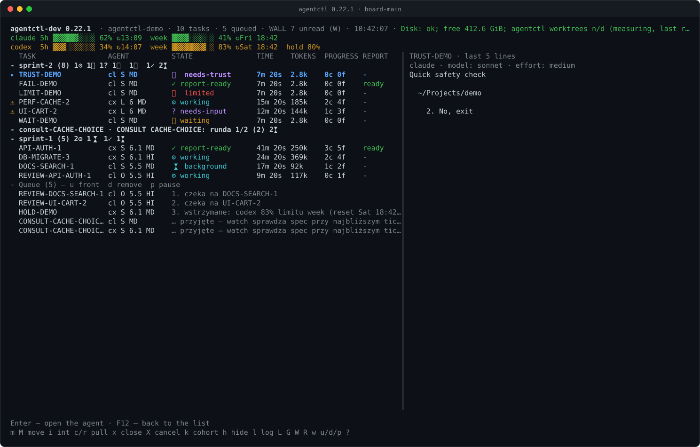
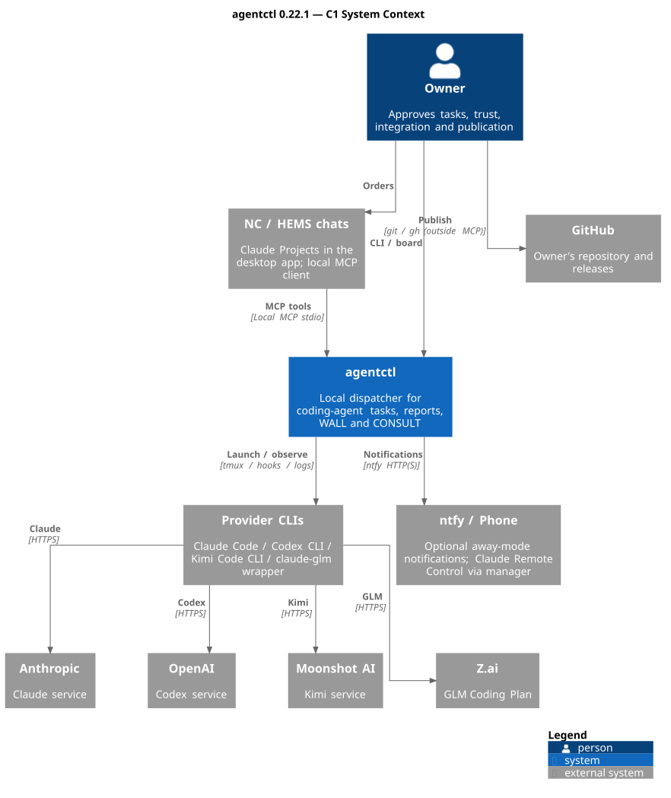

# agentctl

Local task dispatch for Claude Code, OpenAI Codex CLI, Kimi Code CLI and Z.ai GLM. A Markdown spec becomes a Git worktree, an interactive tmux agent and a reviewable report. Watch services the queue, delivery, notifications and consultations.

[Polski](README.pl.md) · **[English manual](docs/en/overview.md)** · [From zero](docs/en/tutorial.md) · [0.22.1 release notes](docs/release-notes/0.22.1.en.md)

Dependencies/verdict gates, provider slots/plan holds, safe follow-ups, reports, cohorts, WALL and CONSULT: [all features](docs/en/features.md). [Every TUI view](docs/en/screenshots.md) includes help, capacity, WALL filters and threads.

| Start here | Reference |
|---|---|
| [Install and first task](docs/en/tutorial.md) | [Configuration/specs](docs/en/configuration.md) |
| [Providers/login](docs/en/providers.md) | [All MCP tools and Accepted](docs/en/mcp-tools.md) |
| [Token economics](docs/en/token-economics.md) | [Troubleshooting/doctor](docs/en/troubleshooting.md) |
| [Project instruction insert](docs/en/agent-insert.md) | [Ordering agent guide](docs/en/agent-guide.md) |
| [CLI commands](docs/commands.md) | [Regression catalog](tests/regression/CATALOG.md) |

## Architecture

[Containers and sequence diagrams](docs/en/architecture.md) show Accepted, trust, reports/recovery, WALL and CONSULT; local PlantUML/C4 sources plus SVG/PNG renders.

## Install

Node ≥22.14.0, Git, tmux and separately installed/logged-in provider CLIs are required. Kimi's current npm CLI needs Node ≥22.19.0. The tutorial covers the stable installation and first config.

~~~sh
git clone https://github.com/Setech-pl/agentctl.git
cd agentctl
npm ci
npm run build
./bin/agentctl-update --ref v0.22.1 --dry-run
~~~

Agentctl runs with your permissions; worktrees are not an OS sandbox. Folder trust is never automatically accepted. Local MCP uses desktop stdio; web/phone cannot connect directly. The owner reviews evidence and decides integration/publication; report actions are proposals. [Boundaries](docs/en/overview.md#boundaries).

[Contributing](CONTRIBUTING.md) · [Changelog](CHANGELOG.md) · [MIT license](LICENSE). Use the repository gate and task-owned cache. This documentation release adds no runtime behavior.
