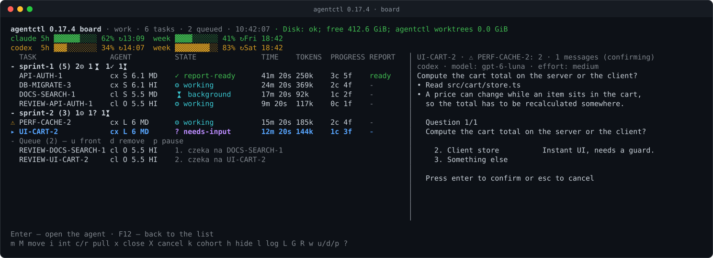
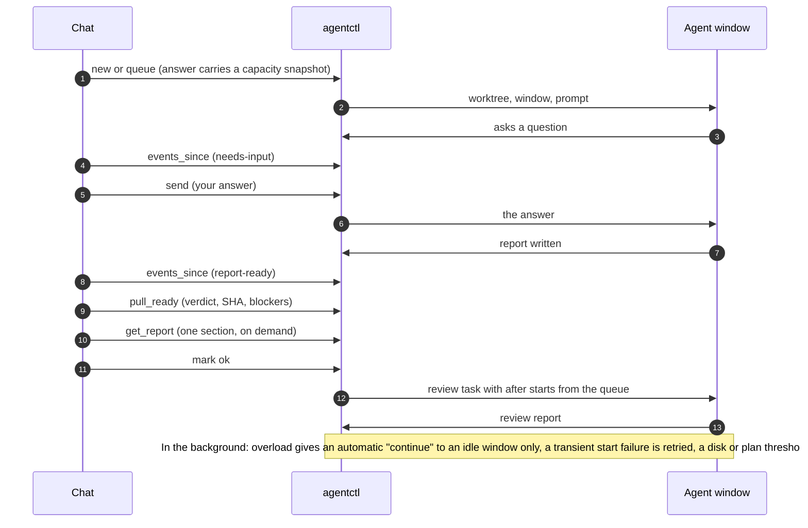
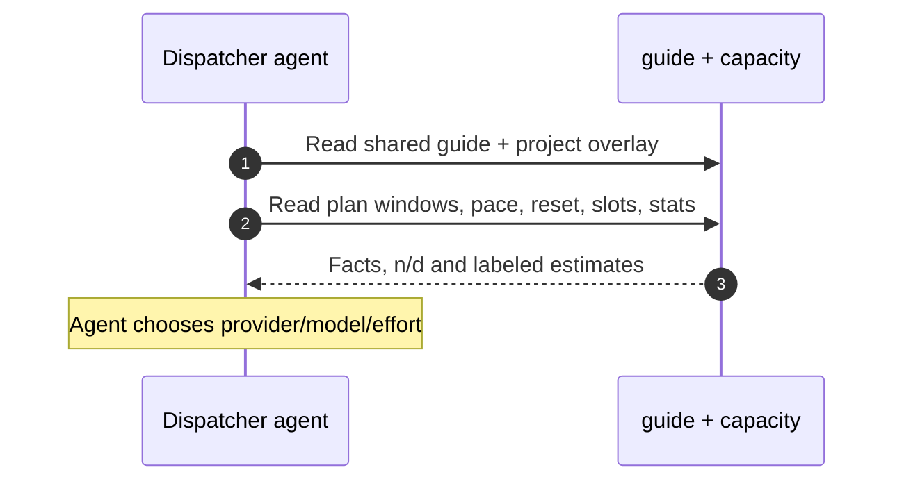
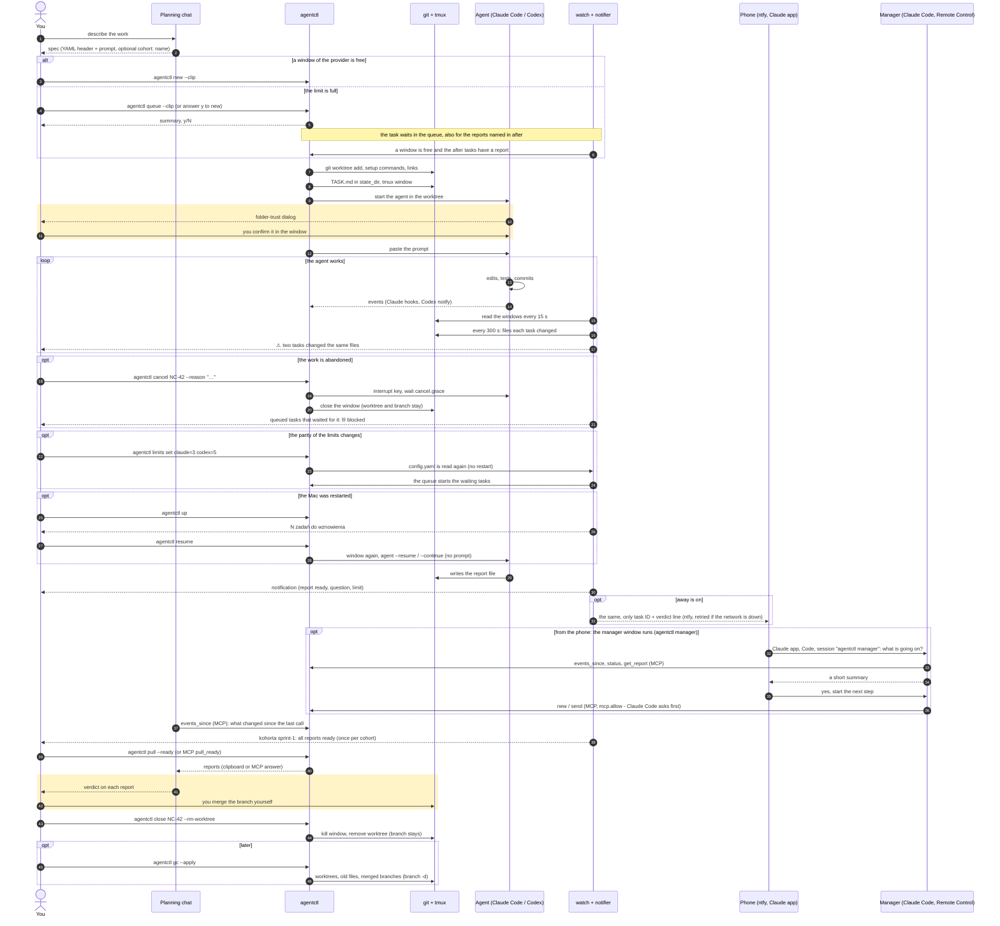
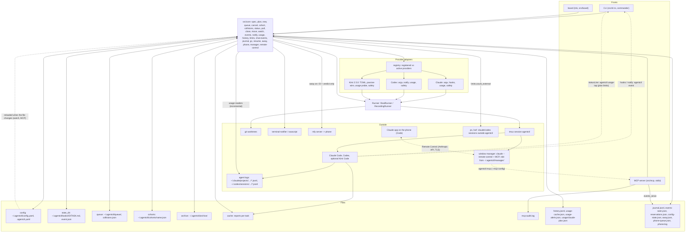
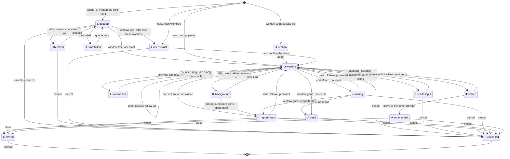

# agentctl

[](https://m8ven.ai/mcp/setech-pl-agentctl-l34k8f?s=readme)

Polski: [README.pl.md](README.pl.md)

**One chat orders and supervises the work of many CLI coding agents – Claude Code, Codex and optional Kimi Code – from one queue, under one set of rules.**

agentctl turns a short spec into a git worktree, a tmux window and a running agent with the model and reasoning effort you chose. It watches every agent for you, tells you when one asks a question or finishes, and hands the reports back to your chat. You stay the one who decides and merges.



*The board of a demo session on fake agents: two cohorts, a question that waits for you, a finished report, a review chain in the queue, a collision warning (⚠) and the plan usage of both providers. Generated by `npm run docs:screenshot`; some labels (for example "czeka na") are Polish in the product today.*

## Why agentctl

- **One chat, many workers.** Plan in your chat (the [MCP server](docs/mcp.md) or the clipboard) and send the tasks to Claude Code and Codex – Gemini follows – each with the model and reasoning effort you pick per task.
- **More capacity.** Every plan has its own limits. agentctl shows both plans with their reset times and the free window slots, `capacity` reports the age of each reading, work waits in the [queue](#queue) instead of overrunning a limit, and `agentctl move` hands a task that hit its limit to the other provider ([usage and limits](docs/details.md#usage-and-limits)).
- **Fewer tokens in the chat.** MCP answers are concise by default and reports arrive as summaries, with sections and full text on demand. On a set of fakes (six reports of about 20 KB, `pull_ready` with `all: true`, 0.17.1 against 0.17.2) the answer shrank from 120 762 to 1 522 bytes – a measurement on fakes, not a promise for your work. `defaults.effort` sets the effort once, and `peek` shows a window without pasting logs into the chat.
- **Statistics.** Tokens per task, cohort, model and effort come from the agents' own logs. Your `mark` (ok / partial / fail) and the verdict line of the agent's report give success rates per model × effort, so you see which model pays off for which kind of work ([history and stats](#history-and-stats)).
- **Review by another model, queue with dependencies.** `review_of` refuses to let the same agent and model grade its own work, and `after` keeps a task in the queue until the report it depends on exists – so a review starts by itself when the author's report is ready ([queue](#queue), [dependencies](#dependencies)).
- **Supervision without watching.** The board and the notifications (Mac, and phone through ntfy) tell you about questions, trust dialogs, overload, limits, collisions and free disk space. After a provider overload agentctl sends "continue" – only to an idle window with an empty prompt, a few times – and a transient start failure is retried after 1, 5 and 15 minutes.
- **Safe by construction.** One git worktree per task. agentctl never merges, never pushes, never uses `--force` and never accepts a permission or trust dialog for you ([safety model](#safety-model)).
- **Open and local.** MIT licensed, runs on your Mac, has no server of its own; the MCP server is a local process that runs as you.

## Automatic flow

The chat talks to agentctl, agentctl talks to the agents. Between your answers most of it runs by itself:



What the chat sees in the demo session of the screenshot (the output of the tools is Polish today). `events_since`, after the agents did their work:

```text
Zdarzenia z ostatnich 1d: 7
10:37  UŻYCIE  codex week: usage crossed 80% (83%)
10:38  WYNIKI RAPORTU  API-AUTH-1  API-AUTH-1: 1 decisions, 0 actions
10:39  RAPORT  API-AUTH-1  Verdict: PASS – refresh rotates the session id, logout revokes the whole token family.
10:40  PYTANIE  UI-CART-2  UI-CART-2: Compute the cart total on the server or the client?
10:41  WYNIKI RAPORTU  DOCS-SEARCH-1  DOCS-SEARCH-1: 0 decisions, 0 actions
10:42  RAPORT  DOCS-SEARCH-1  Verdict: PASS – search guide and API reference written, the index rebuild finished.
10:43  START  REVIEW-DOCS-SEARCH-1  Uruchomiono REVIEW-DOCS-SEARCH-1 z kolejki (claude)
Teraz: 7 aktywne (3 pracuje) · 1 w kolejce · 2 raporty do pobrania (API-AUTH-1, DOCS-SEARCH-1) · 2 zadań bez oceny · czeka na Ciebie: REVIEW-DOCS-SEARCH-1 (waiting), UI-CART-2 (needs-input): Compute the cart total on the server or the client?, API-AUTH-1: decision: Choose the rollout window.
has_more: false; next_cursor: e2:7:0
```

`pull_ready` in its default summary mode, with the one report that was ready:

```text
1 report summary delivered (full reports not marked as pulled): API-AUTH-1. Omitted (remain new): none.

=== API-AUTH-1 ===
attempt: 3f9c2a7e-51d4-4b86-9e0a-7c1d6b2f8a45
path: /home/demo/agentctl/cache/api-auth-1/API-AUTH-1.md
bytes: 965
{"outputs":{"version":1,"verdict":"PASS","commits":[{"repo":"shop","branch":"agent/api-auth-1","sha":"41c39c35c2118f44d822a4be08d5c20aa2f7c153"}],"integrate":[{"repo":"shop","branch":"agent/api-auth-1","sha":"41c39c35c2118f44d822a4be08d5c20aa2f7c153","note":"ready for human integration"}],"decisions":["Choose the rollout window"],"actions":[],"checks":[{"name":"auth tests","result":"PASS","note":"18 passed"}],"notes":[]},"outputs_valid":true,"outputs_errors":[]}
sha: 41c39c35c2118f44d822a4be08d5c20aa2f7c153
truncated: false
Verdict: PASS – refresh rotates the session id, logout revokes the whole token family.

- Branch: agent/api-auth-1
- SHA: 41c39c35c2118f44d822a4be08d5c20aa2f7c153
- Tests: 18 passed, 0 failed

## Summary

Refresh tokens are single-use and belong to a family (`src/auth/token.ts`). The session id rotates on every refresh (`src/auth/session.ts`) and a revoked family answers 401 (`src/auth/middleware.ts`).

## Blockers

None.

## Decisions

- Revoking one token revokes its whole family: a replayed refresh token is treated as theft.

## Open points

None.

```agentctl-outputs
version: 1
verdict: PASS
commits: [{repo: shop, branch: agent/api-auth-1, sha: 41c39c35c2118f44d822a4be08d5c20aa2f7c153}]
integrate: [{repo: shop, branch: agent/api-auth-1, sha: 41c39c35c2118f44d822a4be08d5c20aa2f7c153, note: ready for human integration}]
decisions: [Choose the rollout window]
actions: []
checks: [{name: auth tests, result: PASS, note: 18 passed}]
notes: []
```

<!-- agentctl:report-end -->

next_cursor: 8b1e4d93-0a7c-42f5-b6d8-2e9f1c3a7d60:1; has_more: false
```


The `repo` field in `agentctl-outputs` accepts the repository name or path and the task worktree directory name or path. Accepted aliases normalize to the repository name; ambiguous names are rejected.

## How it works

1. Write a spec (or let your planning chat write it): task, agent, model, effort, repos, report path.
2. `agentctl new` creates the worktree, opens a tmux window and starts the agent within your per-provider limits – or queues it until a slot frees up.
3. Watch and decide: the board and notifications tell you when an agent asks or finishes; `pull` brings the report; you review, merge and close.

Planning in a Claude chat? The [built-in MCP server](docs/mcp.md) lets the chat read plan usage and pick up reports itself, and order tasks when write access is allowed. The [clipboard workflow](#daily-loop) also works without MCP.

## For the ordering agent

Start any project with `agentctl guide --project /path/to/repo --clip` and `agentctl capacity --clip` (or the read-only MCP tools `guide` and `capacity`). The shared [dispatcher guide](docs/dispatcher.md) covers specs, provider/model/effort selection, cross-review, cohorts, queue and the `events_since` → `pull_ready` → `get_report` chat loop. [Polski](docs/dispatcher.pl.md).

Capacity shows current windows, reading age, pace, reset, slots, queue, equivalents and seven-day stats. Unknown is n/d; token estimates carry their basis and confidence. Percent includes work outside agentctl. New and queue responses include a short snapshot (`capacity.snapshot: false` disables it). agentctl reports facts; the ordering agent chooses. Add `guide: docs/agent-dispatch.md` to `.agentctl.yaml` for project rules; a missing overlay warns in guide and doctor. `guide.lang: en|pl` in the global config sets the default language.

Board: `C` opens capacity. Start without attaching: `agentctl up --no-attach`. Restart by stable role: `agentctl watch --tmux --restart` / `agentctl board --tmux --restart`; renamed windows are supported. `agentctl version` is an alias of `--version`.

The board bounds its session cache and drops progress for removed tasks during long runs. While an action is running, repeated action keys are ignored; navigation, refresh and quit remain available. Usage-cache persistence runs asynchronously with one writer so disk writes yield to keyboard handling.

Board headers, tmux status-left and board/watch terminal titles identify `agentctl` or `agentctl-dev` using the doctor/version dev detection. Set `ui: {instance_name: staging}` to override the label; terminal titles are restored on exit where the terminal supports the xterm title stack.



## In daily use

<!-- Numbers from agentctl stats on the author's machine – verify before publishing -->
agentctl is built for and used on a real project: cohorts of tasks run every day across Claude Code and Codex in parallel, with cross-model reviews before every merge.

## Task states

The board tracks `needs-attention`, `overloaded`, `working`, `waiting`, `needs-input`, `needs-trust`, `limited`, `report-ready`, `background`, `queued`, `blocked`, `dead`, `orphan`, `closed`, `cancelled`, `superseded` and `start-failed`. A `report-candidate` flag keeps the current task state. See [task states and details](docs/details.md#task-states).

When the canonical report is missing, status, board and events suggest `report_from` for a fresh nearby Markdown file matching the task ID or canonical filename. Discovery checks the report directory and task worktrees (bounded depth and file budget, excluding dependencies); it never adopts a file automatically.

### Architecture and flow







## Quick start

Requirements: **Node 22.14+**, **git**, **tmux 3.2+**, and the agents you use (`claude`, `codex`). Optional: [`terminal-notifier`](https://github.com/julienXX/terminal-notifier) for click-to-window notifications.

### npm (recommended)

```sh
npm i -g @setech-pl/agentctl
agentctl --version
agentctl doctor
```

Do not confuse this project with **@orgloop/agentctl**, which also installs the command `agentctl`.
Check `command -v agentctl`; `doctor` warns if PATH resolves to another installation.
Update with `npm i -g @setech-pl/agentctl@latest` or `agentctl-update`.
An npm update does not restart running watchers or MCP servers; restart those processes after updating.

Supported runtime: macOS and Linux with git and tmux 3.2+. macOS notifications use terminal-notifier or osascript;
Linux uses notify-send (no click action). ntfy works on either system. Claude Desktop integration is macOS-only;
Windows is unsupported (use a Linux environment in WSL). CI currently validates macOS; Linux has not been validated locally.

### Clone (development)

```sh
git clone https://github.com/Setech-pl/agentctl.git
cd agentctl
bin/agentctl-update            # a stable copy in ~/workspace/agentctl-stable, npm ci, npm run build, npm link, doctor
agentctl doctor                # tmux, node, git, claude, codex, gh, cache directory, configs
```

`agentctl-update` keeps a detached copy of the repo for daily use, so that a half-finished branch of your clone is never what the global `agentctl` runs; run it again after each release. Details and options: [docs/details.md](docs/details.md#stable-install-and-updates). For a development link, run `npm ci && npm run build && npm link` in the clone. Rebuild after source changes.

The npm package runs compiled JavaScript in `dist/`. Development and tests may run the TypeScript sources directly with Node type stripping.

<!-- tmux-dev-start -->
### Dedicated tmux server for development

Use a separate config home **and** server: a different session name alone still shares the server environment, key bindings and buffers. From the development checkout, set the home and edit its existing config (keep its other settings):

```sh
export AGENTCTL_HOME="$HOME/.agentctl-dev"
mkdir -p "$AGENTCTL_HOME"
${EDITOR:-vi} "$AGENTCTL_HOME/config.yaml"
```

Add or update these top-level keys:

```yaml
session: agentctl-dev
tmux:
  socket: agentctl-dev
```

`tmux.socket` is the name passed to `tmux -L`, not a socket path. Omit it to keep the default tmux server selection. Watch, board, tasks, peek, send, close, attach and doctor all use this server, including direct tmux calls. Attach hints quote exact targets so `agentctl` cannot select `agentctl-dev` by prefix. Doctor displays the selected socket and warns about a different `AGENTCTL_HOME` in that server's global or session environment.

Start from a terminal outside tmux:

```sh
node --experimental-strip-types --no-warnings bin/agentctl.ts up --no-attach
node --experimental-strip-types --no-warnings bin/agentctl.ts doctor
tmux -L agentctl-dev attach -t '=agentctl-dev'
```

To migrate an existing **dev session named agentctl-dev on the default server**, first keep the old config (socket unset), inspect status and the old windows, and let agents finish or save their conversations. Killing the old dev session below terminates its processes; do this only after saving work and checking session receipts in the dev task state. Do not kill the default server: the production session may share it.

```sh
export AGENTCTL_HOME="$HOME/.agentctl-dev"
node --experimental-strip-types --no-warnings bin/agentctl.ts status --json
tmux list-windows -t '=agentctl-dev'
tmux kill-session -t '=agentctl-dev'
${EDITOR:-vi} "$AGENTCTL_HOME/config.yaml"
```

Now add the YAML keys above, leave the old worktrees and task state in place, and restart dev processes so they reload the socket. Restart any dev MCP process as well. tmux cannot transfer running agent processes between servers; resume recreates their windows on the new server.

```sh
node --experimental-strip-types --no-warnings bin/agentctl.ts up --no-attach
node --experimental-strip-types --no-warnings bin/agentctl.ts status
node --experimental-strip-types --no-warnings bin/agentctl.ts resume
node --experimental-strip-types --no-warnings bin/agentctl.ts doctor
tmux -L agentctl-dev attach -t '=agentctl-dev'
```

After server/session loss, unfinished tasks show `needs-attention` with a recovery hint and one `tmux-lost` journal event per loss. Claude records the session ID at `SessionStart`; other provider receipts are retained as soon as received. If a saved session exists, use the suggested `agentctl resume TASK` after reviewing the list. Without one, create a spec with a **new task ID**, point its repositories at the old worktree, and use `agentctl new --reuse recovery.md` to start a replacement task; do not assume that `--continue` or `--last` identifies the lost conversation. Finished reports, closed and cancelled tasks keep their existing state.
<!-- tmux-dev-end -->

Your first task:

```sh
agentctl spec example > nc-42.md     # a ready-made spec, see "Spec format"
$EDITOR nc-42.md                     # paths, task ID, prompt
agentctl new --dry-run nc-42.md      # every command it would run; nothing is executed
agentctl new --clip                  # or: spec from the clipboard, a summary, y/N
agentctl board --tmux                # overview in window "board" of the agentctl session
tmux attach -t agentctl              # watch the agent work; confirm its folder-trust dialog once
agentctl pull --ready                # new reports to the clipboard, marked as pulled
agentctl close NC-42 --rm-worktree   # window and worktree gone; the branch stays
```

## Daily loop

```
chat gives a spec -> agentctl new --clip -> agentctl watch notifies -> agentctl pull --ready -> paste into the chat -> chat gives a close line
```

1. **The chat gives a spec**, as exactly one code block starting with `---`, so the copy button copies the spec and nothing else.
2. **`agentctl new --clip`** reads it from the clipboard, prints a summary (task, agent/model/effort, worktree, branch, setup, links) and asks `Start? [y/N]`. `-y` skips the question. `agentctl send --clip` does the same for a follow-up prompt.
3. **`agentctl watch --tmux`** runs the watcher in its own tmux window. Every 15 seconds it works out the [state](docs/details.md#task-states) of every task and sends one notification per transition. It also puts a state icon in front of each window name and the task counts in the tmux status bar.
4. **`agentctl pull --ready`** joins every report that is ready and not yet pulled into one text, each under `=== NC-42 (claude opus/high) ===`, copies it and marks those tasks as pulled.
5. **You paste it into the chat.** The chat judges the reports; agentctl never gives verdicts.
6. **The chat gives a closing line**, for example `agentctl close NC-41 NC-42 --rm-worktree`. `close` lists the tasks (flagging those without a report) and asks y/N. Branches are kept, nothing is merged.

In the morning **`agentctl up`** starts the watcher and the board if they are not running, says which tasks to [resume](#resuming) after a restart and opens the board. `agentctl status --clip` copies a compact Markdown table of all tasks, to paste at the start of a fresh chat. With the [MCP server](#chat-integration-mcp) the chat can read all of this itself, without the clipboard.

## Spec format

A spec is a YAML header between `---` lines, followed by the prompt. Several specs can follow each other in one file; each header starts a new spec.

```markdown
---
task: TASK-42
agent: claude
model: claude-opus-5-5
effort: high
repos:
  - path: ~/src/sample-app
    worktree: ~/worktrees/sample-app-task-42
    base: main
    branch: task-42-notification-sound
links: []
env:
  APP_TASK: TASK-42
report: ~/reports/task-42/TASK-42.md
---
Play a notification sound when a background task finishes.

- Reuse the existing audio bus; do not add new dependencies.
- Cover the new behaviour with a test.
- When you are done, write a short report (what changed, how you checked it,
  what is left) to ~/reports/task-42/TASK-42.md.
```

| Field | Required | Meaning |
|---|---|---|
| `task` | yes | Task ID: uppercase letters, digits, `-`, `_`, starting with a letter. The tmux window is the lowercase ID. |
| `agent` | yes (or `defaults.agent`) | `claude` or `codex`. |
| `model` | no | Model name passed to the agent; omitted or `default`: the agent's own default. |
| `effort` | no | `low`, `medium`, `high` (default), `xhigh`, `max` (not for Codex). |
| `repos[]` | yes | At least one `{path, worktree, base, branch}`. The agent starts in the first worktree. |
| `setup` | no | Shell commands run after `git worktree add` and before the links, per repository in that repository's own worktree: the entry's `repos[].setup`, else the `setup` of that repository's `.agentctl.yaml`. The top-level `setup` (and the global one) belongs to the first repository only. Not accepted from the chat. |
| `links[]` | no | `{from, to}` symlinks in the first worktree, for example to wire a client to a backend under test. |
| `env` | no | Environment variables of the tmux window. |
| `review_of` | no | Task ID under review; the reviewer must use another agent or another model than the author. |
| `pin` | no | `true`: never move the task to the other provider. |
| `priority` | no | `high` or `normal` (default): queue order. |
| `after` | no | Task ID or list: a queued task starts only when each has a report. |
| `touches` | no | Globs of the files the task will change: a warning when an active task already changes them. |
| `cohort` | no | Name of the group the task belongs to (`--cohort` on `new` and `queue` overrides it). Without it the task is in no cohort. |
| `report` | no | Where the agent writes its report (default `<cache>/<task>/<TASK>.md`). |

Links that point to themselves or place a link inside its target (or its target inside the link) are rejected during preview, including paths resolved through symlink parents. A missing absolute `links.from` path produces a warning; `from` must stay inside the primary worktree.


`{task}`, `{TASK}` and `{cache}` work as placeholders in paths. All keys, types and defaults: [docs/configuration.md](docs/configuration.md#spec-keys). Mistakes are reported all at once, in plain words, with a hint.

## Configuration

Three layers, the later one wins: the global `~/.agentctl/config.yaml`, then `.agentctl.yaml` in the project repo (the first repo of the spec), then the spec itself. `env` and `links` merge, `setup`, `report`, `worktree_root` and `defaults` are overridden. Unknown keys are errors. `AGENTCTL_HOME` replaces `~/.agentctl`.

```yaml
# ~/.agentctl/config.yaml
cache: ~/workspace/cache        # one folder per task for the reports; the only place agents write to
state_dir: ~/.agentctl/tasks   # agentctl's own state per task, out of the agents' reach
session: agentctl              # tmux session name
limits: {claude: 3, codex: 3}  # most simultaneous windows per provider
defaults: {effort: high}       # agent, model, effort for specs that leave them out
equivalents: []                # extra Claude <-> Codex pairs
notify: {backend: auto}        # auto, terminal-notifier or osascript
mcp: {allow: []}               # write tools the chat may use: send, new, interrupt, close, move
```

```yaml
# .agentctl.yaml in the project repo
worktree_root: ~/workspace/wt   # worktrees go to <worktree_root>/<repo>-<task>
setup:
  - npm ci --prefer-offline --no-audit --no-fund
env:
  APP_TASK: "{TASK}"
defaults: {agent: claude}
```

Every key with type, default and meaning: [docs/configuration.md](docs/configuration.md).

## Board

`agentctl board` is a full-screen overview of all tasks, refreshed every 2 seconds. `agentctl board --tmux` opens it in window `board` of the agentctl session. From 110 columns it shows the last lines of the selected window on the right; below that the list takes the whole width.

Every periodic, watch or manual board refresh cancels the previous deadline. The next refresh is armed after the shared load completes (also after an error): 2 seconds with unfinished tasks, 5 seconds when all tasks are done. Exit cancels the timer and queued follow-up.

Arrow keys remain usable during both record scanning and status collection; selection changes request a fresh preview and survive completion of an older refresh.

```text
agentctl 0.17.2 board · agentctl-test · 2 tasks · 06:54:51 · Disk: ok; free 307.4 GiB; agentctl worktrees 0.0 GiB
  TASK                 AGENT          STATE               TIME    TOKENS  PROGRESS REPORT   │ NEON-BACKEND-TASK-12 · last 1 lines
▸ NEON-BACKEND-TASK-12 cx S 6.1 XH    ⚙ working           1m 00s  n/d     -        -        │ codex · model: gpt-6.1-sol · effort: xhigh
  NEON-CITY-REVIEW-12  cl O 5.5 HI    ⚙ working           1m 00s  n/d     -        -        │ Working (esc to interrupt)
```

The AGENT column uses `cl` (Claude) / `cx` (Codex), a model family initial, its known version and a two-letter effort. `cx S 6.1 XH` means codex / gpt-6.1-sol / xhigh. Alias versions come first from the observed session model of the same family, then `board.model_versions`; unknown versions are omitted. `default`/missing model and missing effort use `–`. The selected task preview and `?` help keep the full selected model and effort names.

At 140+ terminal columns the list gets at least 92 columns, then about 45% of terminal width, keeping 20-character task IDs and standard task/model/state/time/progress/report cells visible. The preview keeps at least 32 columns. Narrower terminals retain their previous split. Override with `board.list_width: 100` or `board.list_width: "55%"`; see [configuration](docs/configuration.md).

| Effort | Short |
|---|---|
| minimal | MN |
| low | LO |
| medium | MD |
| high | HI |
| xhigh | XH |
| max | MX |
| none | NO |


| Key | Action |
|---|---|
| `↑` `↓` (`j`) | select a task |
| `Enter` | go to the task's window; **`F12`** comes back to the board |
| `m` / `i` | message the agent / interrupt its turn (after y/N) |
| `M` | move the task to the other provider after a usage limit (after y/N) |
| `c` / `r` | copy the selected report / all new reports |
| `x` | close the window (after y/N; a second question for the worktree) |
| `X` | cancel the task: an optional reason, then y/N; a queued task leaves the queue, a move is cancelled with its other half |
| `k` | pick a cohort to show (`wszystkie`, a cohort, `bez kohorty`) |
| `g` / `E` | fold the cohort group of the selected task / open all groups |
| `L` | the limits per provider and what uses them (`agentctl limits`) |
| `G` | the preview of the clean-up (`agentctl gc`; the board never deletes) |
| `R` | resume the tasks listed under "Do wznowienia" (after y/N) |
| `l` | the log of the tasks (history; `↑↓` scroll, `Esc` back) |
| `o` / `p` / `f` | mark the selected finished task ok / partial / fail (`p` pauses the queue when no finished task is selected) |
| `h` / `z` / `a` | hide a task / open the Finished section / list hidden, closed and cancelled tasks |
| `?` / `q` | help / leave (the agents keep running) |

Under the title line a panel shows the plan of each provider (a bar, the percentage and the reset; n/d when unknown), and a TOKENS column the tokens of each task.

With cohorts the list is grouped under foldable headers with the counts of their states (`- sprint-1 (4) 2⚙ 1✓ 1⧗`), the tasks without a cohort last under `bez kohorty`. The tmux status bar keeps counting all tasks.

In the agentctl tmux session the mouse is on (click a window name in the status bar), and `F12` goes back to the board from any window. Nothing destructive runs on a single key. More: [docs/details.md](docs/details.md#board).

## Notifications and events

Reading a screen every 15 seconds is a guess, so `agentctl new` also asks each agent to report itself: Claude Code through hooks (`Notification`, `Stop`, `StopFailure`), Codex through its `notify` command. `agentctl event` (never typed by hand) records the message, updates the task state at once and notifies. The watcher stays as the fallback, and one transition is announced once.

- Notifications go through `terminal-notifier` when installed (a click runs `agentctl attach <task> --switch-client` and brings your terminal forward), else through `osascript` (`notify-send` on Linux). `notify.backend` chooses; `agentctl notify-test` says which channel carried a test message.
- Texts: `NC-42: <question>`, `NC-42: raport gotowy – <verdict>` (the verdict is the `verdict` of the outputs block, the line `notify.verdict_pattern` matches, or a verdict line in the report header), a usage limit, a task that waits for more than 120 seconds, a vanished window. The texts are in Polish at the moment.
- States: [docs/diagrams.md](docs/diagrams.md#task-states). Details, event tables and what was checked on Claude Code 2.1.309 and Codex 0.166.0: [docs/details.md](docs/details.md#events).


Codex: collapsed questions show their count and the shortcut read from “to answer”. `needs-input` takes priority while Codex keeps working; after answering, the screen determines the state again. Board preview, peek, status/MCP `question` and macOS show the question or opening instructions. ntfy sends only opening instructions by default; `notify.ntfy.include_question: true` opts into question text.

## Phone notifications

When you leave the Mac, the events that need you can go to your phone through [ntfy](https://ntfy.sh), a free notification app for iOS and Android. It works with the public server `ntfy.sh` or with one of your own. The notifications on the Mac stay as they are; the phone is an addition, and it is quiet while you sit at the Mac.

1. **Make a topic.** `agentctl ntfy-setup` writes a random topic (`agentctl-` and 24 hex digits) to `config.yaml`, keeps your comments, and prints these steps. `--server https://ntfy.example.com` is for a server of your own; `--show-qr` also prints the subscription link as a QR code if the `qrencode` tool is installed (`brew install qrencode`; agentctl adds no dependency for it).
2. **Subscribe on the phone.** Install the app (iOS: App Store, "ntfy"; Android: Google Play or F-Droid, "ntfy"), tap **+** and type the topic. For your own server switch on "Use another server" and enter its address.
3. **Test it.** `agentctl notify-test --phone` sends one message and prints the result, the HTTP code and the time (`--all` tests the Mac as well).
4. **Say when you are away.** `agentctl away on` when you leave, `agentctl away off` when you are back; `agentctl away` shows the state. Or let the Mac decide: `away: {auto_idle: 15}` counts the Mac as away after 15 minutes without keyboard or mouse (macOS) and back at the first touch. `notify.ntfy.always: true` sends always.

```yaml
notify:
  ntfy:
    topic: agentctl-3f9c0a7e51b2d84c6e19a0f7   # written by ntfy-setup
    # server: https://ntfy.sh                  # your own server instead
    # token: tk_...                            # a private server or an ntfy account
    # events: [needs-input, report-ready, limited, dead]
    # priority: {report-ready: low}
    # click_url: https://claude.ai/             # opened by a tap on the notification
away:
  auto_idle: 15
```

- **What is sent.** `needs-input`, `needs-trust`, `limited`, `blocked`, `report-ready`, `cohort-done`, `queue-failed`, `orphan`, `dead` and `usage-critical` by default; `notify.ntfy.events` chooses. `needs-input`, `limited` and `usage-critical` have the priority `high`, the rest `default`; `notify.ntfy.priority` changes it. The phone gets what the Mac got: one transition is announced once, also when the agent's event and the watcher both see it.
- **Privacy.** On the public `ntfy.sh` anyone who knows the topic name can read the messages and send their own: **the name is the only protection**, so keep it secret, do not commit `config.yaml`, and prefer your own server or an account with a token for anything sensitive. That is why a message holds only the task ID, the name of a cohort and the first line of the verdict (`include_verdict: false` leaves that out). Question content stays local by default; `notify.ntfy.include_question: true` explicitly enables it (up to 120 characters). Report content beyond the verdict is never sent. `agentctl doctor` warns about a short or word-like topic and about a private server without a token.
- **When the network is down.** The watcher is not slowed or stopped. A failed message is tried again three times (after 30 seconds, 2 and 10 minutes), then dropped with a line in `<config dir>/phone.log`; the watch log warns once an hour. `agentctl events` marks the events that went to the phone with 📱.
- **Where you see away.** The board header (`📱 away`; key `w` switches it, after y/N), a 📱 in front of the tmux status line, `agentctl away status`, and the MCP `status` and `events_since`. A chat can switch it with the MCP tool `away` if you put `away` in `mcp.allow` (no confirm step; it is audited).

Details: [docs/details.md](docs/details.md#phone-notifications).

## Remote control from your phone

The local MCP server does not work in the chats of claude.ai on a phone (only in the Claude desktop app). **Claude Code Remote Control** does the other thing: a Claude Code session that runs on your Mac can be continued from the Claude app on iOS and Android, with its local tools and MCP servers. `agentctl manager` starts such a session for you, a **dispatcher**: it sees your agents through the agentctl MCP tools, answers what is going on in short sentences, pulls reports, and starts the next step only after your clear yes.

1. **Check the requirements.** Claude Code logged in through claude.ai (`claude auth login`; Pro, Max, Team or Enterprise, on Team and Enterprise an Owner must switch Remote Control on), **not** an API key, Bedrock, Vertex or a gateway (`ANTHROPIC_BASE_URL`). The Claude app on the phone, signed in to the same account. `agentctl doctor` checks the flags of your `claude` and warns about the variables that make Claude Code refuse Remote Control.
2. **Start the manager.** `agentctl manager` (set `manager.project` once, a folder you work in, e.g. `~/src/sample-app`; `--project` overrides it). It makes the window `manager` in the agentctl session and starts `claude --remote-control "agentctl manager"` in your project. **The first time Claude Code asks in that window** for the folder trust and to *Enable Remote Control*: answer there (`tmux attach -t agentctl \; select-window -t manager`, or select the 🧭 line on the board and press Enter). agentctl never answers these dialogs.
3. **Open it on the phone.** Claude app, tap **Code**, pick the session **agentctl manager** (a computer icon with a green dot). `agentctl manager --url` prints the address and the QR code when the window shows them; in the window `/remote-control` shows both.
4. **Talk to it.** "Co słychać?" makes the manager call `events_since`. "Pokaż raport NC-42" gives you a short version. "Uruchom NC-43" makes it show the spec and wait for your yes. What it may change is limited twice: by `mcp.allow` of agentctl and by Claude Code, which asks you for permission on the phone before it calls a tool that changes something (the read tools need no tap).

```yaml
manager:
  project: ~/src/sample-app        # where the session runs; its files are not changed
  # name: agentctl manager             # the name in the Claude app
  # model: sonnet                      # the default
  # effort: medium                     # the default
  # guide: docs/agent-dispatch.md   # rules for writing specs, added to the role
  # autostart: true                    # agentctl up starts the manager too
mcp:
  allow: [send, new, queue]            # what the manager may do at all, with your yes
```

- **What `agentctl manager` does.** One window `manager`, never a second copy; `agentctl manager stop` closes it (the session goes offline in the app). It is an interactive session, started with `--mcp-config` (the agentctl server), `--settings` (the read tools need no tap) and `--append-system-prompt-file` (the role), all three from files in `~/.agentctl/manager/`: nothing in your project is changed. The role: look at `events_since` first, change things only with your clear yes to that very action, summaries of at most 6 lines, never merge, push or tag. The window is **not a task**: it is no orphan in `status`, does not count against the limits, and `close`, `cancel` and `gc` do not touch it. The board shows it in its own line (🧭 *czeka na potwierdzenie w oknie / czeka na połączenie / połączony*).
- **Answering a task from the phone.** `remote_control: true` in a spec (or `defaults.remote_control: true`, Claude only) starts that agent with `--remote-control <TASK>`: the task shows up in the same list in the Claude app, named after its ID, and you can answer its question from there. The `needs-input` notification on the phone then ends with "Odpowiesz w aplikacji Claude: NC-42".
- **Notifications.** With the manager window up, the phone notifications for a question, a ready report and a finished cohort end with "Otwórz sesję „agentctl manager” w aplikacji Claude." No link, no path.
- **Limits.** The Mac has to be on, **not asleep**, and the `claude` process has to keep running (tmux does that; closing the window ends the session). After a sleep or a lost network an interactive session reconnects by itself. Needs a claude.ai plan (Pro or Max for a person); while connected the conversation is stored on Anthropic's servers. One session per `claude` process. Commands such as `/plugin` work only at the Mac. Remote Control has not been tried here against a real Claude Code (tests and the live harness use a fake `claude`): [what is checked and what is not](docs/details.md#remote-control-and-the-manager).

Details: [docs/details.md](docs/details.md#remote-control-and-the-manager).

## Model equivalents and move

Claude and Codex models do not map one to one, so agentctl keeps a table of pairs you consider equivalent (usable both ways), for example `opus/high` and `gpt-6-astra/medium`. Add your own under `equivalents:`; they win over the built-in ones. Fable and effort `max` are deliberately not mapped.

- `agentctl new --agent codex spec.md` runs the specs on Codex through the table.
- When the window limit of the ordered provider is full and the other has room, `new` asks before it switches. It never switches silently; `pin: true` forbids it.
- `agentctl move NC-42` hands a task that hit its usage limit to the other provider: a new window `nc-42-2` in the same worktree, with the original prompt and a note to continue from `git log` and `git diff`. The old window stays as `superseded` and you close it yourself.

The built-in table and the rules for limits: [docs/details.md](docs/details.md#model-equivalents).

## Queue

You order more tasks than there are free windows (`limits.claude`, `limits.codex`)? Put the extra ones in the queue; `agentctl watch` starts each as soon as a window of its provider is free, by the same path as `new` (worktree, setup, links, the folder-trust dialog is still yours).

```sh
agentctl queue nc-42.md        # same checks as "new", a summary, y/N; -y skips the question, --clip reads the clipboard
agentctl queue list            # position, task, agent/model/effort, priority, start condition, how long it waits
agentctl queue up NC-42        # first in line (priority: high still goes first)
agentctl queue rm NC-42        # take it out
agentctl queue pause           # nothing new starts; queue resume lets it run again
agentctl queue retry NC-42     # a failed start, once more
```

- `new` with a full limit asks "add to the queue? [y/N]" instead of only failing (without a terminal: the old error, now naming `agentctl queue`).
- The spec field `priority: high` goes before `normal`; inside a class it is first come, first served. A full provider never holds back a task of the other provider.
- **The queue never switches provider by itself.** A task runs on the agent it was ordered on; moving it stays explicit (`--agent`, `move`).
- A start that fails goes to the end of the line as `failed` with a log and a notification, and is not tried in a loop; `queue retry` is your call. "Uruchomiono NC-42 z kolejki" tells you when one starts.
- The board has a **Queue (N)** section (`u` front, `d` remove, `p` pause) and the tmux status bar counts the queue (`2⚙ 1⏳ 3⧗`).

## Dependencies

`after: NC-42` (or a list) in a spec keeps a queued task waiting until every named task has a report (`report-ready`, or closed with its report). `status`, `queue list` and the board say `czeka na NC-42`. The typical use is the cross-review: the review (`review_of: NC-42`) starts by itself right after the author's report.

```yaml
---
task: NC-42-REVIEW
agent: codex
review_of: NC-42
after: NC-42
---
```

A review without `after` gets a hint in the summary. An unknown task or a circle is an error at adding. Details: [docs/details.md](docs/details.md#dependencies-after).

## Collisions

Two active tasks that change the same files in the same repository are a merge conflict waiting to happen. Every 300 seconds (`collisions.interval`) `watch` asks git which files each active task changed (commits over its base plus uncommitted ones) and compares the tasks of one repository.

- `agentctl status` shows a `COLLIDE` column, e.g. `⚠ LANDING-QS-1: 2` (two shared files); the board marks the task with `⚠`; `watch` sends one notification per new pair.
- `agentctl overlap [TASK]` lists the shared files.
- `touches: [src/menu/**]` in a spec makes `queue` and `new` warn (and ask y/N) when an active task already changes matching files.
- `collisions.ignore` leaves out lock files and the like. It compares file names, not hunks: two tasks in different parts of one file are still reported.

Details: [docs/details.md](docs/details.md#collisions).

## Cancelling tasks

Work is abandoned half way: the approach was wrong, the plan changed, the task was ordered twice.

```sh
agentctl cancel NC-42 --reason "wrong approach"   # list, y/N; interrupt, wait cancel.grace (5 s), close the window
agentctl cancel NC-41 NC-42 --rm-worktree         # also remove the worktrees (never --force; branches stay)
agentctl cancel --cohort sprint-1                 # every open task of a cohort, queued ones too
agentctl unblock NC-43 [--drop-after NC-42]       # a task that waited for a cancelled one: drop the dependency
```

- **The worktree and the branch stay**, because half-done work is often worth keeping. `--rm-worktree` removes the worktree only.
- `cancelled` is a state of its own (not `closed`). A cancelled task leaves `status` and the board (`status --all` and the board key `a` list it under **Cancelled**), does not count against the window limits and is never taken by `pull --ready`. A report it had written stays: `agentctl pull NC-42`.
- A queued task is taken out of the queue (`queue rm` is the same without a reason). A task you moved with `move` is cancelled together with its other half, after one question.
- A queued task whose `after` names a cancelled task is **blocked** (⛓): it shows the cause, `watch` says "NC-43 zablokowane – NC-42 anulowane" once, and it stays until you `unblock` it or cancel it.
- The reason, the time and who asked (`cli`, `board`, `mcp`) are written into `TASK.md`. On the board it is **`X`**; for the chat there is the MCP tool `cancel`, which announces itself on the desktop.

Details: [docs/details.md](docs/details.md#cancelling-tasks).

## Cohorts

Related tasks can share a name you choose, so you can watch, pull and close them as a group.

```yaml
---
task: NC-42
agent: claude
cohort: sprint-1        # optional; no name, no cohort
---
```

```sh
agentctl new --cohort sprint-1 nc-42.md        # the flag overrides the spec; also on queue
agentctl cohort list                           # tasks per cohort by state, since when
agentctl cohort show sprint-1                  # the tasks as in status
agentctl cohort add sprint-1 NC-43 NC-44       # existing tasks; cohort remove NC-44; cohort note sprint-1 "…"
agentctl status --cohort sprint-1              # also --json, --clip; pull --ready, close, cancel, queue list take it too
```

- A task without a name belongs to **no cohort**: there is no default one. Names are letters, digits, `-`, `_` and `.`, compared without regard to case and shown as first written. The first task makes the cohort (`~/.agentctl/cohorts/<name>.json`).
- When every task of a cohort that was not cancelled has a report, `watch` says "kohorta sprint-1: wszystkie raporty gotowe (3)", once; again only when a task joins.
- `close --cohort X` and `cancel --cohort X` list the tasks and ask y/N. The board groups by cohort (`k` filters, `g` folds); the MCP server has `cohort_list`, `cohort_show` and a `cohort` argument of `status` and `pull_ready`.

Details: [docs/details.md](docs/details.md#cohorts).

## Usage and limits

How many tokens do the tasks use, and how close are the plans of Claude and Codex? Ask before you hand out more work.

```sh
agentctl usage                       # plans (5 hour and weekly window, with the reset), tokens today and in 7 days, active tasks, cohorts
agentctl usage --since 30d --cohort sprint-1
agentctl usage --json                # or --clip: a Markdown table to the clipboard
agentctl status                      # a TOKENS column (1.2M) once a session log is found
```

```
PROVIDER  5H LIMIT     WEEK LIMIT       TODAY  7D
claude    62% ↻ 14:30  41% ↻ Sun 18:00  1.2M   8.4M
codex     n/d          3% ↻ Sun 04:00   300k   2.1M
```

- **Tokens** are read from the agents' own logs: Claude Code's transcripts (`~/.claude/projects/…/<session>.jsonl`, subagents included) and Codex's session logs (`~/.codex/sessions/…`). A session belongs to the task whose worktree it ran in, from the task's start to its end (a task that continues it after `move`, its close or its cancel); the sessions named by the agent's own events count too. The number shown is input + output + cache writes; cache reads are kept apart (`--json`). The files are read once and then only what was appended, so `watch`, the board and the tmux line can ask every few seconds.
- **Plan limits** are what the provider says, never a guess. Codex writes its 5 hour and weekly windows (percentage, reset) into every session log, so the newest log tells. Claude Code hands them only to a `statusLine` command; `agentctl new` therefore sets the `statusLine` of a Claude window to `agentctl usage-tap`, which keeps the numbers, remembers the session and runs your own `statusLine` after it (`usage.claude_tap: false` turns it off). Until a Claude window has answered once, or when you have no claude.ai subscription, Claude's limit is **n/d**; so is a window that was reset since the last reading.
- **Board and tmux:** a panel with a bar, the percentage and the reset per provider (green, yellow from `usage.warn`, red from `usage.critical`), a TOKENS column, and `C 62% · X 18%` in the status line of the session (`usage.status_line`).
- **Warnings:** `watch` sends one notification when a window crosses `usage.warn` (default 80) and one when it crosses `usage.critical` (95), per provider and per window period. `new` and `queue` show the plan of the provider of the task and, when it is close to its limit while the other one has room, the hint "claude blisko limitu (83%), codex ma zapas (15%): --agent codex". It only says so: nothing is switched, and a `pin: true` task stays.
- **Queue hold:** with `usage.queue_hold: 90` the queue starts no task of a provider whose plan is above 90 %; `queue list` says why. Off by default.

Details, the formats that were checked and what is n/d: [docs/details.md](docs/details.md#usage-and-limits).

## History and stats

Which model and effort work for what? Every report, close and cancel is written to `~/.agentctl/history.jsonl`.

```sh
agentctl mark NC-42 ok                 # ok | partial | fail, --note "…": how it turned out, as you judge it
agentctl log --since 7d                # one line per task: agent/model/effort, time, tokens, progress, result, verdict
agentctl stats --since 30d             # per agent/model/effort: tasks, median time and tokens, ok/partial/fail, cancelled, moved
```

- A record has the task, cohort, project, the order as written and as run, start, report, close or cancel (with the reason), duration, tokens (input, output, cache; `null` when no log was found), commits and files, the first line of the verdict, and the move. The same report is recorded once.
- `stats` shares of ok, partial and fail are of the tasks you marked; tasks moved to the other provider after a limit are counted in the group that hit it.
- Board: **`l`** shows the log, **`o`** / **`p`** / **`f`** mark the selected finished task ok / partial / fail (`p` is still the queue pause when no finished task is selected). MCP: `usage`, `log`, `stats` (read) and `mark` (write, behind `mcp.allow`, batch marks require preview/confirm).

Details: [docs/details.md](docs/details.md#history-and-stats).

## Limits

The parity changes during the day (today 3 Claude, 5 Codex)? Change it without restarting anything.

```sh
agentctl limits                              # per provider: limit, used, free; the windows, the reserved and the external ones; the queue
agentctl limits set claude=3 codex=5         # summary, y/N (-y skips it); codex=off disables a provider, codex=0 removes a limit
agentctl limits reserve claude=1 --note "my own session"   # a place for an agent you start by hand
agentctl limits release claude               # give the places back
```

- `limits set` edits `~/.agentctl/config.yaml` with a YAML parser that keeps your comments and the order of the keys, keeps the old file as `config.yaml.bak`, and checks that the result loads (else the old text comes back).
- **No restart.** `watch` and the MCP server read the config again when the file changes (`fs.watch`, and a check at every tick), for every key: `limits`, `mcp.allow`, `usage.*`, `notify.*`, `watch.*`. After a raised limit the queue starts the waiting tasks at the next tick. A file that does not load changes nothing: the previous settings stay in force, the watch log warns once, and `status` (MCP) and `doctor` say so.
- **Agents you started by hand** are not in agentctl's windows. `limits reserve` holds places for them; with `limits.count_external: true` the claude/codex terminal sessions found with `ps` (and `lsof` for their directory) outside the agentctl session count too, and show as "external". MCP servers, headless runs (`-p`, `exec`), `usage-tap` and agentctl itself are not counted.
- MCP: `limits` (read), `set_limits` and `reserve` (write, behind `mcp.allow`, a summary first and `confirm: true`). Board: **`L`**.

## Events for the chat

A chat gets no notifications. One call tells it what changed.

```sh
agentctl events                    # since the last call of the cli client
agentctl events --since 2h --cohort sprint-1
agentctl events --clip             # Markdown for the start of a chat (does not move the marker)
```

- The journal (`~/.agentctl/journal.jsonl`) is written by `watch`, the agents' events, the queue, `cancel` and the limits commands: reports ready (with the verdict line), starts from the queue, questions, folder trust, blocked, cancelled and limited tasks, finished cohorts, plan thresholds, changed limits. Then comes one line with the state now: active, queued, reports to pull.
- Each client has its own "last" marker (`cli`, `mcp`); the first call looks back 24 hours; `--since` takes `last`, an age (`30m`, `2h`, `1d`), `HH:MM` or an ISO time.
- MCP `events_since` (read) says in its description that a chat should call it at the start of every answer about the work of the agents. Events are recorded while `agentctl watch` runs.

## Cleaning up

```sh
agentctl gc                                # a dry run with sizes
agentctl gc --apply                        # the list, then y/N
agentctl gc --branches --older-than 3d --cohort sprint-1 --apply -y
```

- Candidates: the worktrees of closed, cancelled and archived tasks **without uncommitted changes** (`git worktree remove`, never forced); the files next to their reports older than `--older-than` (default 7d; the `*.md` reports stay); the state folders of closed tasks (moved to the archive); with `--branches` their branches merged into the base (`git branch -d`, never `-D`, never `main`/`master`, the current branch or a remote one).
- Uncommitted work, worktrees that are not agentctl's, branches that are not merged and files that are too new are listed as **skipped (reason)**. A folder of the cache that belongs to no task of agentctl is not touched. The history and the reports stay.
- Board: **`G`** shows the preview. MCP: `gc_preview` reads the plan; the separately allowed, two-step `gc` applies it.

## Resuming

After a restart of the Mac the tasks that were at work have a worktree and no window.

```sh
agentctl resume                            # the list, y/N, then the windows come back
agentctl resume NC-42 -y                   # one task; --all also takes tasks that have a report
agentctl up                                # the start of the day
```

- `resume` makes the window again and starts the agent **in resume mode**, with the same model, effort, flags, event hooks and usage tap: Claude with `--resume <session>` (the session the hooks or the usage tap recorded) or `--continue`, Codex with `resume <session>` or `resume --last`. The prompt is not pasted again. A provider's limit is respected; a task that does not fit is skipped.
- When `watch` starts it sends one notification, "N zadań do wznowienia". The board lists them under **"Do wznowienia"**; **`R`** resumes them (after y/N). MCP: `resume` (write, behind `mcp.allow`, a summary first and `confirm: true`).
- `agentctl up` makes sure the watcher and the board (and, with `manager.autostart: true`, the manager) run in the agentctl session (never a second copy), says which tasks can be resumed, and goes to the board; without a terminal it only prints the command.

## Chat integration (MCP)

`agentctl mcp` is a local MCP server on stdio. The Claude app, Claude Code and VS Code start it themselves; nothing listens on a port.

- **Read tools** (always on): `status`, `events_since`, `peek`, `list_reports`, `get_report`, `pull_ready`, `task_spec`, `queue_list`, `cohort_list`, `cohort_show`, `overlap`, `usage`, `log`, `stats`, `limits`, `gc_preview`, `version`.
- **Write tools** (off until listed in `mcp.allow`): `send`, `new`, `queue`, `queue_rm`, `cancel`, `interrupt`, `close`, `move`, `mark`, `set_limits`, `reserve`, `resume`. `new`, `queue`, `cancel`, `move`, `set_limits`, `reserve` and `resume` change nothing until called again with `confirm: true`; `mark` records the result you named; multiple tasks require a scope preview and confirmation. Every write is audited in `~/.agentctl/mcp-audit.log`; desktop write notices are grouped by default.
- No tool merges, pushes, rebases, deletes a branch, cleans up (`gc_preview` only looks), runs a shell command or takes a path.

```sh
agentctl mcp install --desktop --dry-run   # Claude app: the entry and the diff, nothing written
agentctl mcp install --claude-code         # Claude Code and the VS Code extension
```

Checked: the read tools work in the chats of a Project in the Claude app on macOS. Everything about install, tools, security and limits: [docs/mcp.md](docs/mcp.md).

## Why not Orca / Claude Squad / Conductor?

Orca, Claude Squad and Conductor are good at *managing agent windows*: opening sessions, showing them side by side, switching between them. If that is what you need, use them. agentctl does not try to replace a window manager (it uses tmux for that); it manages **work orders**, and a spec carries things a window manager does not know about:

- **Symlinks**: a worktree wired to another worktree's packages.
- **Env and setup**: per-task variables and install commands, layered global, project, spec.
- **Agent flags**: model, effort and your default flags per agent, with a guard against auto-accept.
- **A cross-review rule**: `review_of` refuses to let the same agent and model grade its own work.
- **Per-provider window limits**, with an error that lists who holds them.
- **A paper trail**: `TASK.md` in the state folder records the spec, the start time and every follow-up prompt.

## Safety model

What agentctl never does:

- **No merge, rebase or push.** `git` is only called with `worktree add`, `worktree remove`, read-only queries and, for `gc --branches`, `branch -d` (merged branches only, never `-D`). No `--force`; a worktree with `main` or `master` checked out is never removed.
- **No auto-accept.** It adds no such flag, and a config that tries to (`--dangerously-skip-permissions`, `--yolo`, `--full-auto`, `-a never`, …) is invalid. The agent keeps asking you for permission. Codex runs with `--sandbox danger-full-access` as ordered, but with its approval policy untouched.
- **It never answers a dialog for you.** The folder-trust dialog of a fresh worktree is confirmed by a human; `new` waits for that. The Codex "Update available" modal is also yours (task windows start with `-c check_for_update_on_startup=false`, so a current Codex does not show it); if an older Codex shows it anyway, the start stops at once as needs-input instead of waiting out the ready timeout.
- **No verdicts.** Judging a report is yours (or your chat's).
- **Small footprint.** Files go to the state folder and the cache folder only, never to `~/.claude` or `/tmp`. A chat can do only what `mcp.allow` lists.

## Limitations

`npm run build` compiles TypeScript into `dist/` and rewrites imports to JavaScript. The installed command runs `dist/bin/agentctl.js` without a TypeScript loader. Development still uses `node --experimental-strip-types bin/agentctl.ts`. Run `npm ci`, `npm run build`, then `npm pack` to prepare a package.
- **Screen patterns are heuristics** tied to the wording of the current Claude Code (2.1.309) and Codex (0.166.0) TUIs; they are configurable.
- **Not observed on a real screen:** the text of a usage-limit message in either TUI (the patterns come from strings in the binaries, so as not to burn a plan), and the footer text of Codex when it waits for background terminals (`agents.codex.background_patterns` is a best guess).
- Codex 0.166.0 sends no event for an approval request, so those are found by the screen reader, and only while `watch` runs.
- Window limits count the windows agentctl made, the places you reserved (`limits reserve`) and, with `limits.count_external`, the claude/codex terminal sessions that `ps` finds; a session in a terminal that agentctl cannot see is only counted if you reserve a place for it.
- The queue moves only while `agentctl watch` runs. `watch` reads the config again when the file changes, so a changed limit needs no restart; a change of `session` or `state_dir` in a running watch is better followed by a restart.
- Collisions compare file names from git, not hunks; a task that only has uncommitted edits in another checkout of the repository is not seen.
- `move` starts a new conversation: the new agent learns the state from `git log` and `git diff`, not from the old agent's context.
- Remote Control: the Mac must be on and awake; a manager window that is closed (or a Mac that was restarted) is gone until `agentctl manager` (or `agentctl up` with `manager.autostart`) starts it again, as a new conversation. The screen texts agentctl reads (`/rc active`, the failure notice, the "Enable Remote Control" dialog) come from the documentation of Claude Code, not from a real screen.
- Cancelling stops the agent with its interrupt key and closes the window; what the agent already did stays in the worktree (and `cancel` does not undo it). `cancel --rm-worktree` refuses a worktree with uncommitted files, like `close`.
- On the board `k` is the cohort filter, so it no longer moves the selection up (the arrow does; `j` still moves down).
- `close --rm-worktree` kills the window first; a worktree with uncommitted files is then refused (no `--force`).
- The MCP server is local and runs as you. It is a trust decision about the chat, not a sandbox.
- Tested on macOS; Linux is supported for the clipboard and `notify-send` but less used.

## Independence

agentctl is an independent open-source tool. It is not affiliated with, endorsed by or sponsored by Anthropic, OpenAI or Google. Claude Code, Codex and Gemini are products and trademarks of their respective owners.

## Roadmap

Ideas, not promises:

1. Google Antigravity CLI (Gemini) as the next provider, through the provider layer.
2. npm publication (the package is prepared).
3. Fixes from daily use.

## More

- [docs/commands.md](docs/commands.md): every command and option, generated from the code.
- [docs/configuration.md](docs/configuration.md): every config and spec key.
- [docs/mcp.md](docs/mcp.md): the MCP server.
- [docs/diagrams.md](docs/diagrams.md): flow, architecture, task states.
- [docs/details.md](docs/details.md): how the pieces work and what was checked live.
- [CHANGELOG.md](CHANGELOG.md), [CONTRIBUTING.md](CONTRIBUTING.md).

## License

[MIT](LICENSE)

Since 0.17.1 MCP covers queue retry/control, cohorts, `gc` and diagnostics. Check `capacity.disk` before dispatching work. For a failed queue entry, read the reason and propose a repair or `queue_retry`. At disk-warn propose `gc_preview`; at disk-critical seek approval for `gc`, or use it within the user’s authorization. Starts and removals require preview and confirmation; `mcp.allow` alone does not replace confirmation. See [MCP](docs/mcp.md).

0.17.2 changes MCP read defaults to concise text and `pull_ready` to report excerpts. Use `format: "json"`, `mode: "full"` or `get_report` sections for detail. Unconfirmed reports (`report-candidate`) do not release dependencies; `overloaded` retries only at an idle empty prompt. See [configuration](docs/configuration.md).

Report summaries are receipts, not full-report acknowledgment: use full delivery or explicit ack; user mark is separate. Reports complete with `<!-- agentctl:report-end -->` or an ended turn plus report.settle_s (30 s), within the current attempt.

## NC workflow: reports, reviews and follow-ups

A complete report requests a versioned YAML data block before `<!-- agentctl:report-end -->`:

```agentctl-outputs
version: 1
verdict: PASS
commits: [{repo: app, branch: feature, sha: aaaaaaa}]
integrate: [{repo: app, branch: feature, sha: aaaaaaa, note: proposed integration}]
decisions: [Choose a deployment time]
actions: [{title: Deploy after approval, shell: "echo proposed command"}]
checks: [{name: unit tests, result: PASS}]
preview: https://example.invalid/preview
notes: []
```

`outputs`, `outputs_valid` and `outputs_errors` are shared facts. Branches and SHAs must exist in task repositories. Missing/invalid data warns without making a complete report incomplete. Actions are proposed text; agentctl never runs their shell commands, judges a result, or merges. `status` counts decisions/actions; `pull_ready` and `get_report` include the data. `cohort_show` aggregates integration refs (duplicate/conflicting branch tips flagged), decisions, actions and checks with task IDs. `events_since` includes new decisions/actions in `needYou`, once per report hash. Validation is per section and per entry: a bad entry is dropped with a warning in `outputs_errors`, the valid rest stays in `outputs` (`outputs_partial: true`, `outputs_valid: false`), and `status`/`cohort_show` count the kept decisions and actions. Only a wrong `version`/`verdict` refuses the whole block. `checks` entries are `{name, result: PASS|FAIL|WARN|SKIP, note?}` (the standard form); a plain text (`"unit: PASS"`) or a one-key map (`- unit: PASS`, which is what unquoted YAML gives) is accepted and normalized to it, in any letter case.

```yaml
review: auto
# Or in .agentctl.yaml:
# review: {default: auto, rerun: true, template: review.md}
after: [{task: IMPLEMENT, verdict: [PASS, PARTIAL]}]
repos:
  - path: ~/code/app
    worktree: ~/work/app-check
    branch: check
    base: "@IMPLEMENT:app"
```

Automatic review adds `TASK-REV` after the author report, on the author branch and in the same cohort. It prefers another available provider, using `review.*` or `equivalents`; otherwise it needs another configured model. No valid pairing leaves a visible pending review error. The reviewer gets its own detached worktree (`<worktree_root>/<repo>-<task>-rev`, one per repository of the author, pinned to the author's commit) and writes its own report at `cache/<task-rev>/<TASK-REV>.md`; it never shares the author's checkout or branch. It starts only after the author's turn is over (report-end, report settle time, no follow-up queued or unconfirmed, no draft, no git running in the author's checkout); until then the queue shows `czeka na autora …`. If the author commits again before the review starts, the review is re-pinned to the new SHA (delta and heads updated, journal `review-repinned`). `review.rerun: true` schedules `REV2` for a new report, with the previous review's scheduled SHA as the delta base. The first base is the author's recorded base. See the review template in `docs/examples/` and the configuration reference for overrides.

`base: "@TASK"` resolves at start to that task's output commit, otherwise its branch HEAD; specify `:repo-name` for multiple repositories. The resolved commit is shown in the new preview and stored in TASK.md. Missing or ambiguous sources block start. A verdict condition blocks on another verdict or `brak werdyktu`; ordinary `after: TASK` still waits only for a complete report.

`send` pastes a follow-up immediately while Claude/Codex work. Delivery is confirmed from submission, a new working state, transcript/queued-message echo or a new complete report. `idle_prompt` and a late Stop alone do not confirm it; a stuck composer becomes `needs-attention` after `delivery_confirm_s`. An idle-only adapter (`accepts_busy_prompt: false`), or an unconfirmed previous message, keeps later messages in a durable FIFO. Status/peek show the queue; the response says pasted, queued position, or unconfirmed. The watcher drains it in order.

The answer of `send` and `delivery_result` (TASK.md, `status --json`, MCP `status`) say what happened: delivered (`delivered`, with its source), `w kolejce agenta – niepotwierdzone` (queued-in-agent: the screen shows the message in the agent’s queue, nothing has confirmed it) , `w kolejce agenta – potwierdzone` (`queued-in-agent-confirmed`: an exact enqueue is recorded, pending stays until injection) or `nie dostarczono – tekst w polu wpisywania` (not-delivered-in-field: the paste stands in the input field). **Delivered is said only on an exact source**, compared literally (line ends are the one normalisation; no run of white space is squeezed): the UserPromptSubmit hook (its prompt for a collapsed paste is wrapped in `<pasted_content id=…>`; the wrapper is taken off the hook’s text only, by pairs of ids, and nested, mismatching or stray tags are ambiguous = no proof; the pending prompt is compared as written), the notify payload of Codex, or the session transcript of the task itself (Claude Code: the `user` line; for `promptSource:"queued"`, it must correlate uniquely with an unconsumed enqueue from after delivery started; Codex: the `response_item` / `item_completed` line, or `user_message` in older versions) holding a message written after the delivery began that is exactly the pending one (for a collapsed paste the full text, not the label). Only the transcript files of the task’s own sessions are read: the session named by its hook/statusLine/notify for this attempt, with one pinned file identity. Missing, replaced or rotated files never fall back to another session. An enqueue alone confirms only the agent queue; pending stays even after the turn or timeout, with an explicit note until injection or a matching hook. What the agents themselves do to a message is not part of it: the white space at its end is dropped, the newlines around a collapsed paste are the wrapper’s padding, Claude Code stores a tab as four spaces. The screen confirms nothing for a working agent: an echo of Codex or the queue sign of Claude Code (the dim “Press up to edit queued messages”, the queued message with “ctrl+x ctrl+s to send now”) only classifies the state as `w kolejce agenta – niepotwierdzone` (the sign only when it was not on the screen just before our own Enter and appeared after it with our paste gone from the field); the pending prompt stays, and the delivery goes on to wait for the hook or the transcript. For an idle agent that was pasted into, the older signs of the first prompt of every task remain (the turn started, the canonical report changed, the message echoed whole above an empty composer). **agentctl presses Enter only in the call that pastes**: up to three times, and before each one it captures the screen and compares the whole area of the input field, byte for byte (empty lines inside included), with the image taken right after the paste, which must itself be our paste (one placeholder, or the lines of the text); the same capture must show no dialog. The area ends at a structural composer boundary (Claude borders or the recorded Codex model/hints region), never at footer-like text inside the field; an unreadable or truncated structure refuses Enter. A difference, a changed first image or an open dialog means no Enter and `nie dostarczono – tekst w polu wpisywania` (needs-attention at the next watch tick, with the two ways out). `watch` never presses Enter. `agentctl send --enter-only TASK` shows the exact text of the field, the screen state and a token for those bytes; `agentctl send --enter-only TASK --confirm TOKEN` captures again and presses Enter only if the area is still byte for byte the previewed text and the image recorded after our paste (so agentctl pasted it for this delivery) and the screen shows no dialog; anything else is refused with the reason. MCP: `send` with `enter_only: true` and no text needs its own permission `send_enter` in `mcp.allow` (`send` alone does not allow it); without `confirm: true` it only previews (text, state, `token`), with `confirm: true` and that `token` it presses; a refusal and a failed key (tmux `send-keys` error) are `isError` answers with the reason, the failed key is audited `failed` and never announced as sent, a pressed Enter is audited as executed (`enter-sent`, with the delivery) and announced, and the answer keeps “Enter sent” apart from “delivery confirmed”. With an open Codex question nothing is pasted: the answer names the question (“Codex ma otwarte pytanie „…” (zwinięte, N)”) and the message stays in the FIFO. The journal (`events_since`, kind WIADOMOŚĆ) records every change of the result of a follow-up with its delivery id: queued, not delivered, delivered (the first prompt of a task: only the first two). A waiting message can be taken back: `agentctl send --withdraw TASK` (optionally `--entry ID`, a unique prefix is enough; `peek` and `status` list `prompt_queue`) removes the FIFO entry or clears the pending prompt before its delivery began; once the delivery started, the agent may already work on it, so the message is marked `stale` instead. MCP: `send` with `withdraw: "<id>"` (the same `send` permission).

A provider limit emits one notice per episode with the known reset (otherwise `n/d`). Fresh remaining capacity above `limited.resume_above_percent` (5 by default), or an elapsed known reset, permits `limited.message` (`kontynuuj`) to the idle empty window. The overload guards check again before paste and Enter; attempts and limits survive restarts. `limited.auto_resume: false` disables sending. Provider and model stay the same.

`agentctl mark --cohort NC ok --note "reviewed"` previews its exact range; `--yes` confirms. MCP accepts `task`, `tasks` or `cohort`; more than one task requires preview/confirm. With a cohort filter, board `o/p/f` previews its IDs before marking. Agentctl records the user's result. Closing every cohort task emits `gc_suggest` with that cohort's protected cleanup preview; it never deletes automatically.

MCP previews have independent `preview_token` values, expire after ten minutes and refuse a changed range. Pass the token and identical arguments with `confirm: true`; omitting a token uses the latest matching preview for compatibility. `gc_preview` with a cohort gives only the count of foreign worktrees; confirmed `gc` returns its results without repeating the plan. `notify.mcp_writes` defaults to `summary`, at most once per 60 seconds; `all` and `off` are explicit alternatives. Audit remains complete. F12 returns to the board of the current configured session, including a parallel dev session. Duration includes checkout/setup before the agent starts; stale plan notices are once per reading.


## Providers and Kimi Code 2.5.0

The default active providers are `claude` and `codex` (both required). Enable Kimi explicitly in the config:

```yaml
providers: [claude, codex, kimi]
limits: {claude: 3, codex: 3, kimi: 1}
capacity: {kimi_usage_probe: false}
review: {prefer: [codex, kimi, claude]}
```

`agent: kimi` starts interactive `kimi`; an unqualified model alias gets `kimi-code/`, while `model: default` omits the model flag. Models, `display_name` and `support_efforts` come from Kimi's TOML config. Levels are `low/high/max`, subject to the selected model catalog; without catalog evidence agentctl does not force effort. Unversioned aliases are server-managed and dynamic. Manager and Remote Control remain Claude-only.

Kimi has no CLI sandbox. Its permission rules are not an isolation boundary, and file writes may proceed without approval. Trust, login and update dialogs require a human. Agentctl rejects auto-accept flags and `auto` (Never Ask); `manual` (Always Ask) and `yolo` (Ask When Needed) require `permission.dangerous_command_guard=true`. Agentctl sets `KIMI_CODE_NO_AUTO_UPDATE=1` per process and defaults to `KIMI_DISABLE_TELEMETRY=1`. In real 2.5.0, a matching Bash allow rule still asks in `manual`; use `yolo` with the guard for Ask When Needed. Agentctl never edits Kimi config. Prompts, files read, command results and diffs go to Moonshot AI, including for private repositories. Disabling telemetry does not prevent transmission of task data.

Plan limits remain `n/d` until `capacity.kimi_usage_probe` is enabled. The probe opens a separate short session in a neutral directory, requires manual trust, runs `/usage`, parses 5h/Weekly/Monthly and closes with `/exit`; it never reads credentials/OAuth or calls the provider API. `/usage` is never sent to task windows. Probes are limited to one attempt per five minutes. See [configuration](docs/configuration.md#kimi-code-250) for exact-match Bash permission examples.

With three active providers, `move TASK` requires `--agent` and lists free slots and observed percentages. `review: auto` chooses the first active, installed and mappable provider other than the author, using `review.prefer` or `providers` order. Board, usage, capacity, limits and MCP include Kimi only when enabled.

Kimi 2.5.0 effective model/effort comes from passive `llm.request.modelAlias/thinkingEffort`, recorded beside requested settings in TASK.md and status JSON. The footer can retain `high` while the effective wire effort is `low`; a wire mismatch warns. Sessions bind via `sessions/<workspace>/<session>/state.json` (session index fallback); `usage.record` supplies input/output/cache tokens and numeric `time`.

Claude plan capacity can optionally refresh without an active task: set `capacity.claude_usage_probe: true` (default off). `capacity` and `usage` run a neutral, isolated `/usage` probe at most every 15 minutes, with no prompt/model tokens and no task-window interaction. `capacity.claude_usage_probe_interval_minutes` can increase that interval. Folder trust/login is a one-time manual wait for Marcin; agentctl never answers dialogs. See [configuration](docs/configuration.md#claude-plan-usage-probe) for sources, staleness and parser limits.

Codex CLI 0.167 follow-ups: while Codex is working, `send` uses Tab when its footer advertises "tab to queue message"; idle Codex submits with Enter. Wrapped input is checked against the pasted text, and a follow-up is confirmed only by the task session transcript or hook. Claude Code keeps Enter and Kimi keeps C-m. Requeuing an ID after `queue rm` starts fresh; the prior cancelled attempt is preserved under `state/.history`.
Machine awareness: `capacity` (also JSON) and `status --detail` show load averages
for 1/5/15 minutes and free memory in bytes. `capacity.load_threshold` sets the
1-minute load warning threshold (default: 3 × logical CPUs). Watch records one
`machine-load-high` event when exceeded and `machine-load-recovered` on return;
these observations do not block task starts.

Use `weight: heavy` in a task header for costly work. The queue admits at most
`limits.heavy` heavy tasks across all providers (default 1, positive integer),
including starts in progress and live task windows. Normal tasks keep using
provider slots. Queue preview/list explain the heavy-slot wait. Closing the
window frees its heavy slot; report-ready windows still count. Immediate `new`
is outside queue admission. MCP exposes the field in `queue_list` and
`task_spec`; the spec text accepts it everywhere.

Disk hints: `disk.worktree_share_percent` (default 20, in (0, 100]) warns when
known task worktrees exceed that share of their own filesystem. Existing
`disk.warn_gb`/`critical_gb` free-space thresholds also trigger the hint in
status, doctor and disk transition events: run `agentctl gc --preview`, with
reclaimable bytes from the same safe default GC plan (dirty/shared/live
worktrees are excluded). Budgeted readers report reclaimable size as `n/d`;
run the full preview to measure it. Missing/pending measurements remain marked.
`close` reports the retained task worktree size, or size before requested removal.
