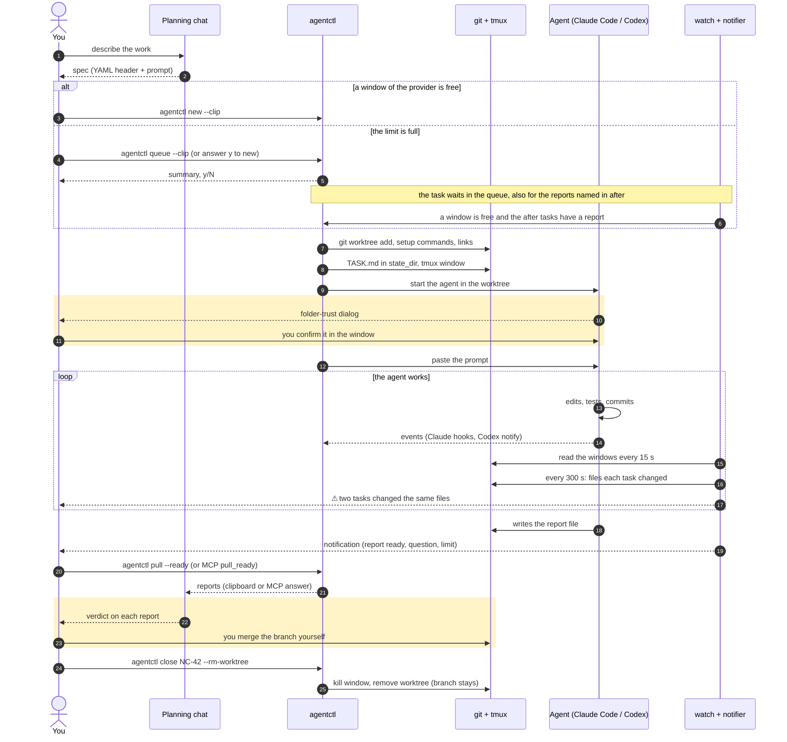
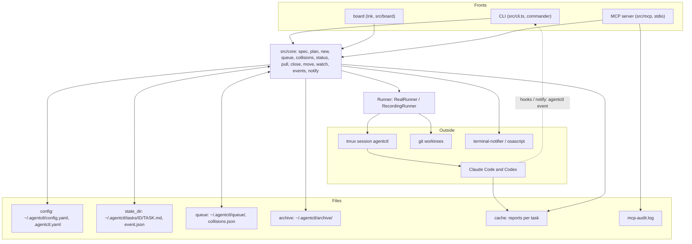
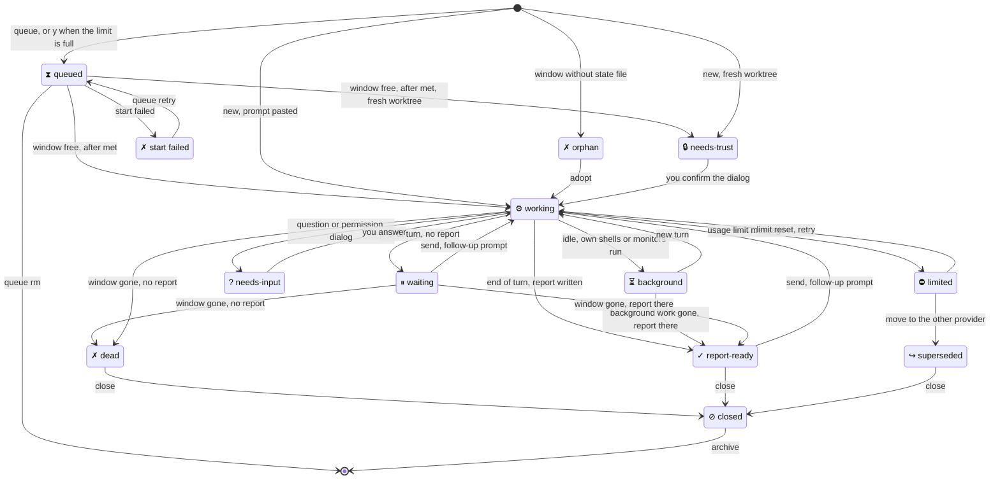

# agentctl

Polski: [README.pl.md](README.pl.md)

**agentctl turns a spec file into a running coding agent: a git worktree, a tmux window and a prompt, and then watches it for you.** It dispatches work orders to the CLI agents [Claude Code](https://docs.claude.com/en/docs/claude-code) and [Codex](https://github.com/openai/codex).

## The problem

Running several coding agents in parallel means a lot of manual steps per task: create a worktree, install dependencies, wire symlinks and environment variables, open a terminal, start the right agent with the right model and effort, paste the prompt, then keep looking at each window to see who is done, who asks something and who ran into a usage limit. Window managers help with the windows. They do not know what a task is.

agentctl manages **work orders, not windows**. The unit is a spec: a Markdown file with a YAML header and a prompt, which you can review, version and reuse. Everything else follows from it.

## Key features

- **One spec, one command.** `agentctl new` creates the git worktree, runs your setup commands, makes the symlinks, sets the environment, opens a tmux window, starts the agent and pastes the prompt.
- **Task states.** `working`, `waiting`, `needs-input`, `needs-trust`, `limited`, `report-ready` and more, from the screen of each window and from events the agents send themselves (Claude hooks, Codex `notify`).
- **Notifications.** One desktop notification per transition; a click on it switches to the task's window.
- **Board.** A full-screen overview of all tasks with a live preview of the selected window.
- **Reports.** `agentctl pull --ready` collects the new reports into one text for your planning chat.
- **Queue, dependencies, collisions.** More tasks than free windows? They wait and start by themselves; a review can wait for the author's report (`after`); two tasks changing the same files are flagged early.
- **Provider switch.** A table of Claude and Codex equivalents; `agentctl move` hands a task that hit its usage limit to the other provider in the same worktree.
- **Chat integration.** A local MCP server lets a chat in the Claude app or Claude Code read status and reports, and, if you allow it, send prompts and start tasks.
- **Small and inspectable.** TypeScript on Node with no build step, no daemon; `--dry-run` prints every command instead of running it.

## How it works



### Architecture

The CLI, the board and the MCP server are thin fronts over the same core. Every side effect goes through the `Runner`, which is a recorder in `--dry-run` and in tests.



### Task states

`status`, the board and the tmux window names show one of these states per task. A live window is classified from its screen and from the agent's events; a task without a window is `report-ready` when its report exists and `dead` when it does not.



| State | Icon | Meaning |
|---|---|---|
| `working` | ⚙ | a turn is running |
| `background` | ⏳ | idle, but the agent's own shells or monitors run; the end of turn is not announced |
| `waiting` | ⏸ | idle at the prompt, no report yet |
| `needs-input` | ? | the agent asked a question or for a permission |
| `needs-trust` | 🔒 | the folder-trust dialog is open; a human must answer it |
| `limited` | ⛔ | the usage limit is used up; `agentctl move` hands the task over |
| `report-ready` | ✓ | the report exists and is newer than the start |
| `superseded` | ↪ | moved to the other provider; this is the old window |
| `dead` | ✗ | the window is gone and there is no report |
| `orphan` | ✗ | a window of the session has no state file; see `agentctl adopt` |
| `closed` | ⊘ | `agentctl close` was run; listed only by `status --all` |

The same diagrams with notes: [docs/diagrams.md](docs/diagrams.md).

## Quick start

Requirements: **Node 22.6+**, **git**, **tmux 3.2+**, and the agents you use (`claude`, `codex`). Optional: [`terminal-notifier`](https://github.com/julienXX/terminal-notifier) for click-to-window notifications.

```sh
git clone https://github.com/Setech-pl/agentctl.git
cd agentctl
bin/agentctl-update            # a stable copy in ~/Projects/agentctl-stable, npm ci, npm link, doctor
agentctl doctor                # tmux, node, git, claude, codex, gh, cache directory, configs
```

`agentctl-update` keeps a detached copy of the repo for daily use, so that a half-finished branch of your clone is never what the global `agentctl` runs; run it again after each release. Details and options: [docs/details.md](docs/details.md#stable-install-and-updates). To only try it, `npm install && npm link` in the clone also works.

The code runs directly on Node's type stripping (`node --experimental-strip-types`, set in the shebang), so there is nothing to build, but it has to be installed from a clone, not from a registry tarball (Node does not strip types inside `node_modules`).

Your first task:

```sh
agentctl spec example > nc-42.md     # a ready-made spec, see "Spec format"
$EDITOR nc-42.md                     # paths, task ID, prompt
agentctl new --dry-run nc-42.md      # every command it would run; nothing is executed
agentctl new --clip                  # or: spec from the clipboard, a summary, y/N
agentctl board --tmux                # overview in window "board" of the agentctl session
tmux attach -t agentctl              # watch the agent work; confirm its folder-trust dialog once
agentctl pull --ready                # new reports to the clipboard, marked as pulled
agentctl close NC-42 --rm-worktree   # window and worktree gone; the branch stays
```

## Daily loop

```
chat gives a spec -> agentctl new --clip -> agentctl watch notifies -> agentctl pull --ready -> paste into the chat -> chat gives a close line
```

1. **The chat gives a spec**, as exactly one code block starting with `---`, so the copy button copies the spec and nothing else.
2. **`agentctl new --clip`** reads it from the clipboard, prints a summary (task, agent/model/effort, worktree, branch, setup, links) and asks `Start? [y/N]`. `-y` skips the question. `agentctl send --clip` does the same for a follow-up prompt.
3. **`agentctl watch --tmux`** runs the watcher in its own tmux window. Every 15 seconds it works out the [state](docs/details.md#task-states) of every task and sends one notification per transition. It also puts a state icon in front of each window name and the task counts in the tmux status bar.
4. **`agentctl pull --ready`** joins every report that is ready and not yet pulled into one text, each under `=== NC-42 (claude opus/high) ===`, copies it and marks those tasks as pulled.
5. **You paste it into the chat.** The chat judges the reports; agentctl never gives verdicts.
6. **The chat gives a closing line**, for example `agentctl close NC-41 NC-42 --rm-worktree`. `close` lists the tasks (flagging those without a report) and asks y/N. Branches are kept, nothing is merged.

`agentctl status --clip` copies a compact Markdown table of all tasks, to paste at the start of a fresh chat. With the [MCP server](#chat-integration-mcp) the chat can read all of this itself, without the clipboard.

## Spec format

A spec is a YAML header between `---` lines, followed by the prompt. Several specs can follow each other in one file; each header starts a new spec.

```markdown
---
task: NC-42
agent: claude
model: opus
effort: high
repos:
  - path: ~/Projects/neon-city
    worktree: ~/Projects/wt/neon-city-nc-42
    base: master
    branch: nc-42-tram-bell
links:
  # Point the client's @neon-city/* packages at the backend worktree under test.
  - from: node_modules/@neon-city/*
    to: ~/Projects/wt/neon-city-backend-merge3/packages/*
env:
  NEON_CITY_TASK: NC-42
report: ~/Projects/cache/nc-42/NC-42.md
---
Add a bell sound to the tram when it leaves a stop.

- Reuse the existing audio bus; do not add new dependencies.
- Cover the new behaviour with a test.
- When you are done, write a short report (what changed, how you checked it,
  what is left) to ~/Projects/cache/nc-42/NC-42.md.
```

| Field | Required | Meaning |
|---|---|---|
| `task` | yes | Task ID: uppercase letters, digits, `-`, `_`, starting with a letter. The tmux window is the lowercase ID. |
| `agent` | yes (or `defaults.agent`) | `claude` or `codex`. |
| `model` | no | Model name passed to the agent; omitted or `default`: the agent's own default. |
| `effort` | no | `low`, `medium`, `high` (default), `xhigh`, `max` (not for Codex). |
| `repos[]` | yes | At least one `{path, worktree, base, branch}`. The agent starts in the first worktree. |
| `setup` | no | Shell commands run in the first worktree after `git worktree add` and before the links. |
| `links[]` | no | `{from, to}` symlinks in the first worktree, for example to wire a client to a backend under test. |
| `env` | no | Environment variables of the tmux window. |
| `review_of` | no | Task ID under review; the reviewer must use another agent or another model than the author. |
| `pin` | no | `true`: never move the task to the other provider. |
| `priority` | no | `high` or `normal` (default): queue order. |
| `after` | no | Task ID or list: a queued task starts only when each has a report. |
| `touches` | no | Globs of the files the task will change: a warning when an active task already changes them. |
| `report` | no | Where the agent writes its report (default `<cache>/<task>/<TASK>.md`). |

`{task}`, `{TASK}` and `{cache}` work as placeholders in paths. All keys, types and defaults: [docs/configuration.md](docs/configuration.md#spec-keys). Mistakes are reported all at once, in plain words, with a hint.

## Configuration

Three layers, the later one wins: the global `~/.agentctl/config.yaml`, then `.agentctl.yaml` in the project repo (the first repo of the spec), then the spec itself. `env` and `links` merge, `setup`, `report`, `worktree_root` and `defaults` are overridden. Unknown keys are errors. `AGENTCTL_HOME` replaces `~/.agentctl`.

```yaml
# ~/.agentctl/config.yaml
cache: ~/Projects/cache        # one folder per task for the reports; the only place agents write to
state_dir: ~/.agentctl/tasks   # agentctl's own state per task, out of the agents' reach
session: agentctl              # tmux session name
limits: {claude: 3, codex: 3}  # most simultaneous windows per provider
defaults: {effort: high}       # agent, model, effort for specs that leave them out
equivalents: []                # extra Claude <-> Codex pairs
notify: {backend: auto}        # auto, terminal-notifier or osascript
mcp: {allow: []}               # write tools the chat may use: send, new, interrupt, close, move
```

```yaml
# .agentctl.yaml in the project repo
worktree_root: ~/Projects/wt   # worktrees go to <worktree_root>/<repo>-<task>
setup:
  - npm ci --prefer-offline --no-audit --no-fund
env:
  NEON_CITY_TASK: "{TASK}"
defaults: {agent: claude}
```

Every key with type, default and meaning: [docs/configuration.md](docs/configuration.md).

## Board

`agentctl board` is a full-screen overview of all tasks, refreshed every 2 seconds. `agentctl board --tmux` opens it in window `board` of the agentctl session. From 110 columns it shows the last lines of the selected window on the right; below that the list takes the whole width.

```
agentctl board  agentctl-test · 3 tasks · 09:41:03
  TASK       AGENT              STATE          TIME    PROGRESS REPORT │ AC5-C · last 13 lines
  AC5-A      claude opus/high   ⏸ waiting      37s     2c 3f    -      │ bash-3.2$ claude --model sonnet --effort medium
  AC5-B      codex gpt-6.1-sol… ✓ report-ready 37s     1c 1f    ready  │ Claude Code (fake) --model sonnet --effort medium
▸ AC5-C      claude sonnet/med… ? needs-input  36s     2c 2f    -      │
                                                                       │ ● got: Model: sonnet · effort medium
                                                                       │
                                                                       │ ● working on: Third fake task that asks you something. W…
                                                                       │ ● Edited file-1.txt
                                                                       │ ● Edited file-0.txt
                                                                       │ ? Tea or coffee?
                                                                       │   1. Tea
                                                                       │   2. Coffee
                                                                       │   Enter to select · Esc to cancel
                                                                       │ ● you chose: tea please

Enter – open the agent · F12 – back to the list
↑↓ ⏎  m msg  M move  i int  c/r pull  x close  h hide  z done  a all  u/d/p  ?
```

| Key | Action |
|---|---|
| `↑` `↓` (`k` `j`) | select a task |
| `Enter` | go to the task's window; **`F12`** comes back to the board |
| `m` / `i` | message the agent / interrupt its turn (after y/N) |
| `M` | move the task to the other provider after a usage limit (after y/N) |
| `c` / `r` | copy the selected report / all new reports |
| `x` | close the window (after y/N; a second question for the worktree) |
| `h` / `z` / `a` | hide a task / open the Finished section / list hidden and closed tasks |
| `?` / `q` | help / leave (the agents keep running) |

In the agentctl tmux session the mouse is on (click a window name in the status bar), and `F12` goes back to the board from any window. Nothing destructive runs on a single key. More: [docs/details.md](docs/details.md#board).

## Notifications and events

Reading a screen every 15 seconds is a guess, so `agentctl new` also asks each agent to report itself: Claude Code through hooks (`Notification`, `Stop`, `StopFailure`), Codex through its `notify` command. `agentctl event` (never typed by hand) records the message, updates the task state at once and notifies. The watcher stays as the fallback, and one transition is announced once.

- Notifications go through `terminal-notifier` when installed (a click runs `agentctl attach <task> --switch-client` and brings your terminal forward), else through `osascript` (`notify-send` on Linux). `notify.backend` chooses; `agentctl notify-test` says which channel carried a test message.
- Texts: `NC-42: <question>`, `NC-42: raport gotowy – <verdict>` (the verdict is the first meaningful report line, or the line `notify.verdict_pattern` matches), a usage limit, a task that waits for more than 120 seconds, a vanished window. The texts are in Polish at the moment.
- States: [docs/diagrams.md](docs/diagrams.md#task-states). Details, event tables and what was checked on Claude Code 2.1.309 and Codex 0.166.0: [docs/details.md](docs/details.md#events).

## Model equivalents and move

Claude and Codex models do not map one to one, so agentctl keeps a table of pairs you consider equivalent (usable both ways), for example `opus/high` and `gpt-6-astra/medium`. Add your own under `equivalents:`; they win over the built-in ones. Fable and effort `max` are deliberately not mapped.

- `agentctl new --agent codex spec.md` runs the specs on Codex through the table.
- When the window limit of the ordered provider is full and the other has room, `new` asks before it switches. It never switches silently; `pin: true` forbids it.
- `agentctl move NC-42` hands a task that hit its usage limit to the other provider: a new window `nc-42-2` in the same worktree, with the original prompt and a note to continue from `git log` and `git diff`. The old window stays as `superseded` and you close it yourself.

The built-in table and the rules for limits: [docs/details.md](docs/details.md#model-equivalents).

## Queue

You order more tasks than there are free windows (`limits.claude`, `limits.codex`)? Put the extra ones in the queue; `agentctl watch` starts each as soon as a window of its provider is free, by the same path as `new` (worktree, setup, links, the folder-trust dialog is still yours).

```sh
agentctl queue nc-42.md        # same checks as "new", a summary, y/N; -y skips the question, --clip reads the clipboard
agentctl queue list            # position, task, agent/model/effort, priority, start condition, how long it waits
agentctl queue up NC-42        # first in line (priority: high still goes first)
agentctl queue rm NC-42        # take it out
agentctl queue pause           # nothing new starts; queue resume lets it run again
agentctl queue retry NC-42     # a failed start, once more
```

- `new` with a full limit asks "add to the queue? [y/N]" instead of only failing (without a terminal: the old error, now naming `agentctl queue`).
- The spec field `priority: high` goes before `normal`; inside a class it is first come, first served. A full provider never holds back a task of the other provider.
- **The queue never switches provider by itself.** A task runs on the agent it was ordered on; moving it stays explicit (`--agent`, `move`).
- A start that fails goes to the end of the line as `failed` with a log and a notification, and is not tried in a loop; `queue retry` is your call. "Uruchomiono NC-42 z kolejki" tells you when one starts.
- The board has a **Queue (N)** section (`u` front, `d` remove, `p` pause) and the tmux status bar counts the queue (`2⚙ 1⏳ 3⧗`).

## Dependencies

`after: NC-42` (or a list) in a spec keeps a queued task waiting until every named task has a report (`report-ready`, or closed with its report). `status`, `queue list` and the board say `czeka na NC-42`. The typical use is the cross-review: the review (`review_of: NC-42`) starts by itself right after the author's report.

```yaml
---
task: NC-42-REVIEW
agent: codex
review_of: NC-42
after: NC-42
---
```

A review without `after` gets a hint in the summary. An unknown task or a circle is an error at adding. Details: [docs/details.md](docs/details.md#dependencies-after).

## Collisions

Two active tasks that change the same files in the same repository are a merge conflict waiting to happen. Every 300 seconds (`collisions.interval`) `watch` asks git which files each active task changed (commits over its base plus uncommitted ones) and compares the tasks of one repository.

- `agentctl status` shows a `COLLIDE` column, e.g. `⚠ LANDING-QS-1: 2` (two shared files); the board marks the task with `⚠`; `watch` sends one notification per new pair.
- `agentctl overlap [TASK]` lists the shared files.
- `touches: [src/menu/**]` in a spec makes `queue` and `new` warn (and ask y/N) when an active task already changes matching files.
- `collisions.ignore` leaves out lock files and the like. It compares file names, not hunks: two tasks in different parts of one file are still reported.

Details: [docs/details.md](docs/details.md#collisions).

## Chat integration (MCP)

`agentctl mcp` is a local MCP server on stdio. The Claude app, Claude Code and VS Code start it themselves; nothing listens on a port.

- **Read tools** (always on): `status`, `peek`, `list_reports`, `get_report`, `pull_ready`, `task_spec`, `queue_list`, `overlap`.
- **Write tools** (off until listed in `mcp.allow`): `send`, `new`, `queue`, `queue_rm`, `interrupt`, `close`, `move`. `new`, `queue` and `move` change nothing until called again with `confirm: true`. Every write is audited in `~/.agentctl/mcp-audit.log` and announced on the desktop.
- No tool merges, pushes, rebases, deletes a branch, runs a shell command or takes a path.

```sh
agentctl mcp install --desktop --dry-run   # Claude app: the entry and the diff, nothing written
agentctl mcp install --claude-code         # Claude Code and the VS Code extension
```

Checked: the read tools work in the chats of a Project in the Claude app on macOS. Everything about install, tools, security and limits: [docs/mcp.md](docs/mcp.md).

## Why not Orca / Claude Squad / Conductor?

Orca, Claude Squad and Conductor are good at *managing agent windows*: opening sessions, showing them side by side, switching between them. If that is what you need, use them. agentctl does not try to replace a window manager (it uses tmux for that); it manages **work orders**, and a spec carries things a window manager does not know about:

- **Symlinks**: a worktree wired to another worktree's packages.
- **Env and setup**: per-task variables and install commands, layered global, project, spec.
- **Agent flags**: model, effort and your default flags per agent, with a guard against auto-accept.
- **A cross-review rule**: `review_of` refuses to let the same agent and model grade its own work.
- **Per-provider window limits**, with an error that lists who holds them.
- **A paper trail**: `TASK.md` in the state folder records the spec, the start time and every follow-up prompt.

## Safety model

What agentctl never does:

- **No merge, rebase or push.** `git` is only called with `worktree add`, `worktree remove` and read-only queries. No `--force`, no branch deletion; a worktree with `main` or `master` checked out is never removed.
- **No auto-accept.** It adds no such flag, and a config that tries to (`--dangerously-skip-permissions`, `--yolo`, `--full-auto`, `-a never`, …) is invalid. The agent keeps asking you for permission. Codex runs with `--sandbox danger-full-access` as ordered, but with its approval policy untouched.
- **It never answers a dialog for you.** The folder-trust dialog of a fresh worktree is confirmed by a human; `new` waits for that.
- **No verdicts.** Judging a report is yours (or your chat's).
- **Small footprint.** Files go to the state folder and the cache folder only, never to `~/.claude` or `/tmp`. A chat can do only what `mcp.allow` lists.

## Limitations

- **Install from a clone.** Node does not strip types inside `node_modules`, so a registry install would not run; a build step is planned for an npm release.
- **Screen patterns are heuristics** tied to the wording of the current Claude Code (2.1.309) and Codex (0.166.0) TUIs; they are configurable.
- **Not observed on a real screen:** the text of a usage-limit message in either TUI (the patterns come from strings in the binaries, so as not to burn a plan), and the footer text of Codex when it waits for background terminals (`agents.codex.background_patterns` is a best guess).
- Codex 0.166.0 sends no event for an approval request, so those are found by the screen reader, and only while `watch` runs.
- Window limits count only windows created by agentctl.
- The queue moves only while `agentctl watch` runs, and `watch` reads the config when it starts (restart it after changing limits).
- Collisions compare file names from git, not hunks; a task that only has uncommitted edits in another checkout of the repository is not seen.
- `move` starts a new conversation: the new agent learns the state from `git log` and `git diff`, not from the old agent's context.
- `close --rm-worktree` kills the window first; a worktree with uncommitted files is then refused (no `--force`).
- The MCP server is local and runs as you. It is a trust decision about the chat, not a sandbox.
- Tested on macOS; Linux is supported for the clipboard and `notify-send` but less used.

## Roadmap

Ideas, not promises:

1. **History, `gc` and `resume`:** a list of finished work, cleaning up old worktrees and state, resuming a task.
2. **Phone notifications.**
3. **Remote MCP:** a server a chat on the web or phone can reach, with authentication.
4. **Local models** as a third kind of agent.
5. **npm release** with a build step.

## More

- [docs/commands.md](docs/commands.md): every command and option, generated from the code.
- [docs/configuration.md](docs/configuration.md): every config and spec key.
- [docs/mcp.md](docs/mcp.md): the MCP server.
- [docs/diagrams.md](docs/diagrams.md): flow, architecture, task states.
- [docs/details.md](docs/details.md): how the pieces work and what was checked live.
- [CHANGELOG.md](CHANGELOG.md), [CONTRIBUTING.md](CONTRIBUTING.md).

## License

[MIT](LICENSE)
