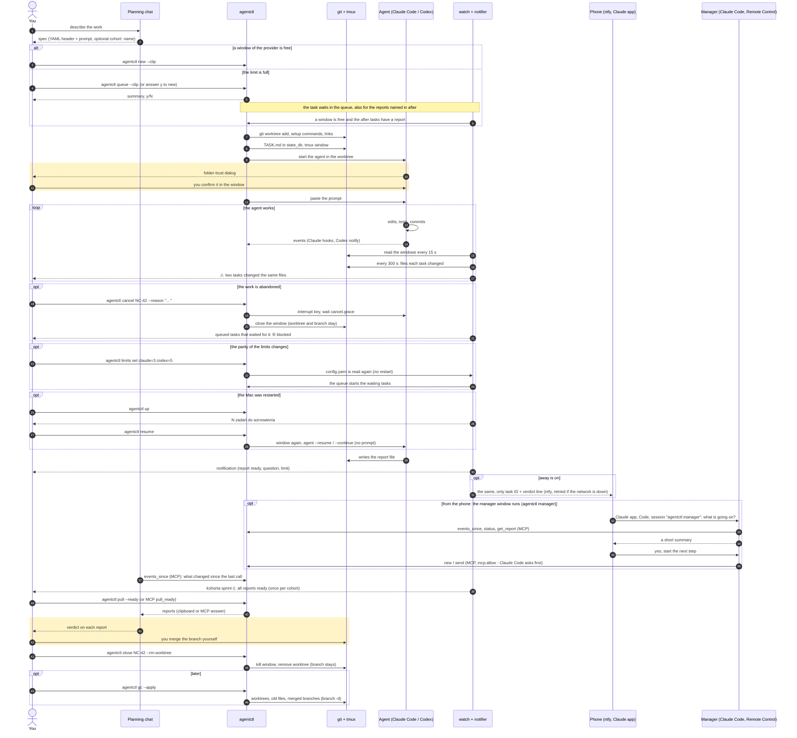
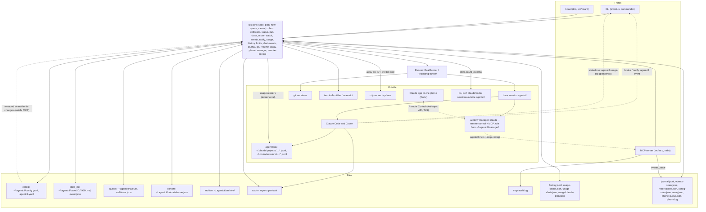
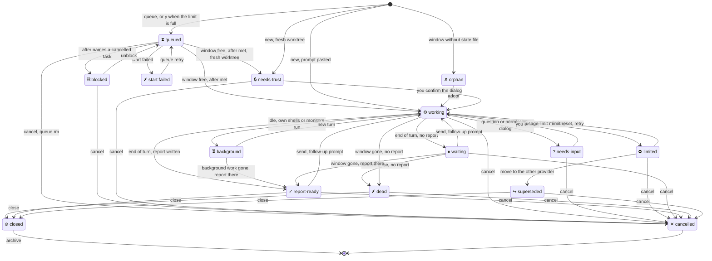

# agentctl

Polski: [README.pl.md](README.pl.md)

**agentctl turns a spec file into a running coding agent: a git worktree, a tmux window and a prompt, and then watches it for you.** It dispatches work orders to the CLI agents [Claude Code](https://docs.claude.com/en/docs/claude-code) and [Codex](https://github.com/openai/codex).

## The problem

Running several coding agents in parallel means a lot of manual steps per task: create a worktree, install dependencies, wire symlinks and environment variables, open a terminal, start the right agent with the right model and effort, paste the prompt, then keep looking at each window to see who is done, who asks something and who ran into a usage limit. Window managers help with the windows. They do not know what a task is.

agentctl manages **work orders, not windows**. The unit is a spec: a Markdown file with a YAML header and a prompt, which you can review, version and reuse. Everything else follows from it.

## Key features

- **One spec, one command.** `agentctl new` creates the git worktree, runs your setup commands, makes the symlinks, sets the environment, opens a tmux window, starts the agent and pastes the prompt.
- **Task states.** `working`, `waiting`, `needs-input`, `needs-trust`, `limited`, `report-ready` and more, from the screen of each window and from events the agents send themselves (Claude hooks, Codex `notify`).
- **Notifications.** One desktop notification per transition; a click on it switches to the task's window.
- **Phone.** `agentctl ntfy-setup` and `agentctl away on`: the events that need you also go to your phone through ntfy, with only the task ID and the verdict line in the message.
- **Remote control.** `agentctl manager` starts a Claude Code session with Remote Control and the agentctl MCP tools: you talk to your agents from the Claude app on the phone.
- **Board.** A full-screen overview of all tasks with a live preview of the selected window.
- **Reports.** `agentctl pull --ready` collects the new reports into one text for your planning chat. A report the agent wrote elsewhere than the spec says is found and copied ([Report detection](docs/details.md#report-detection)).
- **Queue, dependencies, collisions.** More tasks than free windows? They wait and start by themselves; a review can wait for the author's report (`after`); two tasks changing the same files are flagged early.
- **Cancelling and cohorts.** Work is abandoned in the middle of a turn? `agentctl cancel` interrupts, closes the window and keeps the worktree; tasks that waited for it are blocked, not forgotten. Tasks you name a cohort for are grouped on the board, filtered by `--cohort` and announced together when all their reports are in.
- **Provider switch.** A table of Claude and Codex equivalents; `agentctl move` hands a task that hit its usage limit to the other provider in the same worktree.
- **Usage and limits.** `agentctl usage` shows the tokens of the tasks and how close the Claude and Codex plans are to their limits (n/d when a provider does not say); `watch` warns at 80 % and 95 %, `new` hints at the provider with room, the queue can hold back a provider that is nearly out. `agentctl log` and `stats` keep a history of the tasks to calibrate the choice of model and effort.
- **Live limits.** `agentctl limits set claude=3 codex=5` changes the parity while `watch` runs; places for agents you start by hand can be reserved or counted.
- **Events for the chat.** `agentctl events` and MCP `events_since` tell a chat what changed since its last call.
- **Clean-up and resume.** `agentctl gc` takes back worktrees, old files and merged branches of finished tasks; `agentctl resume` brings the windows back after a restart, and `agentctl up` starts the day.
- **Chat integration.** A local MCP server lets a chat in the Claude app or Claude Code read status and reports, and, if you allow it, send prompts and start tasks.
- **Small and inspectable.** TypeScript on Node with no build step, no daemon; `--dry-run` prints every command instead of running it.

## How it works



### Architecture

The CLI, the board and the MCP server are thin fronts over the same core. Every side effect goes through the `Runner`, which is a recorder in `--dry-run` and in tests.



### Task states

`status`, the board and the tmux window names show one of these states per task. A live window is classified from its screen and from the agent's events; a task without a window is `report-ready` when its report exists and `dead` when it does not.



| State | Icon | Meaning |
|---|---|---|
| `working` | ⚙ | a turn is running |
| `background` | ⏳ | idle, but the agent's own shells or monitors run; the end of turn is not announced |
| `waiting` | ⏸ | idle at the prompt, no report yet |
| `needs-input` | ? | the agent asked a question or for a permission |
| `needs-trust` | 🔒 | the folder-trust dialog is open; a human must answer it |
| `limited` | ⛔ | the usage limit is used up; `agentctl move` hands the task over |
| `report-ready` | ✓ | the report exists and is newer than the start |
| `superseded` | ↪ | moved to the other provider; this is the old window |
| `dead` | ✗ | the window is gone and there is no report |
| `orphan` | ✗ | a window of the session has no state file; see `agentctl adopt` |
| `closed` | ⊘ | `agentctl close` was run; listed only by `status --all` |
| `cancelled` | ✕ | `agentctl cancel` was run: the work was abandoned, in the middle of a turn or in the queue; listed only by `status --all`, under **Cancelled** on the board |

A queued task whose `after` names a cancelled task is **blocked** (⛓): not a state of a window, but a condition of the queue that `status`, `queue list` and the board show with its cause. [Cancelling tasks](#cancelling-tasks) and `agentctl unblock` are the ways out.

The same diagrams with notes: [docs/diagrams.md](docs/diagrams.md).

## Quick start

Requirements: **Node 22.6+**, **git**, **tmux 3.2+**, and the agents you use (`claude`, `codex`). Optional: [`terminal-notifier`](https://github.com/julienXX/terminal-notifier) for click-to-window notifications.

```sh
git clone https://github.com/Setech-pl/agentctl.git
cd agentctl
bin/agentctl-update            # a stable copy in ~/Projects/agentctl-stable, npm ci, npm link, doctor
agentctl doctor                # tmux, node, git, claude, codex, gh, cache directory, configs
```

`agentctl-update` keeps a detached copy of the repo for daily use, so that a half-finished branch of your clone is never what the global `agentctl` runs; run it again after each release. Details and options: [docs/details.md](docs/details.md#stable-install-and-updates). To only try it, `npm install && npm link` in the clone also works.

The code runs directly on Node's type stripping (`node --experimental-strip-types`, set in the shebang), so there is nothing to build, but it has to be installed from a clone, not from a registry tarball (Node does not strip types inside `node_modules`).

Your first task:

```sh
agentctl spec example > nc-42.md     # a ready-made spec, see "Spec format"
$EDITOR nc-42.md                     # paths, task ID, prompt
agentctl new --dry-run nc-42.md      # every command it would run; nothing is executed
agentctl new --clip                  # or: spec from the clipboard, a summary, y/N
agentctl board --tmux                # overview in window "board" of the agentctl session
tmux attach -t agentctl              # watch the agent work; confirm its folder-trust dialog once
agentctl pull --ready                # new reports to the clipboard, marked as pulled
agentctl close NC-42 --rm-worktree   # window and worktree gone; the branch stays
```

## Daily loop

```
chat gives a spec -> agentctl new --clip -> agentctl watch notifies -> agentctl pull --ready -> paste into the chat -> chat gives a close line
```

1. **The chat gives a spec**, as exactly one code block starting with `---`, so the copy button copies the spec and nothing else.
2. **`agentctl new --clip`** reads it from the clipboard, prints a summary (task, agent/model/effort, worktree, branch, setup, links) and asks `Start? [y/N]`. `-y` skips the question. `agentctl send --clip` does the same for a follow-up prompt.
3. **`agentctl watch --tmux`** runs the watcher in its own tmux window. Every 15 seconds it works out the [state](docs/details.md#task-states) of every task and sends one notification per transition. It also puts a state icon in front of each window name and the task counts in the tmux status bar.
4. **`agentctl pull --ready`** joins every report that is ready and not yet pulled into one text, each under `=== NC-42 (claude opus/high) ===`, copies it and marks those tasks as pulled.
5. **You paste it into the chat.** The chat judges the reports; agentctl never gives verdicts.
6. **The chat gives a closing line**, for example `agentctl close NC-41 NC-42 --rm-worktree`. `close` lists the tasks (flagging those without a report) and asks y/N. Branches are kept, nothing is merged.

In the morning **`agentctl up`** starts the watcher and the board if they are not running, says which tasks to [resume](#resuming) after a restart and opens the board. `agentctl status --clip` copies a compact Markdown table of all tasks, to paste at the start of a fresh chat. With the [MCP server](#chat-integration-mcp) the chat can read all of this itself, without the clipboard.

## Spec format

A spec is a YAML header between `---` lines, followed by the prompt. Several specs can follow each other in one file; each header starts a new spec.

```markdown
---
task: NC-42
agent: claude
model: opus
effort: high
repos:
  - path: ~/Projects/neon-city
    worktree: ~/Projects/wt/neon-city-nc-42
    base: master
    branch: nc-42-tram-bell
links:
  # Point the client's @neon-city/* packages at the backend worktree under test.
  - from: node_modules/@neon-city/*
    to: ~/Projects/wt/neon-city-backend-merge3/packages/*
env:
  NEON_CITY_TASK: NC-42
report: ~/Projects/cache/nc-42/NC-42.md
---
Add a bell sound to the tram when it leaves a stop.

- Reuse the existing audio bus; do not add new dependencies.
- Cover the new behaviour with a test.
- When you are done, write a short report (what changed, how you checked it,
  what is left) to ~/Projects/cache/nc-42/NC-42.md.
```

| Field | Required | Meaning |
|---|---|---|
| `task` | yes | Task ID: uppercase letters, digits, `-`, `_`, starting with a letter. The tmux window is the lowercase ID. |
| `agent` | yes (or `defaults.agent`) | `claude` or `codex`. |
| `model` | no | Model name passed to the agent; omitted or `default`: the agent's own default. |
| `effort` | no | `low`, `medium`, `high` (default), `xhigh`, `max` (not for Codex). |
| `repos[]` | yes | At least one `{path, worktree, base, branch}`. The agent starts in the first worktree. |
| `setup` | no | Shell commands run in the first worktree after `git worktree add` and before the links. |
| `links[]` | no | `{from, to}` symlinks in the first worktree, for example to wire a client to a backend under test. |
| `env` | no | Environment variables of the tmux window. |
| `review_of` | no | Task ID under review; the reviewer must use another agent or another model than the author. |
| `pin` | no | `true`: never move the task to the other provider. |
| `priority` | no | `high` or `normal` (default): queue order. |
| `after` | no | Task ID or list: a queued task starts only when each has a report. |
| `touches` | no | Globs of the files the task will change: a warning when an active task already changes them. |
| `cohort` | no | Name of the group the task belongs to (`--cohort` on `new` and `queue` overrides it). Without it the task is in no cohort. |
| `report` | no | Where the agent writes its report (default `<cache>/<task>/<TASK>.md`). |

`{task}`, `{TASK}` and `{cache}` work as placeholders in paths. All keys, types and defaults: [docs/configuration.md](docs/configuration.md#spec-keys). Mistakes are reported all at once, in plain words, with a hint.

## Configuration

Three layers, the later one wins: the global `~/.agentctl/config.yaml`, then `.agentctl.yaml` in the project repo (the first repo of the spec), then the spec itself. `env` and `links` merge, `setup`, `report`, `worktree_root` and `defaults` are overridden. Unknown keys are errors. `AGENTCTL_HOME` replaces `~/.agentctl`.

```yaml
# ~/.agentctl/config.yaml
cache: ~/Projects/cache        # one folder per task for the reports; the only place agents write to
state_dir: ~/.agentctl/tasks   # agentctl's own state per task, out of the agents' reach
session: agentctl              # tmux session name
limits: {claude: 3, codex: 3}  # most simultaneous windows per provider
defaults: {effort: high}       # agent, model, effort for specs that leave them out
equivalents: []                # extra Claude <-> Codex pairs
notify: {backend: auto}        # auto, terminal-notifier or osascript
mcp: {allow: []}               # write tools the chat may use: send, new, interrupt, close, move
```

```yaml
# .agentctl.yaml in the project repo
worktree_root: ~/Projects/wt   # worktrees go to <worktree_root>/<repo>-<task>
setup:
  - npm ci --prefer-offline --no-audit --no-fund
env:
  NEON_CITY_TASK: "{TASK}"
defaults: {agent: claude}
```

Every key with type, default and meaning: [docs/configuration.md](docs/configuration.md).

## Board

`agentctl board` is a full-screen overview of all tasks, refreshed every 2 seconds. `agentctl board --tmux` opens it in window `board` of the agentctl session. From 110 columns it shows the last lines of the selected window on the right; below that the list takes the whole width.

```
agentctl board  agentctl-test · 3 tasks · 09:41:03
  TASK       AGENT              STATE          TIME    PROGRESS REPORT │ AC5-C · last 13 lines
  AC5-A      claude opus/high   ⏸ waiting      37s     2c 3f    -      │ bash-3.2$ claude --model sonnet --effort medium
  AC5-B      codex gpt-6.1-sol… ✓ report-ready 37s     1c 1f    ready  │ Claude Code (fake) --model sonnet --effort medium
▸ AC5-C      claude sonnet/med… ? needs-input  36s     2c 2f    -      │
                                                                       │ ● got: Model: sonnet · effort medium
                                                                       │
                                                                       │ ● working on: Third fake task that asks you something. W…
                                                                       │ ● Edited file-1.txt
                                                                       │ ● Edited file-0.txt
                                                                       │ ? Tea or coffee?
                                                                       │   1. Tea
                                                                       │   2. Coffee
                                                                       │   Enter to select · Esc to cancel
                                                                       │ ● you chose: tea please

Enter – open the agent · F12 – back to the list
m msg M move i int c/r pull x close X cancel k cohort h hide l log L G R u/d/p ?
```

| Key | Action |
|---|---|
| `↑` `↓` (`j`) | select a task |
| `Enter` | go to the task's window; **`F12`** comes back to the board |
| `m` / `i` | message the agent / interrupt its turn (after y/N) |
| `M` | move the task to the other provider after a usage limit (after y/N) |
| `c` / `r` | copy the selected report / all new reports |
| `x` | close the window (after y/N; a second question for the worktree) |
| `X` | cancel the task: an optional reason, then y/N; a queued task leaves the queue, a move is cancelled with its other half |
| `k` | pick a cohort to show (`wszystkie`, a cohort, `bez kohorty`) |
| `g` / `E` | fold the cohort group of the selected task / open all groups |
| `L` | the limits per provider and what uses them (`agentctl limits`) |
| `G` | the preview of the clean-up (`agentctl gc`; the board never deletes) |
| `R` | resume the tasks listed under "Do wznowienia" (after y/N) |
| `l` | the log of the tasks (history; `↑↓` scroll, `Esc` back) |
| `o` / `p` / `f` | mark the selected finished task ok / partial / fail (`p` pauses the queue when no finished task is selected) |
| `h` / `z` / `a` | hide a task / open the Finished section / list hidden, closed and cancelled tasks |
| `?` / `q` | help / leave (the agents keep running) |

Under the title line a panel shows the plan of each provider (a bar, the percentage and the reset; n/d when unknown), and a TOKENS column the tokens of each task.

With cohorts the list is grouped under foldable headers with the counts of their states (`- sprint-1 (4) 2⚙ 1✓ 1⧗`), the tasks without a cohort last under `bez kohorty`. The tmux status bar keeps counting all tasks.

In the agentctl tmux session the mouse is on (click a window name in the status bar), and `F12` goes back to the board from any window. Nothing destructive runs on a single key. More: [docs/details.md](docs/details.md#board).

## Notifications and events

Reading a screen every 15 seconds is a guess, so `agentctl new` also asks each agent to report itself: Claude Code through hooks (`Notification`, `Stop`, `StopFailure`), Codex through its `notify` command. `agentctl event` (never typed by hand) records the message, updates the task state at once and notifies. The watcher stays as the fallback, and one transition is announced once.

- Notifications go through `terminal-notifier` when installed (a click runs `agentctl attach <task> --switch-client` and brings your terminal forward), else through `osascript` (`notify-send` on Linux). `notify.backend` chooses; `agentctl notify-test` says which channel carried a test message.
- Texts: `NC-42: <question>`, `NC-42: raport gotowy – <verdict>` (the verdict is the first meaningful report line, or the line `notify.verdict_pattern` matches), a usage limit, a task that waits for more than 120 seconds, a vanished window. The texts are in Polish at the moment.
- States: [docs/diagrams.md](docs/diagrams.md#task-states). Details, event tables and what was checked on Claude Code 2.1.309 and Codex 0.166.0: [docs/details.md](docs/details.md#events).

## Phone notifications

When you leave the Mac, the events that need you can go to your phone through [ntfy](https://ntfy.sh), a free notification app for iOS and Android. It works with the public server `ntfy.sh` or with one of your own. The notifications on the Mac stay as they are; the phone is an addition, and it is quiet while you sit at the Mac.

1. **Make a topic.** `agentctl ntfy-setup` writes a random topic (`agentctl-` and 24 hex digits) to `config.yaml`, keeps your comments, and prints these steps. `--server https://ntfy.example.com` is for a server of your own; `--show-qr` also prints the subscription link as a QR code if the `qrencode` tool is installed (`brew install qrencode`; agentctl adds no dependency for it).
2. **Subscribe on the phone.** Install the app (iOS: App Store, "ntfy"; Android: Google Play or F-Droid, "ntfy"), tap **+** and type the topic. For your own server switch on "Use another server" and enter its address.
3. **Test it.** `agentctl notify-test --phone` sends one message and prints the result, the HTTP code and the time (`--all` tests the Mac as well).
4. **Say when you are away.** `agentctl away on` when you leave, `agentctl away off` when you are back; `agentctl away` shows the state. Or let the Mac decide: `away: {auto_idle: 15}` counts the Mac as away after 15 minutes without keyboard or mouse (macOS) and back at the first touch. `notify.ntfy.always: true` sends always.

```yaml
notify:
  ntfy:
    topic: agentctl-3f9c0a7e51b2d84c6e19a0f7   # written by ntfy-setup
    # server: https://ntfy.sh                  # your own server instead
    # token: tk_...                            # a private server or an ntfy account
    # events: [needs-input, report-ready, limited, dead]
    # priority: {report-ready: low}
    # click_url: https://claude.ai/             # opened by a tap on the notification
away:
  auto_idle: 15
```

- **What is sent.** `needs-input`, `needs-trust`, `limited`, `blocked`, `report-ready`, `cohort-done`, `queue-failed`, `orphan`, `dead` and `usage-critical` by default; `notify.ntfy.events` chooses. `needs-input`, `limited` and `usage-critical` have the priority `high`, the rest `default`; `notify.ntfy.priority` changes it. The phone gets what the Mac got: one transition is announced once, also when the agent's event and the watcher both see it.
- **Privacy.** On the public `ntfy.sh` anyone who knows the topic name can read the messages and send their own: **the name is the only protection**, so keep it secret, do not commit `config.yaml`, and prefer your own server or an account with a token for anything sensitive. That is why a message holds only the task ID, the name of a cohort and the first line of the verdict (`include_verdict: false` leaves that out). Never the text of a report, a question of an agent, a path or a file name. `agentctl doctor` warns about a short or word-like topic and about a private server without a token.
- **When the network is down.** The watcher is not slowed or stopped. A failed message is tried again three times (after 30 seconds, 2 and 10 minutes), then dropped with a line in `<config dir>/phone.log`; the watch log warns once an hour. `agentctl events` marks the events that went to the phone with 📱.
- **Where you see away.** The board header (`📱 away`; key `w` switches it, after y/N), a 📱 in front of the tmux status line, `agentctl away status`, and the MCP `status` and `events_since`. A chat can switch it with the MCP tool `away` if you put `away` in `mcp.allow` (no confirm step; it is audited).

Details: [docs/details.md](docs/details.md#phone-notifications).

## Remote control from your phone

The local MCP server does not work in the chats of claude.ai on a phone (only in the Claude desktop app). **Claude Code Remote Control** does the other thing: a Claude Code session that runs on your Mac can be continued from the Claude app on iOS and Android, with its local tools and MCP servers. `agentctl manager` starts such a session for you, a **dispatcher**: it sees your agents through the agentctl MCP tools, answers what is going on in short sentences, pulls reports, and starts the next step only after your clear yes.

1. **Check the requirements.** Claude Code logged in through claude.ai (`claude auth login`; Pro, Max, Team or Enterprise, on Team and Enterprise an Owner must switch Remote Control on), **not** an API key, Bedrock, Vertex or a gateway (`ANTHROPIC_BASE_URL`). The Claude app on the phone, signed in to the same account. `agentctl doctor` checks the flags of your `claude` and warns about the variables that make Claude Code refuse Remote Control.
2. **Start the manager.** `agentctl manager` (set `manager.project` once, a folder you work in, e.g. `~/Projects/neon-city`; `--project` overrides it). It makes the window `manager` in the agentctl session and starts `claude --remote-control "agentctl manager"` in your project. **The first time Claude Code asks in that window** for the folder trust and to *Enable Remote Control*: answer there (`tmux attach -t agentctl \; select-window -t manager`, or select the 🧭 line on the board and press Enter). agentctl never answers these dialogs.
3. **Open it on the phone.** Claude app, tap **Code**, pick the session **agentctl manager** (a computer icon with a green dot). `agentctl manager --url` prints the address and the QR code when the window shows them; in the window `/remote-control` shows both.
4. **Talk to it.** "Co słychać?" makes the manager call `events_since` and `status`. "Pokaż raport NC-42" gives you a short version. "Uruchom NC-43" makes it show the spec and wait for your yes. What it may change is limited twice: by `mcp.allow` of agentctl and by Claude Code, which asks you for permission on the phone before it calls a tool that changes something (the read tools need no tap).

```yaml
manager:
  project: ~/Projects/neon-city        # where the session runs; its files are not changed
  # name: agentctl manager             # the name in the Claude app
  # model: sonnet                      # the default
  # effort: medium                     # the default
  # guide: ~/Projects/neon-city/claude/AGENTCTL-SPEC-GUIDE.md   # rules for writing specs, added to the role
  # autostart: true                    # agentctl up starts the manager too
mcp:
  allow: [send, new, queue]            # what the manager may do at all, with your yes
```

- **What `agentctl manager` does.** One window `manager`, never a second copy; `agentctl manager stop` closes it (the session goes offline in the app). It is an interactive session, started with `--mcp-config` (the agentctl server), `--settings` (the read tools need no tap) and `--append-system-prompt-file` (the role), all three from files in `~/.agentctl/manager/`: nothing in your project is changed. The role: look at `events_since` and `status` first, change things only with your clear yes to that very action, summaries of at most 6 lines, never merge, push or tag. The window is **not a task**: it is no orphan in `status`, does not count against the limits, and `close`, `cancel` and `gc` do not touch it. The board shows it in its own line (🧭 *czeka na potwierdzenie w oknie / czeka na połączenie / połączony*).
- **Answering a task from the phone.** `remote_control: true` in a spec (or `defaults.remote_control: true`, Claude only) starts that agent with `--remote-control <TASK>`: the task shows up in the same list in the Claude app, named after its ID, and you can answer its question from there. The `needs-input` notification on the phone then ends with "Odpowiesz w aplikacji Claude: NC-42".
- **Notifications.** With the manager window up, the phone notifications for a question, a ready report and a finished cohort end with "Otwórz sesję „agentctl manager” w aplikacji Claude." No link, no path.
- **Limits.** The Mac has to be on, **not asleep**, and the `claude` process has to keep running (tmux does that; closing the window ends the session). After a sleep or a lost network an interactive session reconnects by itself. Needs a claude.ai plan (Pro or Max for a person); while connected the conversation is stored on Anthropic's servers. One session per `claude` process. Commands such as `/plugin` work only at the Mac. Remote Control has not been tried here against a real Claude Code (tests and the live harness use a fake `claude`): [what is checked and what is not](docs/details.md#remote-control-and-the-manager).

Details: [docs/details.md](docs/details.md#remote-control-and-the-manager).

## Model equivalents and move

Claude and Codex models do not map one to one, so agentctl keeps a table of pairs you consider equivalent (usable both ways), for example `opus/high` and `gpt-6-astra/medium`. Add your own under `equivalents:`; they win over the built-in ones. Fable and effort `max` are deliberately not mapped.

- `agentctl new --agent codex spec.md` runs the specs on Codex through the table.
- When the window limit of the ordered provider is full and the other has room, `new` asks before it switches. It never switches silently; `pin: true` forbids it.
- `agentctl move NC-42` hands a task that hit its usage limit to the other provider: a new window `nc-42-2` in the same worktree, with the original prompt and a note to continue from `git log` and `git diff`. The old window stays as `superseded` and you close it yourself.

The built-in table and the rules for limits: [docs/details.md](docs/details.md#model-equivalents).

## Queue

You order more tasks than there are free windows (`limits.claude`, `limits.codex`)? Put the extra ones in the queue; `agentctl watch` starts each as soon as a window of its provider is free, by the same path as `new` (worktree, setup, links, the folder-trust dialog is still yours).

```sh
agentctl queue nc-42.md        # same checks as "new", a summary, y/N; -y skips the question, --clip reads the clipboard
agentctl queue list            # position, task, agent/model/effort, priority, start condition, how long it waits
agentctl queue up NC-42        # first in line (priority: high still goes first)
agentctl queue rm NC-42        # take it out
agentctl queue pause           # nothing new starts; queue resume lets it run again
agentctl queue retry NC-42     # a failed start, once more
```

- `new` with a full limit asks "add to the queue? [y/N]" instead of only failing (without a terminal: the old error, now naming `agentctl queue`).
- The spec field `priority: high` goes before `normal`; inside a class it is first come, first served. A full provider never holds back a task of the other provider.
- **The queue never switches provider by itself.** A task runs on the agent it was ordered on; moving it stays explicit (`--agent`, `move`).
- A start that fails goes to the end of the line as `failed` with a log and a notification, and is not tried in a loop; `queue retry` is your call. "Uruchomiono NC-42 z kolejki" tells you when one starts.
- The board has a **Queue (N)** section (`u` front, `d` remove, `p` pause) and the tmux status bar counts the queue (`2⚙ 1⏳ 3⧗`).

## Dependencies

`after: NC-42` (or a list) in a spec keeps a queued task waiting until every named task has a report (`report-ready`, or closed with its report). `status`, `queue list` and the board say `czeka na NC-42`. The typical use is the cross-review: the review (`review_of: NC-42`) starts by itself right after the author's report.

```yaml
---
task: NC-42-REVIEW
agent: codex
review_of: NC-42
after: NC-42
---
```

A review without `after` gets a hint in the summary. An unknown task or a circle is an error at adding. Details: [docs/details.md](docs/details.md#dependencies-after).

## Collisions

Two active tasks that change the same files in the same repository are a merge conflict waiting to happen. Every 300 seconds (`collisions.interval`) `watch` asks git which files each active task changed (commits over its base plus uncommitted ones) and compares the tasks of one repository.

- `agentctl status` shows a `COLLIDE` column, e.g. `⚠ LANDING-QS-1: 2` (two shared files); the board marks the task with `⚠`; `watch` sends one notification per new pair.
- `agentctl overlap [TASK]` lists the shared files.
- `touches: [src/menu/**]` in a spec makes `queue` and `new` warn (and ask y/N) when an active task already changes matching files.
- `collisions.ignore` leaves out lock files and the like. It compares file names, not hunks: two tasks in different parts of one file are still reported.

Details: [docs/details.md](docs/details.md#collisions).

## Cancelling tasks

Work is abandoned half way: the approach was wrong, the plan changed, the task was ordered twice.

```sh
agentctl cancel NC-42 --reason "wrong approach"   # list, y/N; interrupt, wait cancel.grace (5 s), close the window
agentctl cancel NC-41 NC-42 --rm-worktree         # also remove the worktrees (never --force; branches stay)
agentctl cancel --cohort sprint-1                 # every open task of a cohort, queued ones too
agentctl unblock NC-43 [--drop-after NC-42]       # a task that waited for a cancelled one: drop the dependency
```

- **The worktree and the branch stay**, because half-done work is often worth keeping. `--rm-worktree` removes the worktree only.
- `cancelled` is a state of its own (not `closed`). A cancelled task leaves `status` and the board (`status --all` and the board key `a` list it under **Cancelled**), does not count against the window limits and is never taken by `pull --ready`. A report it had written stays: `agentctl pull NC-42`.
- A queued task is taken out of the queue (`queue rm` is the same without a reason). A task you moved with `move` is cancelled together with its other half, after one question.
- A queued task whose `after` names a cancelled task is **blocked** (⛓): it shows the cause, `watch` says "NC-43 zablokowane – NC-42 anulowane" once, and it stays until you `unblock` it or cancel it.
- The reason, the time and who asked (`cli`, `board`, `mcp`) are written into `TASK.md`. On the board it is **`X`**; for the chat there is the MCP tool `cancel`, which announces itself on the desktop.

Details: [docs/details.md](docs/details.md#cancelling-tasks).

## Cohorts

Related tasks can share a name you choose, so you can watch, pull and close them as a group.

```yaml
---
task: NC-42
agent: claude
cohort: sprint-1        # optional; no name, no cohort
---
```

```sh
agentctl new --cohort sprint-1 nc-42.md        # the flag overrides the spec; also on queue
agentctl cohort list                           # tasks per cohort by state, since when
agentctl cohort show sprint-1                  # the tasks as in status
agentctl cohort add sprint-1 NC-43 NC-44       # existing tasks; cohort remove NC-44; cohort note sprint-1 "…"
agentctl status --cohort sprint-1              # also --json, --clip; pull --ready, close, cancel, queue list take it too
```

- A task without a name belongs to **no cohort**: there is no default one. Names are letters, digits, `-`, `_` and `.`, compared without regard to case and shown as first written. The first task makes the cohort (`~/.agentctl/cohorts/<name>.json`).
- When every task of a cohort that was not cancelled has a report, `watch` says "kohorta sprint-1: wszystkie raporty gotowe (3)", once; again only when a task joins.
- `close --cohort X` and `cancel --cohort X` list the tasks and ask y/N. The board groups by cohort (`k` filters, `g` folds); the MCP server has `cohort_list`, `cohort_show` and a `cohort` argument of `status` and `pull_ready`.

Details: [docs/details.md](docs/details.md#cohorts).

## Usage and limits

How many tokens do the tasks use, and how close are the plans of Claude and Codex? Ask before you hand out more work.

```sh
agentctl usage                       # plans (5 hour and weekly window, with the reset), tokens today and in 7 days, active tasks, cohorts
agentctl usage --since 30d --cohort sprint-1
agentctl usage --json                # or --clip: a Markdown table to the clipboard
agentctl status                      # a TOKENS column (1.2M) once a session log is found
```

```
PROVIDER  5H LIMIT     WEEK LIMIT       TODAY  7D
claude    62% ↻ 14:30  41% ↻ Sun 18:00  1.2M   8.4M
codex     n/d          3% ↻ Sun 04:00   300k   2.1M
```

- **Tokens** are read from the agents' own logs: Claude Code's transcripts (`~/.claude/projects/…/<session>.jsonl`, subagents included) and Codex's session logs (`~/.codex/sessions/…`). A session belongs to the task whose worktree it ran in, from the task's start to its end (a task that continues it after `move`, its close or its cancel); the sessions named by the agent's own events count too. The number shown is input + output + cache writes; cache reads are kept apart (`--json`). The files are read once and then only what was appended, so `watch`, the board and the tmux line can ask every few seconds.
- **Plan limits** are what the provider says, never a guess. Codex writes its 5 hour and weekly windows (percentage, reset) into every session log, so the newest log tells. Claude Code hands them only to a `statusLine` command; `agentctl new` therefore sets the `statusLine` of a Claude window to `agentctl usage-tap`, which keeps the numbers, remembers the session and runs your own `statusLine` after it (`usage.claude_tap: false` turns it off). Until a Claude window has answered once, or when you have no claude.ai subscription, Claude's limit is **n/d**; so is a window that was reset since the last reading.
- **Board and tmux:** a panel with a bar, the percentage and the reset per provider (green, yellow from `usage.warn`, red from `usage.critical`), a TOKENS column, and `C 62% · X 18%` in the status line of the session (`usage.status_line`).
- **Warnings:** `watch` sends one notification when a window crosses `usage.warn` (default 80) and one when it crosses `usage.critical` (95), per provider and per window period. `new` and `queue` show the plan of the provider of the task and, when it is close to its limit while the other one has room, the hint "claude blisko limitu (83%), codex ma zapas (15%): --agent codex". It only says so: nothing is switched, and a `pin: true` task stays.
- **Queue hold:** with `usage.queue_hold: 90` the queue starts no task of a provider whose plan is above 90 %; `queue list` says why. Off by default.

Details, the formats that were checked and what is n/d: [docs/details.md](docs/details.md#usage-and-limits).

## History and stats

Which model and effort work for what? Every report, close and cancel is written to `~/.agentctl/history.jsonl`.

```sh
agentctl mark NC-42 ok                 # ok | partial | fail, --note "…": how it turned out, as you judge it
agentctl log --since 7d                # one line per task: agent/model/effort, time, tokens, progress, result, verdict
agentctl stats --since 30d             # per agent/model/effort: tasks, median time and tokens, ok/partial/fail, cancelled, moved
```

- A record has the task, cohort, project, the order as written and as run, start, report, close or cancel (with the reason), duration, tokens (input, output, cache; `null` when no log was found), commits and files, the first line of the verdict, and the move. The same report is recorded once.
- `stats` shares of ok, partial and fail are of the tasks you marked; tasks moved to the other provider after a limit are counted in the group that hit it.
- Board: **`l`** shows the log, **`o`** / **`p`** / **`f`** mark the selected finished task ok / partial / fail (`p` is still the queue pause when no finished task is selected). MCP: `usage`, `log`, `stats` (read) and `mark` (write, behind `mcp.allow`, no confirm step).

Details: [docs/details.md](docs/details.md#history-and-stats).

## Limits

The parity changes during the day (today 3 Claude, 5 Codex)? Change it without restarting anything.

```sh
agentctl limits                              # per provider: limit, used, free; the windows, the reserved and the external ones; the queue
agentctl limits set claude=3 codex=5         # summary, y/N (-y skips it); codex=off removes a limit
agentctl limits reserve claude=1 --note "my own session"   # a place for an agent you start by hand
agentctl limits release claude               # give the places back
```

- `limits set` edits `~/.agentctl/config.yaml` with a YAML parser that keeps your comments and the order of the keys, keeps the old file as `config.yaml.bak`, and checks that the result loads (else the old text comes back).
- **No restart.** `watch` and the MCP server read the config again when the file changes (`fs.watch`, and a check at every tick), for every key: `limits`, `mcp.allow`, `usage.*`, `notify.*`, `watch.*`. After a raised limit the queue starts the waiting tasks at the next tick. A file that does not load changes nothing: the previous settings stay in force, the watch log warns once, and `status` (MCP) and `doctor` say so.
- **Agents you started by hand** are not in agentctl's windows. `limits reserve` holds places for them; with `limits.count_external: true` the claude/codex terminal sessions found with `ps` (and `lsof` for their directory) outside the agentctl session count too, and show as "external". MCP servers, headless runs (`-p`, `exec`), `usage-tap` and agentctl itself are not counted.
- MCP: `limits` (read), `set_limits` and `reserve` (write, behind `mcp.allow`, a summary first and `confirm: true`). Board: **`L`**.

## Events for the chat

A chat gets no notifications. One call tells it what changed.

```sh
agentctl events                    # since the last call of the cli client
agentctl events --since 2h --cohort sprint-1
agentctl events --clip             # Markdown for the start of a chat (does not move the marker)
```

- The journal (`~/.agentctl/journal.jsonl`) is written by `watch`, the agents' events, the queue, `cancel` and the limits commands: reports ready (with the verdict line), starts from the queue, questions, folder trust, blocked, cancelled and limited tasks, finished cohorts, plan thresholds, changed limits. Then comes one line with the state now: active, queued, reports to pull.
- Each client has its own "last" marker (`cli`, `mcp`); the first call looks back 24 hours; `--since` takes `last`, an age (`30m`, `2h`, `1d`), `HH:MM` or an ISO time.
- MCP `events_since` (read) says in its description that a chat should call it at the start of every answer about the work of the agents. Events are recorded while `agentctl watch` runs.

## Cleaning up

```sh
agentctl gc                                # a dry run with sizes
agentctl gc --apply                        # the list, then y/N
agentctl gc --branches --older-than 3d --cohort sprint-1 --apply -y
```

- Candidates: the worktrees of closed, cancelled and archived tasks **without uncommitted changes** (`git worktree remove`, never forced); the files next to their reports older than `--older-than` (default 7d; the `*.md` reports stay); the state folders of closed tasks (moved to the archive); with `--branches` their branches merged into the base (`git branch -d`, never `-D`, never `main`/`master`, the current branch or a remote one).
- Uncommitted work, worktrees that are not agentctl's, branches that are not merged and files that are too new are listed as **skipped (reason)**. A folder of the cache that belongs to no task of agentctl is not touched. The history and the reports stay.
- Board: **`G`** shows the preview. MCP: `gc_preview` (read only: no tool cleans up).

## Resuming

After a restart of the Mac the tasks that were at work have a worktree and no window.

```sh
agentctl resume                            # the list, y/N, then the windows come back
agentctl resume NC-42 -y                   # one task; --all also takes tasks that have a report
agentctl up                                # the start of the day
```

- `resume` makes the window again and starts the agent **in resume mode**, with the same model, effort, flags, event hooks and usage tap: Claude with `--resume <session>` (the session the hooks or the usage tap recorded) or `--continue`, Codex with `resume <session>` or `resume --last`. The prompt is not pasted again. A provider's limit is respected; a task that does not fit is skipped.
- When `watch` starts it sends one notification, "N zadań do wznowienia". The board lists them under **"Do wznowienia"**; **`R`** resumes them (after y/N). MCP: `resume` (write, behind `mcp.allow`, a summary first and `confirm: true`).
- `agentctl up` makes sure the watcher and the board (and, with `manager.autostart: true`, the manager) run in the agentctl session (never a second copy), says which tasks can be resumed, and goes to the board; without a terminal it only prints the command.

## Chat integration (MCP)

`agentctl mcp` is a local MCP server on stdio. The Claude app, Claude Code and VS Code start it themselves; nothing listens on a port.

- **Read tools** (always on): `status`, `events_since`, `peek`, `list_reports`, `get_report`, `pull_ready`, `task_spec`, `queue_list`, `cohort_list`, `cohort_show`, `overlap`, `usage`, `log`, `stats`, `limits`, `gc_preview`, `version`.
- **Write tools** (off until listed in `mcp.allow`): `send`, `new`, `queue`, `queue_rm`, `cancel`, `interrupt`, `close`, `move`, `mark`, `set_limits`, `reserve`, `resume`. `new`, `queue`, `cancel`, `move`, `set_limits`, `reserve` and `resume` change nothing until called again with `confirm: true`; `mark` only records the result you named in the history, so it has no confirm step. Every write is audited in `~/.agentctl/mcp-audit.log` and announced on the desktop.
- No tool merges, pushes, rebases, deletes a branch, cleans up (`gc_preview` only looks), runs a shell command or takes a path.

```sh
agentctl mcp install --desktop --dry-run   # Claude app: the entry and the diff, nothing written
agentctl mcp install --claude-code         # Claude Code and the VS Code extension
```

Checked: the read tools work in the chats of a Project in the Claude app on macOS. Everything about install, tools, security and limits: [docs/mcp.md](docs/mcp.md).

## Why not Orca / Claude Squad / Conductor?

Orca, Claude Squad and Conductor are good at *managing agent windows*: opening sessions, showing them side by side, switching between them. If that is what you need, use them. agentctl does not try to replace a window manager (it uses tmux for that); it manages **work orders**, and a spec carries things a window manager does not know about:

- **Symlinks**: a worktree wired to another worktree's packages.
- **Env and setup**: per-task variables and install commands, layered global, project, spec.
- **Agent flags**: model, effort and your default flags per agent, with a guard against auto-accept.
- **A cross-review rule**: `review_of` refuses to let the same agent and model grade its own work.
- **Per-provider window limits**, with an error that lists who holds them.
- **A paper trail**: `TASK.md` in the state folder records the spec, the start time and every follow-up prompt.

## Safety model

What agentctl never does:

- **No merge, rebase or push.** `git` is only called with `worktree add`, `worktree remove`, read-only queries and, for `gc --branches`, `branch -d` (merged branches only, never `-D`). No `--force`; a worktree with `main` or `master` checked out is never removed.
- **No auto-accept.** It adds no such flag, and a config that tries to (`--dangerously-skip-permissions`, `--yolo`, `--full-auto`, `-a never`, …) is invalid. The agent keeps asking you for permission. Codex runs with `--sandbox danger-full-access` as ordered, but with its approval policy untouched.
- **It never answers a dialog for you.** The folder-trust dialog of a fresh worktree is confirmed by a human; `new` waits for that.
- **No verdicts.** Judging a report is yours (or your chat's).
- **Small footprint.** Files go to the state folder and the cache folder only, never to `~/.claude` or `/tmp`. A chat can do only what `mcp.allow` lists.

## Limitations

- **Install from a clone.** Node does not strip types inside `node_modules`, so a registry install would not run; a build step is planned for an npm release.
- **Screen patterns are heuristics** tied to the wording of the current Claude Code (2.1.309) and Codex (0.166.0) TUIs; they are configurable.
- **Not observed on a real screen:** the text of a usage-limit message in either TUI (the patterns come from strings in the binaries, so as not to burn a plan), and the footer text of Codex when it waits for background terminals (`agents.codex.background_patterns` is a best guess).
- Codex 0.166.0 sends no event for an approval request, so those are found by the screen reader, and only while `watch` runs.
- Window limits count the windows agentctl made, the places you reserved (`limits reserve`) and, with `limits.count_external`, the claude/codex terminal sessions that `ps` finds; a session in a terminal that agentctl cannot see is only counted if you reserve a place for it.
- The queue moves only while `agentctl watch` runs. `watch` reads the config again when the file changes, so a changed limit needs no restart; a change of `session` or `state_dir` in a running watch is better followed by a restart.
- Collisions compare file names from git, not hunks; a task that only has uncommitted edits in another checkout of the repository is not seen.
- `move` starts a new conversation: the new agent learns the state from `git log` and `git diff`, not from the old agent's context.
- Remote Control: the Mac must be on and awake; a manager window that is closed (or a Mac that was restarted) is gone until `agentctl manager` (or `agentctl up` with `manager.autostart`) starts it again, as a new conversation. The screen texts agentctl reads (`/rc active`, the failure notice, the "Enable Remote Control" dialog) come from the documentation of Claude Code, not from a real screen.
- Cancelling stops the agent with its interrupt key and closes the window; what the agent already did stays in the worktree (and `cancel` does not undo it). `cancel --rm-worktree` refuses a worktree with uncommitted files, like `close`.
- On the board `k` is the cohort filter, so it no longer moves the selection up (the arrow does; `j` still moves down).
- `close --rm-worktree` kills the window first; a worktree with uncommitted files is then refused (no `--force`).
- The MCP server is local and runs as you. It is a trust decision about the chat, not a sandbox.
- Tested on macOS; Linux is supported for the clipboard and `notify-send` but less used.

## Roadmap

Ideas, not promises:

1. **Remote MCP:** a server a chat on the web or phone can reach, with authentication.
2. **Local models** as a third kind of agent.
3. **npm release** with a build step.

## More

- [docs/commands.md](docs/commands.md): every command and option, generated from the code.
- [docs/configuration.md](docs/configuration.md): every config and spec key.
- [docs/mcp.md](docs/mcp.md): the MCP server.
- [docs/diagrams.md](docs/diagrams.md): flow, architecture, task states.
- [docs/details.md](docs/details.md): how the pieces work and what was checked live.
- [CHANGELOG.md](CHANGELOG.md), [CONTRIBUTING.md](CONTRIBUTING.md).

## License

[MIT](LICENSE)
