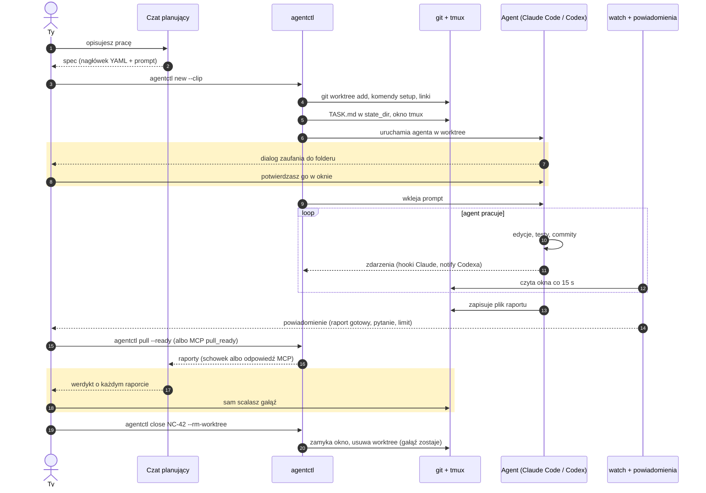
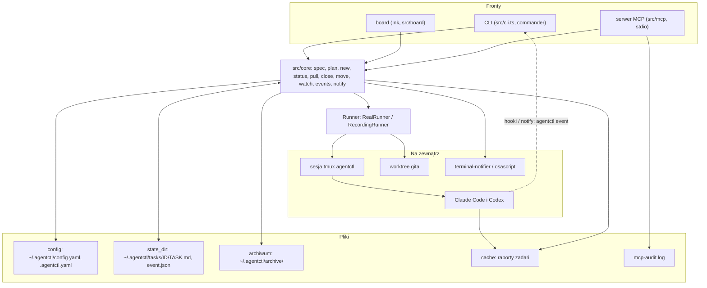
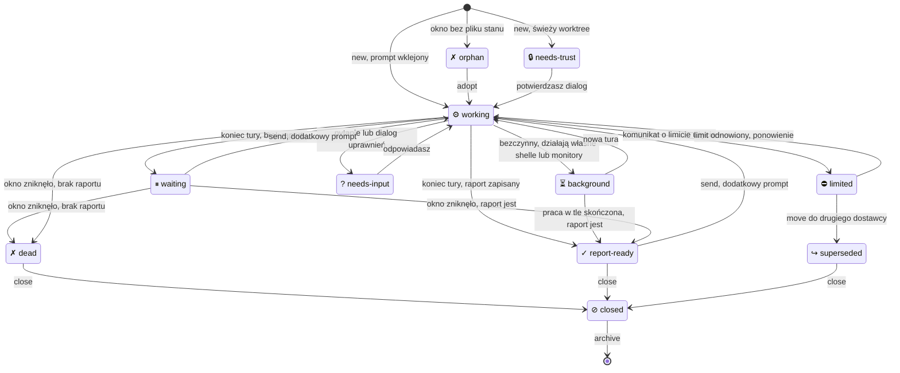

# agentctl

English: [README.md](README.md)

**agentctl zamienia plik spec w działającego agenta kodującego: worktree gita, okno tmux i prompt, a potem pilnuje go za Ciebie.** Rozdziela zlecenia do agentów CLI [Claude Code](https://docs.claude.com/en/docs/claude-code) i [Codex](https://github.com/openai/codex).

## Problem

Kilku agentów kodujących równolegle to dużo ręcznych kroków na każde zadanie: utworzyć worktree, zainstalować zależności, podłączyć symlinki i zmienne środowiskowe, otworzyć terminal, uruchomić właściwego agenta z właściwym modelem i effortem, wkleić prompt, a potem zaglądać do każdego okna, żeby zobaczyć, kto skończył, kto o coś pyta, a kto trafił na limit użycia. Menedżery okien pomagają z oknami. Nie wiedzą, czym jest zadanie.

agentctl zarządza **zleceniami, nie oknami**. Jednostką jest spec: plik Markdown z nagłówkiem YAML i promptem, który można przejrzeć, wersjonować i użyć ponownie. Reszta z niego wynika.

## Najważniejsze funkcje

- **Jeden spec, jedno polecenie.** `agentctl new` tworzy worktree gita, uruchamia komendy setup, robi symlinki, ustawia środowisko, otwiera okno tmux, uruchamia agenta i wkleja prompt.
- **Stany zadań.** `working`, `waiting`, `needs-input`, `needs-trust`, `limited`, `report-ready` i inne, z ekranu każdego okna oraz ze zdarzeń, które agenci wysyłają sami (hooki Claude, `notify` Codexa).
- **Powiadomienia.** Jedno powiadomienie na zmianę stanu; kliknięcie przełącza na okno zadania.
- **Board.** Pełnoekranowy przegląd wszystkich zadań z podglądem na żywo wybranego okna.
- **Raporty.** `agentctl pull --ready` zbiera nowe raporty w jeden tekst dla czatu planującego.
- **Zmiana dostawcy.** Tabela odpowiedników Claude i Codexa; `agentctl move` przekazuje zadanie, które trafiło na limit użycia, drugiemu dostawcy w tym samym worktree.
- **Integracja z czatem.** Lokalny serwer MCP pozwala czatowi w aplikacji Claude lub w Claude Code czytać status i raporty oraz, jeśli na to pozwolisz, wysyłać prompty i uruchamiać zadania.
- **Mały i przejrzysty.** TypeScript na Node bez kroku budowania, bez demona; `--dry-run` wypisuje każde polecenie zamiast je wykonać.

## Jak to działa



Żółte ramki to decyzje, które zostają przy człowieku: agentctl nigdy nie odpowiada na dialog zaufania, nie wydaje werdyktu i nie scala.

### Architektura

CLI, board i serwer MCP to cienkie fronty nad tym samym rdzeniem. Każdy efekt uboczny przechodzi przez `Runner`, który w `--dry-run` i w testach jest rejestratorem.



### Stany zadań

`status`, board i nazwy okien tmux pokazują jeden z tych stanów na zadanie. Żywe okno jest klasyfikowane z ekranu i ze zdarzeń agenta; zadanie bez okna jest `report-ready`, gdy jego raport istnieje, i `dead`, gdy nie istnieje.



| Stan | Ikona | Znaczenie |
|---|---|---|
| `working` | ⚙ | trwa tura |
| `background` | ⏳ | bezczynny, ale działają własne shelle lub monitory agenta; koniec tury nie jest ogłaszany |
| `waiting` | ⏸ | bezczynny przy prompcie, brak raportu |
| `needs-input` | ? | agent zadał pytanie lub prosi o zgodę |
| `needs-trust` | 🔒 | otwarty dialog zaufania do folderu; musi go potwierdzić człowiek |
| `limited` | ⛔ | limit użycia wyczerpany; `agentctl move` przekazuje zadanie |
| `report-ready` | ✓ | raport istnieje i jest nowszy niż start |
| `superseded` | ↪ | przeniesione do drugiego dostawcy; to stare okno |
| `dead` | ✗ | okno zniknęło i nie ma raportu |
| `orphan` | ✗ | okno sesji bez pliku stanu; zob. `agentctl adopt` |
| `closed` | ⊘ | uruchomiono `agentctl close`; widoczne tylko w `status --all` |

Te same diagramy z uwagami: [docs/diagrams.md](docs/diagrams.md) (po angielsku).

## Szybki start

Wymagania: **Node 22.6+**, **git**, **tmux 3.2+** i agenci, których używasz (`claude`, `codex`). Opcjonalnie [`terminal-notifier`](https://github.com/julienXX/terminal-notifier), żeby kliknięcie w powiadomienie przełączało na okno zadania.

```sh
git clone https://github.com/Setech-pl/agentctl.git
cd agentctl
bin/agentctl-update            # stabilna kopia w ~/Projects/agentctl-stable, npm ci, npm link, doctor
agentctl doctor                # tmux, node, git, claude, codex, gh, katalog cache, configi
```

`agentctl-update` utrzymuje odłączoną kopię repo do codziennej pracy, żeby niedokończona gałąź Twojego klonu nigdy nie była tym, co uruchamia globalne `agentctl`; po każdym wydaniu uruchom go ponownie. Szczegóły i opcje: [docs/details.md](docs/details.md#stable-install-and-updates) (po angielsku). Żeby tylko spróbować, wystarczy też `npm install && npm link` w klonie.

Kod działa bezpośrednio na wycinaniu typów przez Node (`node --experimental-strip-types`, ustawione w shebangu), więc nie ma czego budować, ale trzeba go instalować z klonu, nie z paczki z rejestru (Node nie wycina typów wewnątrz `node_modules`).

Pierwsze zadanie:

```sh
agentctl spec example > nc-42.md     # gotowy spec, zob. „Format specu”
$EDITOR nc-42.md                     # ścieżki, ID zadania, prompt
agentctl new --dry-run nc-42.md      # każde polecenie, które by wykonał; nic nie jest uruchamiane
agentctl new --clip                  # albo: spec ze schowka, podsumowanie, y/N
agentctl board --tmux                # przegląd w oknie „board” sesji agentctl
tmux attach -t agentctl              # patrzysz, jak agent pracuje; raz potwierdzasz jego dialog zaufania
agentctl pull --ready                # nowe raporty do schowka, oznaczone jako pobrane
agentctl close NC-42 --rm-worktree   # okno i worktree znikają; gałąź zostaje
```

## Codzienna pętla

```
czat daje spec -> agentctl new --clip -> agentctl watch powiadamia -> agentctl pull --ready -> wklejasz do czatu -> czat daje linię zamykającą
```

1. **Czat daje spec** jako dokładnie jeden blok kodu zaczynający się od `---`, żeby przycisk kopiowania skopiował spec i nic więcej.
2. **`agentctl new --clip`** czyta go ze schowka, wypisuje podsumowanie (zadanie, agent/model/effort, worktree, gałąź, setup, linki) i pyta `Start? [y/N]`. `-y` pomija pytanie. `agentctl send --clip` robi to samo dla dodatkowego promptu.
3. **`agentctl watch --tmux`** uruchamia obserwatora we własnym oknie tmux. Co 15 sekund ustala [stan](docs/details.md#task-states) każdego zadania i wysyła jedno powiadomienie na zmianę stanu. Przed nazwą każdego okna ustawia też ikonę stanu, a w pasku stanu tmux liczbę zadań.
4. **`agentctl pull --ready`** łączy każdy gotowy, jeszcze niepobrany raport w jeden tekst, każdy pod nagłówkiem `=== NC-42 (claude opus/high) ===`, kopiuje go i oznacza te zadania jako pobrane.
5. **Wklejasz go do czatu.** Czat ocenia raporty; agentctl nigdy nie wydaje werdyktów.
6. **Czat daje linię zamykającą**, na przykład `agentctl close NC-41 NC-42 --rm-worktree`. `close` wypisuje zadania (zaznaczając te bez raportu) i pyta y/N. Gałęzie zostają, nic nie jest scalane.

`agentctl status --clip` kopiuje zwartą tabelę Markdown wszystkich zadań, do wklejenia na początku nowego czatu. Z [serwerem MCP](#integracja-z-czatem-mcp) czat potrafi to wszystko przeczytać sam, bez schowka.

## Format specu

Spec to nagłówek YAML między liniami `---`, a po nim prompt. Kilka specyfikacji może następować po sobie w jednym pliku; każdy nagłówek zaczyna nowy spec.

```markdown
---
task: NC-42
agent: claude
model: opus
effort: high
repos:
  - path: ~/Projects/neon-city
    worktree: ~/Projects/wt/neon-city-nc-42
    base: master
    branch: nc-42-tram-bell
links:
  # Point the client's @neon-city/* packages at the backend worktree under test.
  - from: node_modules/@neon-city/*
    to: ~/Projects/wt/neon-city-backend-merge3/packages/*
env:
  NEON_CITY_TASK: NC-42
report: ~/Projects/cache/nc-42/NC-42.md
---
Add a bell sound to the tram when it leaves a stop.

- Reuse the existing audio bus; do not add new dependencies.
- Cover the new behaviour with a test.
- When you are done, write a short report (what changed, how you checked it,
  what is left) to ~/Projects/cache/nc-42/NC-42.md.
```

(Przykład jest po angielsku, bo to dokładnie to, co drukuje `agentctl spec example`; prompt możesz pisać w dowolnym języku.)

| Pole | Wymagane | Znaczenie |
|---|---|---|
| `task` | tak | ID zadania: wielkie litery, cyfry, `-`, `_`, zaczyna się od litery. Okno tmux ma ID małymi literami. |
| `agent` | tak (albo `defaults.agent`) | `claude` lub `codex`. |
| `model` | nie | Nazwa modelu przekazana agentowi; pominięta lub `default`: domyślny model agenta. |
| `effort` | nie | `low`, `medium`, `high` (domyślnie), `xhigh`, `max` (nie dla Codexa). |
| `repos[]` | tak | Co najmniej jeden `{path, worktree, base, branch}`. Agent startuje w pierwszym worktree. |
| `setup` | nie | Komendy shell uruchamiane w pierwszym worktree po `git worktree add` i przed linkami. |
| `links[]` | nie | Symlinki `{from, to}` w pierwszym worktree, np. żeby podłączyć klienta do testowanego backendu. |
| `env` | nie | Zmienne środowiskowe okna tmux. |
| `review_of` | nie | ID recenzowanego zadania; recenzent musi użyć innego agenta lub innego modelu niż autor. |
| `pin` | nie | `true`: nigdy nie przenoś zadania do drugiego dostawcy. |
| `report` | nie | Gdzie agent zapisuje raport (domyślnie `<cache>/<task>/<TASK>.md`). |

W ścieżkach działają placeholdery `{task}`, `{TASK}` i `{cache}`. Wszystkie klucze, typy i wartości domyślne: [docs/configuration.md](docs/configuration.md#spec-keys) (po angielsku). Błędy są zgłaszane wszystkie naraz, zwykłymi słowami, z podpowiedzią.

## Konfiguracja

Trzy warstwy, późniejsza wygrywa: globalny `~/.agentctl/config.yaml`, potem `.agentctl.yaml` w repo projektu (pierwsze repo specu), potem sam spec. `env` i `links` się łączą, a `setup`, `report`, `worktree_root` i `defaults` są nadpisywane. Nieznane klucze są błędem. `AGENTCTL_HOME` zastępuje `~/.agentctl`.

```yaml
# ~/.agentctl/config.yaml
cache: ~/Projects/cache        # jeden folder na zadanie na raporty; jedyne miejsce, gdzie piszą agenci
state_dir: ~/.agentctl/tasks   # własny stan agentctl na zadanie, poza zasięgiem agentów
session: agentctl              # nazwa sesji tmux
limits: {claude: 3, codex: 3}  # najwięcej jednoczesnych okien na dostawcę
defaults: {effort: high}       # agent, model, effort dla specyfikacji, które ich nie podają
equivalents: []                # dodatkowe pary Claude <-> Codex
notify: {backend: auto}        # auto, terminal-notifier lub osascript
mcp: {allow: []}               # narzędzia zapisu dozwolone dla czatu: send, new, interrupt, close, move
```

```yaml
# .agentctl.yaml w repo projektu
worktree_root: ~/Projects/wt   # worktree trafiają do <worktree_root>/<repo>-<task>
setup:
  - npm ci --prefer-offline --no-audit --no-fund
env:
  NEON_CITY_TASK: "{TASK}"
defaults: {agent: claude}
```

Każdy klucz z typem, wartością domyślną i znaczeniem: [docs/configuration.md](docs/configuration.md) (po angielsku).

## Board

`agentctl board` to pełnoekranowy przegląd wszystkich zadań, odświeżany co 2 sekundy. `agentctl board --tmux` otwiera go w oknie `board` sesji agentctl. Od 110 kolumn po prawej widać ostatnie linie wybranego okna; poniżej lista zajmuje całą szerokość.

```
agentctl board  agentctl-test · 3 tasks · 09:41:03
  TASK       AGENT              STATE          TIME    PROGRESS REPORT │ AC5-C · last 13 lines
  AC5-A      claude opus/high   ⏸ waiting      37s     2c 3f    -      │ bash-3.2$ claude --model sonnet --effort medium
  AC5-B      codex gpt-6.1-sol… ✓ report-ready 37s     1c 1f    ready  │ Claude Code (fake) --model sonnet --effort medium
▸ AC5-C      claude sonnet/med… ? needs-input  36s     2c 2f    -      │
                                                                       │ ● got: Model: sonnet · effort medium
                                                                       │
                                                                       │ ● working on: Third fake task that asks you something. W…
                                                                       │ ● Edited file-1.txt
                                                                       │ ● Edited file-0.txt
                                                                       │ ? Tea or coffee?
                                                                       │   1. Tea
                                                                       │   2. Coffee
                                                                       │   Enter to select · Esc to cancel
                                                                       │ ● you chose: tea please

Enter – open the agent · F12 – back to the list
↑↓ ⏎  m msg  M move  i int  c/r pull  x close  h hide  z done  a all  u/d/p  ?
```

| Klawisz | Działanie |
|---|---|
| `↑` `↓` (`k` `j`) | wybór zadania |
| `Enter` | przejście do okna zadania; **`F12`** wraca do boardu |
| `m` / `i` | wiadomość do agenta / przerwanie jego tury (po y/N) |
| `M` | przeniesienie zadania do drugiego dostawcy po limicie użycia (po y/N) |
| `c` / `r` | kopiuj wybrany raport / wszystkie nowe raporty |
| `x` | zamknij okno (po y/N; drugie pytanie o worktree) |
| `h` / `z` / `a` | ukryj zadanie / otwórz sekcję Finished / pokaż ukryte i zamknięte |
| `?` / `q` | pomoc / wyjście (agenci dalej działają) |

W sesji tmux agentctl włączona jest mysz (klik w nazwę okna w pasku stanu), a `F12` wraca do boardu z każdego okna. Żadna destrukcyjna akcja nie działa na pojedynczy klawisz. Więcej: [docs/details.md](docs/details.md#board) (po angielsku).

## Powiadomienia i zdarzenia

Czytanie ekranu co 15 sekund to zgadywanie, więc `agentctl new` prosi też każdego agenta, żeby zgłaszał się sam: Claude Code przez hooki (`Notification`, `Stop`, `StopFailure`), Codex przez komendę `notify`. `agentctl event` (nigdy nie wpisywane ręcznie) zapisuje wiadomość, od razu aktualizuje stan zadania i powiadamia. Obserwator zostaje jako rezerwa, a jedna zmiana stanu jest ogłaszana raz.

- Powiadomienia idą przez `terminal-notifier`, jeśli jest zainstalowany (kliknięcie uruchamia `agentctl attach <task> --switch-client` i wysuwa terminal na wierzch), w przeciwnym razie przez `osascript` (`notify-send` na Linuksie). Kanał wybiera `notify.backend`; `agentctl notify-test` mówi, którym kanałem poszła wiadomość testowa.
- Teksty: `NC-42: <pytanie>`, `NC-42: raport gotowy – <werdykt>` (werdykt to pierwsza sensowna linia raportu albo linia pasująca do `notify.verdict_pattern`), limit użycia, zadanie czekające dłużej niż 120 sekund, zniknięte okno. Teksty są na razie po polsku.
- Stany: [diagram wyżej](#stany-zadań). Szczegóły, tabele zdarzeń i to, co sprawdzono na Claude Code 2.1.309 i Codex 0.166.0: [docs/details.md](docs/details.md#events) (po angielsku).

## Odpowiedniki modeli i move

Modele Claude i Codexa nie odpowiadają sobie jeden do jednego, więc agentctl trzyma tabelę par, które uznajesz za równoważne (działa w obie strony), na przykład `opus/high` i `gpt-6-astra/medium`. Własne pary dodajesz w `equivalents:`; mają pierwszeństwo przed wbudowanymi. Fable i effort `max` są celowo niemapowane.

- `agentctl new --agent codex spec.md` uruchamia specyfikacje na Codexie przez tabelę.
- Gdy limit okien wskazanego dostawcy jest pełny, a drugi ma miejsce, `new` pyta przed zmianą. Nigdy nie zmienia po cichu; `pin: true` to zakazuje.
- `agentctl move NC-42` przekazuje zadanie, które trafiło na limit użycia, drugiemu dostawcy: nowe okno `nc-42-2` w tym samym worktree, z oryginalnym promptem i notatką, żeby kontynuować na podstawie `git log` i `git diff`. Stare okno zostaje jako `superseded` i zamykasz je sam.

Wbudowana tabela i zasady limitów: [docs/details.md](docs/details.md#model-equivalents) (po angielsku).

## Integracja z czatem (MCP)

`agentctl mcp` to lokalny serwer MCP na stdio. Aplikacja Claude, Claude Code i VS Code uruchamiają go same; nic nie nasłuchuje na porcie.

- **Narzędzia odczytu** (zawsze włączone): `status`, `peek`, `list_reports`, `get_report`, `pull_ready`, `task_spec`.
- **Narzędzia zapisu** (wyłączone, dopóki nie wpiszesz ich w `mcp.allow`): `send`, `new`, `interrupt`, `close`, `move`. `new` i `move` nic nie zmieniają, dopóki nie zostaną wywołane ponownie z `confirm: true`. Każdy zapis trafia do audytu w `~/.agentctl/mcp-audit.log` i jest ogłaszany na pulpicie.
- Żadne narzędzie nie scala, nie pushuje, nie robi rebase, nie usuwa gałęzi, nie uruchamia komend shell i nie przyjmuje ścieżki.

```sh
agentctl mcp install --desktop --dry-run   # aplikacja Claude: wpis i diff, nic nie jest zapisywane
agentctl mcp install --claude-code         # Claude Code i rozszerzenie VS Code
```

Sprawdzone: narzędzia odczytu działają w czatach Projektu w aplikacji Claude na macOS. Wszystko o instalacji, narzędziach, bezpieczeństwie i ograniczeniach: [docs/mcp.md](docs/mcp.md) (po angielsku).

## Dlaczego nie Orca / Claude Squad / Conductor?

Orca, Claude Squad i Conductor dobrze *zarządzają oknami agentów*: otwierają sesje, pokazują je obok siebie, przełączają między nimi. Jeśli tego potrzebujesz, używaj ich. agentctl nie próbuje zastąpić menedżera okien (do tego używa tmux); zarządza **zleceniami**, a spec niesie rzeczy, o których menedżer okien nie wie:

- **Symlinki**: worktree podłączony do pakietów innego worktree.
- **Env i setup**: zmienne i komendy instalacji per zadanie, warstwowo globalnie, w projekcie i w specu.
- **Flagi agenta**: model, effort i Twoje domyślne flagi per agent, ze strażnikiem przed auto-accept.
- **Reguła wzajemnej recenzji**: `review_of` nie pozwala temu samemu agentowi i modelowi oceniać własnej pracy.
- **Limity okien per dostawca**, z błędem wymieniającym, kto je zajmuje.
- **Ślad na papierze**: `TASK.md` w folderze stanu zapisuje spec, czas startu i każdy dodatkowy prompt.

## Model bezpieczeństwa

Czego agentctl nigdy nie robi:

- **Żadnego merge, rebase ani push.** `git` jest wołany tylko z `worktree add`, `worktree remove` i zapytaniami tylko do odczytu. Bez `--force`, bez usuwania gałęzi; worktree z wyciągniętym `main` lub `master` nigdy nie jest usuwany.
- **Żadnego auto-accept.** Nie dodaje takiej flagi, a config, który próbuje (`--dangerously-skip-permissions`, `--yolo`, `--full-auto`, `-a never`, …), jest nieprawidłowy. Agent dalej pyta Cię o zgodę. Codex działa z `--sandbox danger-full-access`, jak zlecono, ale z nietkniętą polityką zatwierdzeń.
- **Nigdy nie odpowiada na dialog za Ciebie.** Dialog zaufania do folderu w świeżym worktree potwierdza człowiek; `new` na to czeka.
- **Żadnych werdyktów.** Ocena raportu należy do Ciebie (albo Twojego czatu).
- **Mały ślad.** Pliki trafiają tylko do folderu stanu i folderu cache, nigdy do `~/.claude` ani `/tmp`. Czat może tylko to, co wymienia `mcp.allow`.

## Ograniczenia

- **Instalacja z klonu.** Node nie wycina typów w `node_modules`, więc instalacja z rejestru by nie działała; krok budowania jest planowany na wydanie npm.
- **Wzorce ekranu to heurystyki** związane z brzmieniem obecnych TUI Claude Code (2.1.309) i Codexa (0.166.0); są konfigurowalne.
- **Niezaobserwowane na prawdziwym ekranie:** tekst komunikatu o limicie użycia w którymkolwiek TUI (wzorce pochodzą z napisów w plikach binarnych, żeby nie spalać planu) oraz tekst stopki Codexa przy oczekiwaniu na terminale w tle (`agents.codex.background_patterns` to najlepsze przypuszczenie).
- Codex 0.166.0 nie wysyła zdarzenia przy prośbie o zatwierdzenie, więc takie sytuacje wykrywa czytnik ekranu, i tylko gdy działa `watch`.
- Limity okien liczą tylko okna utworzone przez agentctl.
- `move` zaczyna nową rozmowę: nowy agent poznaje stan z `git log` i `git diff`, nie z kontekstu starego agenta.
- `close --rm-worktree` najpierw zabija okno; worktree z niezatwierdzonymi plikami jest potem odrzucany (bez `--force`).
- Serwer MCP jest lokalny i działa jako Ty. To decyzja zaufania wobec czatu, nie piaskownica.
- Testowane na macOS; Linux jest obsługiwany dla schowka i `notify-send`, ale rzadziej używany.

## Plan rozwoju

Pomysły, nie obietnice:

1. **Kolejka:** zadania czekające na wolne okno swojego dostawcy.
2. **Historia, `gc` i `resume`:** lista zakończonej pracy, sprzątanie starych worktree i stanu, wznawianie zadania.
3. **Powiadomienia na telefon.**
4. **Zdalny MCP:** serwer dostępny dla czatu w przeglądarce lub na telefonie, z uwierzytelnianiem.
5. **Modele lokalne** jako trzeci rodzaj agenta.
6. **Wydanie npm** z krokiem budowania.

## Więcej

Dokumentacja szczegółowa jest po angielsku:

- [docs/commands.md](docs/commands.md): każde polecenie i opcja, generowane z kodu.
- [docs/configuration.md](docs/configuration.md): każdy klucz configu i specu.
- [docs/mcp.md](docs/mcp.md): serwer MCP.
- [docs/diagrams.md](docs/diagrams.md): przepływ, architektura, stany zadań.
- [docs/details.md](docs/details.md): jak działają poszczególne elementy i co sprawdzono na żywo.
- [CHANGELOG.md](CHANGELOG.md), [CONTRIBUTING.md](CONTRIBUTING.md).

## Licencja

[MIT](LICENSE)
