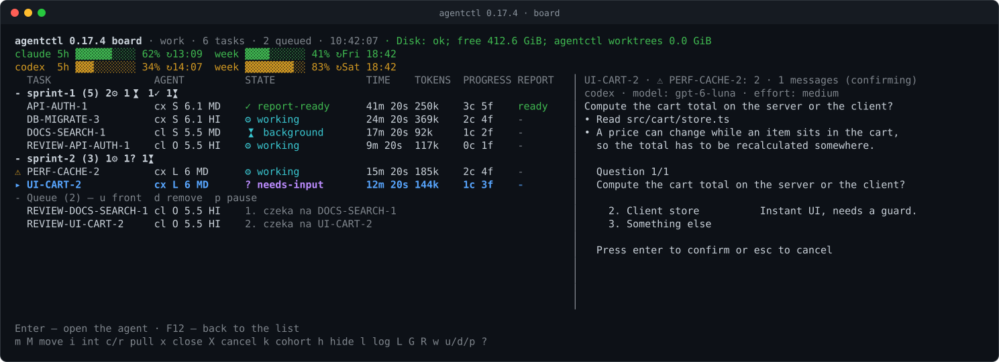
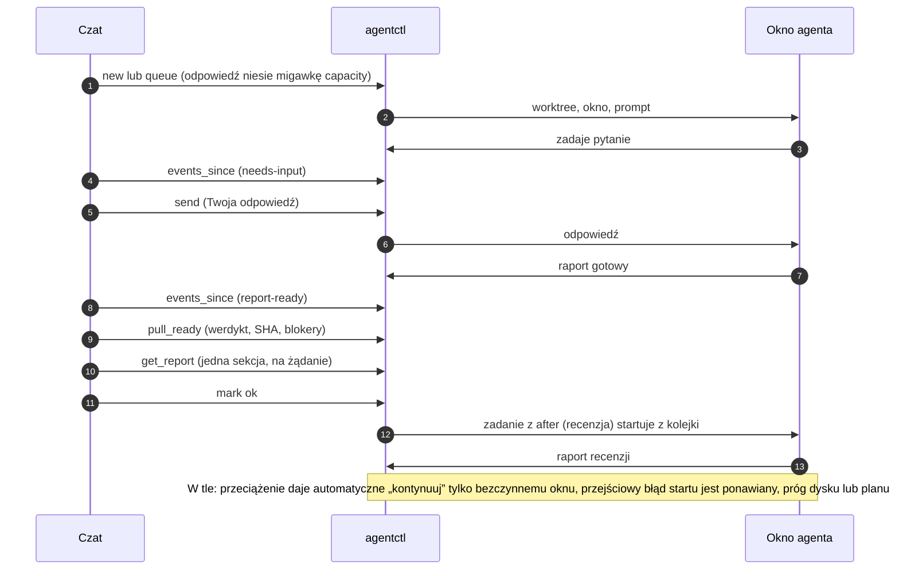
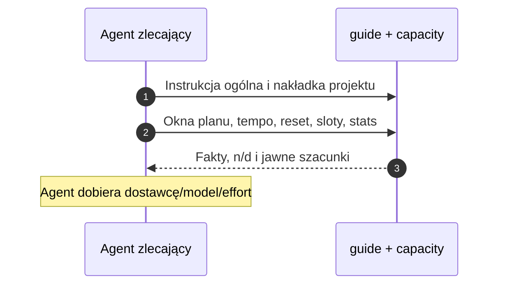
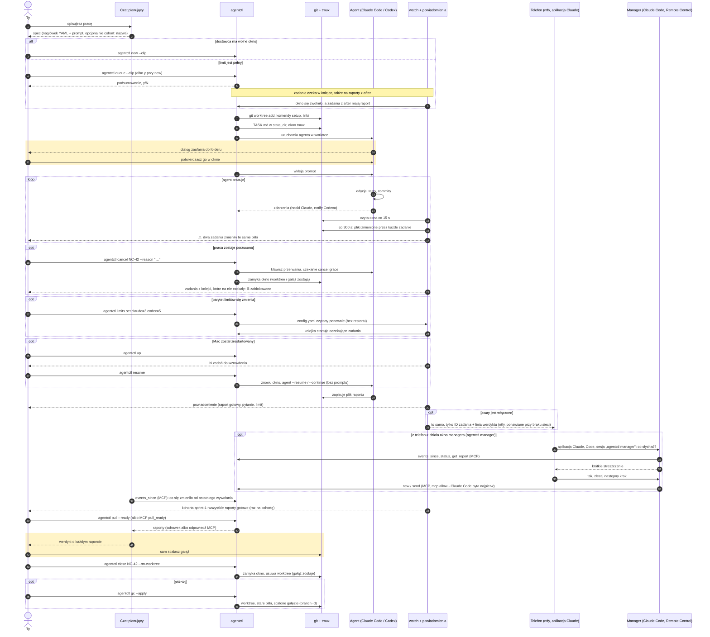
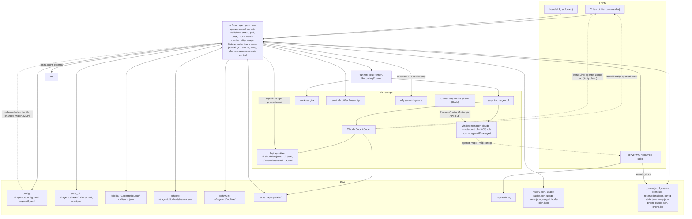
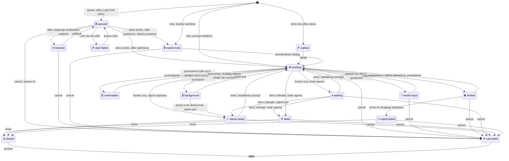

# agentctl

English: [README.md](README.md)

**Jeden czat zleca i nadzoruje pracę wielu agentów CLI – dziś Claude Code i Codexa, w następnym wydaniu także Google Gemini (Antigravity CLI) – z jednej kolejki i według tych samych zasad.**

agentctl zamienia krótki opis zadania w gitowy worktree, okno tmux i działającego agenta z wybranym przez Ciebie modelem i poziomem rozumowania. Pilnuje każdego agenta, informuje, gdy któryś zada pytanie lub skończy, i oddaje raporty Twojemu czatowi. Decyzja i scalanie zostają po Twojej stronie.



*Board sesji demo na atrapach agentów: dwie kohorty, pytanie czekające na Ciebie, gotowy raport, łańcuch recenzji w kolejce, ostrzeżenie o kolizji (⚠) i zużycie planów obu dostawców. Generuje go `npm run docs:screenshot`; część napisów produktu (np. „czeka na”) jest dziś po polsku.*

## Dlaczego agentctl

- **Jeden czat, wielu wykonawców.** Planujesz w czacie ([serwer MCP](docs/mcp.md) albo schowek), a zadania trafiają do Claude Code i Codexa – Gemini dojdzie wkrótce – każde z modelem i poziomem rozumowania wybranym osobno.
- **Więcej pojemności.** Każdy plan ma własne limity. agentctl pokazuje oba plany z czasem resetu i wolne sloty okien, `capacity` podaje wiek każdego odczytu, praca czeka w [kolejce](#kolejka) zamiast przekraczać limit, a `agentctl move` przekazuje zadanie, które wyczerpało limit, drugiemu dostawcy ([zużycie i limity](docs/details.pl.md#użycie-i-limity)).
- **Mniej tokenów w czacie.** Odpowiedzi MCP są domyślnie zwięzłe, a raporty przychodzą jako streszczenia – sekcje i pełny tekst na żądanie. Na zestawie atrap (sześć raportów po ok. 20 KB, `pull_ready` z `all: true`, 0.17.1 kontra 0.17.2) odpowiedź skurczyła się ze 120 762 do 1 522 bajtów – to pomiar na atrapach, nie obietnica dla Twojej pracy. `defaults.effort` ustawia effort raz, a `peek` pokazuje okno bez wklejania logów do czatu.
- **Statystyki.** Tokeny na zadanie, kohortę, model i effort pochodzą z logów samych agentów. Twoja ocena `mark` (ok / partial / fail) i linia werdyktu z raportu agenta dają skuteczność per model × effort, więc widać, który model opłaca się do jakiej pracy ([historia i statystyki](#historia-i-statystyki)).
- **Recenzja innym modelem i kolejka z zależnościami.** `review_of` nie pozwala, by ten sam agent i model oceniał własną pracę, a `after` trzyma zadanie w kolejce, dopóki nie powstanie raport, od którego zależy – recenzja startuje więc sama po raporcie autora ([kolejka](#kolejka), [zależności](#zależności)).
- **Nadzór bez pilnowania.** Board i powiadomienia (Mac oraz telefon przez ntfy) mówią o pytaniach, oknach zaufania, przeciążeniach, limitach, kolizjach i wolnym miejscu na dysku. Po przeciążeniu dostawcy agentctl wysyła „kontynuuj” – tylko do bezczynnego okna z pustym promptem i kilka razy – a przejściowy błąd startu ponawia po 1, 5 i 15 minutach.
- **Bezpieczeństwo z założenia.** Osobny git worktree na zadanie. agentctl nigdy nie scala, nie pushuje, nie używa `--force` i nie akceptuje za Ciebie zgód ani okien zaufania ([model bezpieczeństwa](#model-bezpieczeństwa)).
- **Otwarte i lokalne.** Licencja MIT, działa na Twoim Macu, nie ma własnego serwera; serwer MCP to lokalny proces uruchomiony jako Ty.

## Automatyczny przepływ

Czat rozmawia z agentctl, agentctl z agentami. Między Twoimi odpowiedziami większość dzieje się sama:



Co widzi czat w sesji demo ze zrzutu (wyjście narzędzi jest dziś po polsku). `events_since` po pracy agentów:

```text
Zdarzenia z ostatnich 1d: 7
10:37  UŻYCIE  codex week: usage crossed 80% (83%)
10:38  WYNIKI RAPORTU  API-AUTH-1  API-AUTH-1: 1 decisions, 0 actions
10:39  RAPORT  API-AUTH-1  Verdict: PASS – refresh rotates the session id, logout revokes the whole token family.
10:40  PYTANIE  UI-CART-2  UI-CART-2: Compute the cart total on the server or the client?
10:41  WYNIKI RAPORTU  DOCS-SEARCH-1  DOCS-SEARCH-1: 0 decisions, 0 actions
10:42  RAPORT  DOCS-SEARCH-1  Verdict: PASS – search guide and API reference written, the index rebuild finished.
10:43  START  REVIEW-DOCS-SEARCH-1  Uruchomiono REVIEW-DOCS-SEARCH-1 z kolejki (claude)
Teraz: 7 aktywne (3 pracuje) · 1 w kolejce · 2 raporty do pobrania (API-AUTH-1, DOCS-SEARCH-1) · 2 zadań bez oceny · czeka na Ciebie: REVIEW-DOCS-SEARCH-1 (waiting), UI-CART-2 (needs-input): Compute the cart total on the server or the client?, API-AUTH-1: decision: Choose the rollout window.
has_more: false; next_cursor: e2:7:0
```

`pull_ready` w domyślnym trybie streszczeń, z jedynym gotowym raportem:

```text
1 report summary delivered (full reports not marked as pulled): API-AUTH-1. Omitted (remain new): none.

=== API-AUTH-1 ===
attempt: 3f9c2a7e-51d4-4b86-9e0a-7c1d6b2f8a45
path: /home/demo/agentctl/cache/api-auth-1/API-AUTH-1.md
bytes: 965
{"outputs":{"version":1,"verdict":"PASS","commits":[{"repo":"shop","branch":"agent/api-auth-1","sha":"41c39c35c2118f44d822a4be08d5c20aa2f7c153"}],"integrate":[{"repo":"shop","branch":"agent/api-auth-1","sha":"41c39c35c2118f44d822a4be08d5c20aa2f7c153","note":"ready for human integration"}],"decisions":["Choose the rollout window"],"actions":[],"checks":[{"name":"auth tests","result":"PASS","note":"18 passed"}],"notes":[]},"outputs_valid":true,"outputs_errors":[]}
sha: 41c39c35c2118f44d822a4be08d5c20aa2f7c153
truncated: false
Verdict: PASS – refresh rotates the session id, logout revokes the whole token family.

- Branch: agent/api-auth-1
- SHA: 41c39c35c2118f44d822a4be08d5c20aa2f7c153
- Tests: 18 passed, 0 failed

## Summary

Refresh tokens are single-use and belong to a family (`src/auth/token.ts`). The session id rotates on every refresh (`src/auth/session.ts`) and a revoked family answers 401 (`src/auth/middleware.ts`).

## Blockers

None.

## Decisions

- Revoking one token revokes its whole family: a replayed refresh token is treated as theft.

## Open points

None.

```agentctl-outputs
version: 1
verdict: PASS
commits: [{repo: shop, branch: agent/api-auth-1, sha: 41c39c35c2118f44d822a4be08d5c20aa2f7c153}]
integrate: [{repo: shop, branch: agent/api-auth-1, sha: 41c39c35c2118f44d822a4be08d5c20aa2f7c153, note: ready for human integration}]
decisions: [Choose the rollout window]
actions: []
checks: [{name: auth tests, result: PASS, note: 18 passed}]
notes: []
```

<!-- agentctl:report-end -->

next_cursor: 8b1e4d93-0a7c-42f5-b6d8-2e9f1c3a7d60:1; has_more: false
```

## Jak to działa

1. Przygotuj spec (albo poproś o niego czat planujący): zadanie, agenta, model, effort, repozytoria i ścieżkę raportu.
2. `agentctl new` tworzy worktree, otwiera okno tmux i uruchamia agenta w ramach limitu dostawcy albo umieszcza zadanie w kolejce do zwolnienia miejsca.
3. Obserwuj i decyduj: board i powiadomienia informują o pytaniach i zakończeniu pracy; `pull` pobiera raport, a Ty go sprawdzasz, scalasz i zamykasz zadanie.

Planujesz w czacie Claude? [Wbudowany serwer MCP](docs/mcp.md) pozwala mu odczytywać użycie planu i pobierać raporty, a także zlecać zadania, jeśli przyznano dostęp do operacji zapisu. Możesz też używać [schowka](#codzienna-pętla) bez MCP.

## Dla agenta zlecającego

Zacznij w dowolnym projekcie od `agentctl guide --project /sciezka/do/repo --lang pl --clip` i `agentctl capacity --clip` albo narzędzi MCP `guide` i `capacity` (odczyt bez mcp.allow). Wspólny [podręcznik dyspozytora](docs/dispatcher.pl.md) opisuje specy, dobór dostawcy/modelu/effortu, przegląd krzyżowy, kohorty, kolejkę oraz pętlę `events_since` → `pull_ready` → `get_report`.

Capacity pokazuje okna planu, wiek, tempo, reset, sloty, kolejkę, równoważniki i stats z 7 dni. Brak danych to n/d; szacunki tokenów mają podstawę i pewność. Procent obejmuje pracę poza agentctl. New i queue dodają krótką migawkę (`capacity.snapshot: false` ją wyłącza). Narzędzie podaje fakty; zlecający wybiera. `guide: docs/agent-dispatch.md` w `.agentctl.yaml` dołącza zasady projektu, brak pliku ostrzega także w doctor. Globalne `guide: {lang: pl}` ustala język.

Na boardzie `C` otwiera capacity. `agentctl up --no-attach` nie podłącza terminala. Restart po stabilnej roli: `agentctl watch --tmux --restart` / `agentctl board --tmux --restart`, także po zmianie nazwy okna. `agentctl version` działa jak `--version`.



## W codziennym użyciu

<!-- Numbers from agentctl stats on the author's machine – verify before publishing -->
agentctl powstał i jest używany przy prawdziwym projekcie: codziennie równolegle działają kohorty zadań Claude Code i Codexa, a przed scaleniem każdy wynik przechodzi recenzję innym modelem.

## Stany zadań

Board pokazuje m.in. stany `needs-attention`, `overloaded`, `working`, `waiting`, `needs-input`, `needs-trust`, `limited`, `report-ready`, `background`, `queued`, `blocked`, `dead`, `orphan`, `closed`, `cancelled`, `superseded` i `start-failed`. `report-candidate` to osobna flaga raportu, bez zmiany stanu. Szczegóły opisuje [dokumentacja stanów zadań](docs/details.pl.md#stany-zadań).

### Architektura i przebieg pracy







## Szybki start

Wymagania: **Node 22.14+**, **git**, **tmux 3.2+** i agenci, których używasz (`claude`, `codex`). Opcjonalnie [`terminal-notifier`](https://github.com/julienXX/terminal-notifier), żeby kliknięcie w powiadomienie przełączało na okno zadania.

### npm (zalecane)

```sh
npm i -g @setech-pl/agentctl
agentctl --version
agentctl doctor
```

Nie mylić z **@orgloop/agentctl**, które również instaluje polecenie `agentctl`.
Sprawdź `command -v agentctl`; `doctor` ostrzega, gdy PATH prowadzi do innej instalacji.
Aktualizacja: `npm i -g @setech-pl/agentctl@latest` albo `agentctl-update`.
Aktualizacja npm nie restartuje watcherów ani serwerów MCP; po aktualizacji uruchom te procesy ponownie.

Runtime: macOS i Linux z git i tmux 3.2+. Powiadomienia macOS korzystają z terminal-notifier lub osascript;
Linux z notify-send (bez obsługi kliknięcia). ntfy działa na obu systemach. Integracja Claude Desktop jest tylko na macOS.
Windows nie jest wspierany (użyj środowiska Linux w WSL). CI sprawdza obecnie macOS; Linux nie został lokalnie zweryfikowany.

### Klon (rozwój)

```sh
git clone https://github.com/Setech-pl/agentctl.git
cd agentctl
bin/agentctl-update            # stabilna kopia w ~/workspace/agentctl-stable, npm ci, npm run build, npm link, doctor
agentctl doctor                # tmux, node, git, claude, codex, gh, katalog cache, configi
```

`agentctl-update` utrzymuje odłączoną kopię repo do codziennej pracy, żeby niedokończona gałąź Twojego klonu nigdy nie była tym, co uruchamia globalne `agentctl`; po każdym wydaniu uruchom go ponownie. Szczegóły i opcje: [docs/details.pl.md](docs/details.pl.md#stabilna-instalacja-i-aktualizacje). Link deweloperski: `npm ci && npm run build && npm link` w klonie. Po zmianach źródeł ponów build.

Paczka npm uruchamia skompilowany JavaScript z `dist/`. Rozwój i testy mogą uruchamiać źródła TypeScript bezpośrednio przez wycinanie typów w Node.

Pierwsze zadanie:

```sh
agentctl spec example > nc-42.md     # gotowy spec, zob. „Format specu”
$EDITOR nc-42.md                     # ścieżki, ID zadania, prompt
agentctl new --dry-run nc-42.md      # każde polecenie, które by wykonał; nic nie jest uruchamiane
agentctl new --clip                  # albo: spec ze schowka, podsumowanie, y/N
agentctl board --tmux                # przegląd w oknie „board” sesji agentctl
tmux attach -t agentctl              # patrzysz, jak agent pracuje; raz potwierdzasz jego dialog zaufania
agentctl pull --ready                # nowe raporty do schowka, oznaczone jako pobrane
agentctl close NC-42 --rm-worktree   # okno i worktree znikają; gałąź zostaje
```

## Codzienna pętla

```
czat daje spec -> agentctl new --clip -> agentctl watch powiadamia -> agentctl pull --ready -> wklejasz do czatu -> czat daje linię zamykającą
```

1. **Czat daje spec** jako dokładnie jeden blok kodu zaczynający się od `---`, żeby przycisk kopiowania skopiował spec i nic więcej.
2. **`agentctl new --clip`** czyta go ze schowka, wypisuje podsumowanie (zadanie, agent/model/effort, worktree, gałąź, setup, linki) i pyta `Start? [y/N]`. `-y` pomija pytanie. `agentctl send --clip` robi to samo dla dodatkowego promptu.
3. **`agentctl watch --tmux`** uruchamia obserwatora we własnym oknie tmux. Co 15 sekund ustala [stan](docs/details.pl.md#stany-zadań) każdego zadania i wysyła jedno powiadomienie na zmianę stanu. Przed nazwą każdego okna ustawia też ikonę stanu, a w pasku stanu tmux liczbę zadań.
4. **`agentctl pull --ready`** łączy każdy gotowy, jeszcze niepobrany raport w jeden tekst, każdy pod nagłówkiem `=== NC-42 (claude opus/high) ===`, kopiuje go i oznacza te zadania jako pobrane.
5. **Wklejasz go do czatu.** Czat ocenia raporty; agentctl nigdy nie wydaje werdyktów.
6. **Czat daje linię zamykającą**, na przykład `agentctl close NC-41 NC-42 --rm-worktree`. `close` wypisuje zadania (zaznaczając te bez raportu) i pyta y/N. Gałęzie zostają, nic nie jest scalane.

Rano **`agentctl up`** uruchamia watcher i board, jeśli nie działają, mówi, które zadania [wznowić](#wznawianie) po restarcie, i otwiera board. `agentctl status --clip` kopiuje zwartą tabelę Markdown wszystkich zadań, do wklejenia na początku nowego czatu. Z [serwerem MCP](#integracja-z-czatem-mcp) czat potrafi to wszystko przeczytać sam, bez schowka.

## Format specu

Spec to nagłówek YAML między liniami `---`, a po nim prompt. Kilka specyfikacji może następować po sobie w jednym pliku; każdy nagłówek zaczyna nowy spec.

```markdown
---
task: TASK-42
agent: claude
model: opus
effort: high
repos:
  - path: ~/src/sample-app
    worktree: ~/worktrees/sample-app-task-42
    base: main
    branch: task-42-notification-sound
links: []
env:
  APP_TASK: TASK-42
report: ~/reports/task-42/TASK-42.md
---
Play a notification sound when a background task finishes.

- Reuse the existing audio bus; do not add new dependencies.
- Cover the new behaviour with a test.
- When you are done, write a short report (what changed, how you checked it,
  what is left) to ~/reports/task-42/TASK-42.md.
```

(Przykład jest po angielsku, bo to dokładnie to, co drukuje `agentctl spec example`; prompt możesz pisać w dowolnym języku.)

| Pole | Wymagane | Znaczenie |
|---|---|---|
| `task` | tak | ID zadania: wielkie litery, cyfry, `-`, `_`, zaczyna się od litery. Okno tmux ma ID małymi literami. |
| `agent` | tak (albo `defaults.agent`) | `claude` lub `codex`. |
| `model` | nie | Nazwa modelu przekazana agentowi; pominięta lub `default`: domyślny model agenta. |
| `effort` | nie | `low`, `medium`, `high` (domyślnie), `xhigh`, `max` (nie dla Codexa). |
| `repos[]` | tak | Co najmniej jeden `{path, worktree, base, branch}`. Agent startuje w pierwszym worktree. |
| `setup` | nie | Komendy shell uruchamiane w pierwszym worktree po `git worktree add` i przed linkami. Każdy wpis `repos[]` może mieć własne `setup` (w worktree tego repo), a setup z `.agentctl.yaml` repozytorium też działa w jego worktree; z czatu niedozwolone. |
| `links[]` | nie | Symlinki `{from, to}` w pierwszym worktree, np. żeby podłączyć klienta do testowanego backendu. |
| `env` | nie | Zmienne środowiskowe okna tmux. |
| `review_of` | nie | ID recenzowanego zadania; recenzent musi użyć innego agenta lub innego modelu niż autor. |
| `pin` | nie | `true`: nigdy nie przenoś zadania do drugiego dostawcy. |
| `priority` | nie | `high` albo `normal` (domyślnie): kolejność w kolejce. |
| `after` | nie | ID zadania lub lista: zadanie z kolejki startuje dopiero, gdy każde ma raport. |
| `touches` | nie | Globy plików, które zadanie zmieni: ostrzeżenie, gdy aktywne zadanie już je zmienia. |
| `cohort` | nie | Nazwa grupy, do której należy zadanie (`--cohort` przy `new` i `queue` ją nadpisuje). Bez niej zadanie nie należy do żadnej kohorty. |
| `report` | nie | Gdzie agent zapisuje raport (domyślnie `<cache>/<task>/<TASK>.md`). |

W ścieżkach działają placeholdery `{task}`, `{TASK}` i `{cache}`. Wszystkie klucze, typy i wartości domyślne: [docs/configuration.md](docs/configuration.md#spec-keys) (po angielsku). Błędy są zgłaszane wszystkie naraz, zwykłymi słowami, z podpowiedzią.

## Konfiguracja

Trzy warstwy, późniejsza wygrywa: globalny `~/.agentctl/config.yaml`, potem `.agentctl.yaml` w repo projektu (pierwsze repo specu), potem sam spec. `env` i `links` się łączą, a `setup`, `report`, `worktree_root` i `defaults` są nadpisywane. Nieznane klucze są błędem. `AGENTCTL_HOME` zastępuje `~/.agentctl`.

```yaml
# ~/.agentctl/config.yaml
cache: ~/workspace/cache        # jeden folder na zadanie na raporty; jedyne miejsce, gdzie piszą agenci
state_dir: ~/.agentctl/tasks   # własny stan agentctl na zadanie, poza zasięgiem agentów
session: agentctl              # nazwa sesji tmux
limits: {claude: 3, codex: 3}  # najwięcej jednoczesnych okien na dostawcę
defaults: {effort: high}       # agent, model, effort dla specyfikacji, które ich nie podają
equivalents: []                # dodatkowe pary Claude <-> Codex
notify: {backend: auto}        # auto, terminal-notifier lub osascript
mcp: {allow: []}               # narzędzia zapisu dozwolone dla czatu: send, new, interrupt, close, move
```

```yaml
# .agentctl.yaml w repo projektu
worktree_root: ~/workspace/wt   # worktree trafiają do <worktree_root>/<repo>-<task>
setup:
  - npm ci --prefer-offline --no-audit --no-fund
env:
  APP_TASK: "{TASK}"
defaults: {agent: claude}
```

Każdy klucz z typem, wartością domyślną i znaczeniem: [docs/configuration.md](docs/configuration.md) (po angielsku).

## Board

`agentctl board` to pełnoekranowy przegląd wszystkich zadań, odświeżany co 2 sekundy. `agentctl board --tmux` otwiera go w oknie `board` sesji agentctl. Od 110 kolumn po prawej widać ostatnie linie wybranego okna; poniżej lista zajmuje całą szerokość.

```text
agentctl 0.17.2 board · agentctl-test · 2 tasks · 06:54:51 · Disk: ok; free 307.4 GiB; agentctl worktrees 0.0 GiB
  TASK                 AGENT          STATE               TIME    TOKENS  PROGRESS REPORT   │ NEON-BACKEND-TASK-12 · last 1 lines
▸ NEON-BACKEND-TASK-12 cx S 6.1 XH    ⚙ working           1m 00s  n/d     -        -        │ codex · model: gpt-6.1-sol · effort: xhigh
  NEON-CITY-REVIEW-12  cl O 5.5 HI    ⚙ working           1m 00s  n/d     -        -        │ Working (esc to interrupt)
```

Kolumna AGENT używa `cl` (Claude) / `cx` (Codex), inicjału rodziny modelu, znanej wersji i dwuliterowego effortu. `cx S 6.1 XH` oznacza codex / gpt-6.1-sol / xhigh. Wersja aliasu pochodzi najpierw z modelu zaobserwowanego w sesji tej samej rodziny, następnie z `board.model_versions`; nieznana wersja jest pomijana. `default`/brak modelu i brak effortu dają `–`. Podgląd wybranego zadania i pomoc `?` zachowują pełne nazwy modelu i effortu.

Od 140 kolumn terminala lista dostaje co najmniej 92 kolumny, a następnie około 45% szerokości. Mieszczą się typowe 20-znakowe ID oraz kolumny modelu, stanu, czasu, postępu i raportu. Podgląd zachowuje co najmniej 32 kolumny. Węższe terminale zachowują poprzedni podział. Można go nadpisać przez `board.list_width: 100` lub `board.list_width: "55%"`; zobacz [konfigurację](docs/configuration.md).

| Effort | Skrót |
|---|---|
| minimal | MN |
| low | LO |
| medium | MD |
| high | HI |
| xhigh | XH |
| max | MX |
| none | NO |


| Klawisz | Działanie |
|---|---|
| `↑` `↓` (`j`) | wybór zadania |
| `Enter` | przejście do okna zadania; **`F12`** wraca do boardu |
| `m` / `i` | wiadomość do agenta / przerwanie jego tury (po y/N) |
| `M` | przeniesienie zadania do drugiego dostawcy po limicie użycia (po y/N) |
| `c` / `r` | kopiuj wybrany raport / wszystkie nowe raporty |
| `x` | zamknij okno (po y/N; drugie pytanie o worktree) |
| `X` | anuluj zadanie: opcjonalny powód, potem y/N; zadanie z kolejki wychodzi z kolejki, `move` jest anulowany razem z drugą połową |
| `k` | wybierz kohortę do pokazania (`wszystkie`, kohorta, `bez kohorty`) |
| `g` / `E` | zwiń grupę kohorty wybranego zadania / rozwiń wszystkie grupy |
| `L` | limity per dostawca i co je zajmuje (`agentctl limits`) |
| `G` | podgląd sprzątania (`agentctl gc`; board niczego nie usuwa) |
| `R` | wznów zadania z sekcji „Do wznowienia” (po y/N) |
| `l` | log zadań (historia; `↑↓` przewijanie, `Esc` powrót) |
| `o` / `p` / `f` | oznacz zaznaczone zakończone zadanie jako ok / partial / fail (`p` wstrzymuje kolejkę, gdy nie zaznaczono zakończonego zadania) |
| `h` / `z` / `a` | ukryj zadanie / otwórz sekcję Finished / pokaż ukryte, zamknięte i anulowane |
| `?` / `q` | pomoc / wyjście (agenci dalej działają) |

Pod linią tytułu panel pokazuje plan każdego dostawcy (pasek, procent i reset; n/d, gdy nieznany), a kolumna TOKENS tokeny każdego zadania.

Gdy są kohorty, lista jest pogrupowana pod zwijanymi nagłówkami z licznikami stanów (`- sprint-1 (4) 2⚙ 1✓ 1⧗`), zadania bez kohorty na końcu pod `bez kohorty`. Pasek tmux dalej liczy wszystkie zadania.

W sesji tmux agentctl włączona jest mysz (klik w nazwę okna w pasku stanu), a `F12` wraca do boardu z każdego okna. Żadna destrukcyjna akcja nie działa na pojedynczy klawisz. Więcej: [docs/details.pl.md](docs/details.pl.md#board).

## Powiadomienia i zdarzenia

Czytanie ekranu co 15 sekund to zgadywanie, więc `agentctl new` prosi też każdego agenta, żeby zgłaszał się sam: Claude Code przez hooki (`Notification`, `Stop`, `StopFailure`), Codex przez komendę `notify`. `agentctl event` (nigdy nie wpisywane ręcznie) zapisuje wiadomość, od razu aktualizuje stan zadania i powiadamia. Obserwator zostaje jako rezerwa, a jedna zmiana stanu jest ogłaszana raz.

- Powiadomienia idą przez `terminal-notifier`, jeśli jest zainstalowany (kliknięcie uruchamia `agentctl attach <task> --switch-client` i wysuwa terminal na wierzch), w przeciwnym razie przez `osascript` (`notify-send` na Linuksie). Kanał wybiera `notify.backend`; `agentctl notify-test` mówi, którym kanałem poszła wiadomość testowa.
- Teksty: `NC-42: <pytanie>`, `NC-42: raport gotowy – <werdykt>` (werdykt to pierwsza sensowna linia raportu albo linia pasująca do `notify.verdict_pattern`), limit użycia, zadanie czekające dłużej niż 120 sekund, zniknięte okno. Teksty są na razie po polsku.
- Stany: [diagram wyżej](#stany-zadań). Szczegóły, tabele zdarzeń i to, co sprawdzono na Claude Code 2.1.309 i Codex 0.166.0: [docs/details.pl.md](docs/details.pl.md#zdarzenia).


Codex: zwinięte pytania pokazują liczbę i skrót z „to answer”. `needs-input` ma pierwszeństwo także podczas pracy; po odpowiedzi stan wynika ponownie z ekranu. Podgląd board, peek, status/MCP `question` i macOS pokazują pytanie lub instrukcję otwarcia. ntfy domyślnie wysyła tylko instrukcję otwarcia; `notify.ntfy.include_question: true` włącza treść pytania.

## Powiadomienia na telefon

Gdy wychodzisz od Maca, zdarzenia, które Cię potrzebują, mogą iść na telefon przez [ntfy](https://ntfy.sh) – darmową aplikację powiadomień na iOS i Androida. Działa z publicznym serwerem `ntfy.sh` albo z Twoim własnym. Powiadomienia na Macu zostają bez zmian; telefon to dodatek i milczy, gdy siedzisz przy Macu.

1. **Utwórz temat.** `agentctl ntfy-setup` zapisuje w `config.yaml` losowy temat (`agentctl-` i 24 cyfry szesnastkowe), zachowuje Twoje komentarze i drukuje te kroki. `--server https://ntfy.example.com` jest dla własnego serwera; `--show-qr` drukuje też link subskrypcji jako kod QR, jeśli zainstalowane jest narzędzie `qrencode` (`brew install qrencode`; agentctl nie dodaje do tego żadnej zależności).
2. **Zasubskrybuj na telefonie.** Zainstaluj aplikację (iOS: App Store, „ntfy"; Android: Google Play lub F-Droid, „ntfy"), stuknij **+** i wpisz temat. Dla własnego serwera włącz „Use another server" i wpisz jego adres.
3. **Sprawdź.** `agentctl notify-test --phone` wysyła jedną wiadomość i drukuje wynik, kod HTTP i czas (`--all` testuje też Maca).
4. **Powiedz, kiedy Cię nie ma.** `agentctl away on` przy wyjściu, `agentctl away off` po powrocie; `agentctl away` pokazuje stan. Albo niech zdecyduje Mac: `away: {auto_idle: 15}` uznaje Maca za nieobecnego po 15 minutach bez klawiatury i myszy (macOS), a za obecnego od pierwszego dotyku. `notify.ntfy.always: true` wysyła zawsze.

```yaml
notify:
  ntfy:
    topic: agentctl-3f9c0a7e51b2d84c6e19a0f7   # zapisane przez ntfy-setup
    # server: https://ntfy.sh                  # zamiast tego własny serwer
    # token: tk_...                            # serwer prywatny albo konto ntfy
    # events: [needs-input, report-ready, limited, dead]
    # priority: {report-ready: low}
    # click_url: https://claude.ai/             # otwierany po dotknięciu powiadomienia
away:
  auto_idle: 15
```

- **Co jest wysyłane.** Domyślnie `needs-input`, `needs-trust`, `limited`, `blocked`, `report-ready`, `cohort-done`, `queue-failed`, `orphan`, `dead` i `usage-critical`; wybiera je `notify.ntfy.events`. `needs-input`, `limited` i `usage-critical` mają priorytet `high`, reszta `default`; zmienia to `notify.ntfy.priority`. Telefon dostaje to, co Mac: jedna zmiana stanu jest ogłaszana raz, także gdy widzą ją i zdarzenie agenta, i obserwator.
- **Prywatność.** Na publicznym `ntfy.sh` każdy, kto zna nazwę tematu, może czytać wiadomości i wysyłać własne: **nazwa jest jedynym zabezpieczeniem**, więc nie ujawniaj jej, nie commituj `config.yaml` i do wrażliwych rzeczy używaj własnego serwera albo konta z tokenem. Dlatego wiadomość zawiera tylko ID zadania, nazwę kohorty i pierwszą linię werdyktu (`include_verdict: false` ją pomija). Treść pytania domyślnie zostaje lokalnie; `notify.ntfy.include_question: true` jawnie ją włącza (do 120 znaków). Treść raportu poza werdyktem nigdy nie jest wysyłana. `agentctl doctor` ostrzega przed krótkim lub podobnym do słów tematem i przed serwerem prywatnym bez tokenu.
- **Gdy sieć nie działa.** Obserwator nie zwalnia ani się nie zatrzymuje. Nieudana wiadomość jest ponawiana trzy razy (po 30 sekundach, 2 i 10 minutach), potem porzucana z wpisem w `<katalog konfiguracji>/phone.log`; log obserwatora ostrzega raz na godzinę. `agentctl events` oznacza 📱 zdarzenia, które poszły na telefon.
- **Gdzie widać away.** Nagłówek boardu (`📱 away`; klawisz `w` przełącza, po y/N), 📱 przed paskiem tmux, `agentctl away status` oraz MCP `status` i `events_since`. Czat może to przełączyć narzędziem MCP `away`, jeśli wpiszesz `away` do `mcp.allow` (bez potwierdzenia; jest w audycie).

Szczegóły: [docs/details.pl.md](docs/details.pl.md#powiadomienia-na-telefon).

## Sterowanie z telefonu

Lokalny serwer MCP nie działa w czatach claude.ai na telefonie (tylko w aplikacji desktopowej Claude). **Claude Code Remote Control** robi coś innego: sesję Claude Code, która działa na Twoim Macu, można kontynuować z aplikacji Claude na iOS i Androidzie, z jej lokalnymi narzędziami i serwerami MCP. `agentctl manager` startuje taką sesję za Ciebie, **dyspozytora**: widzi Twoich agentów przez narzędzia MCP agentctl, krótko odpowiada, co się dzieje, pobiera raporty, a kolejny krok zleca dopiero po Twojej wyraźnej zgodzie.

1. **Sprawdź wymagania.** Claude Code zalogowany przez claude.ai (`claude auth login`; Pro, Max, Team lub Enterprise, w Team i Enterprise Owner musi włączyć Remote Control), **nie** klucz API, Bedrock, Vertex ani bramka (`ANTHROPIC_BASE_URL`). Aplikacja Claude na telefonie, zalogowana na to samo konto. `agentctl doctor` sprawdza flagi Twojego `claude` i ostrzega przed zmiennymi, przez które Claude Code odmawia Remote Control.
2. **Uruchom managera.** `agentctl manager` (ustaw raz `manager.project`, folder, w którym pracujesz, np. `~/src/sample-app`; `--project` go nadpisuje). Tworzy okno `manager` w sesji agentctl i startuje w Twoim projekcie `claude --remote-control "agentctl manager"`. **Za pierwszym razem Claude Code pyta w tym oknie** o zaufanie do folderu i o *Enable Remote Control*: odpowiedz tam (`tmux attach -t agentctl \; select-window -t manager` albo zaznacz linię 🧭 na boardzie i naciśnij Enter). agentctl nigdy nie odpowiada na te okna dialogowe.
3. **Otwórz na telefonie.** Aplikacja Claude, zakładka **Code**, sesja **agentctl manager** (ikona komputera z zieloną kropką). `agentctl manager --url` drukuje adres i kod QR, gdy okno je pokazuje; w oknie `/remote-control` pokazuje oba.
4. **Rozmawiaj.** „Co słychać?" każe managerowi wywołać `events_since`. „Pokaż raport NC-42" daje krótką wersję. „Uruchom NC-43" każe mu pokazać spec i czekać na Twoje tak. To, co może zmienić, jest ograniczone dwa razy: przez `mcp.allow` w agentctl i przez Claude Code, który przed wywołaniem narzędzia zmieniającego coś prosi Cię o zgodę na telefonie (narzędzia tylko do odczytu nie wymagają stuknięcia).

```yaml
manager:
  project: ~/src/sample-app        # gdzie działa sesja; jego pliki nie są zmieniane
  # name: agentctl manager             # nazwa w aplikacji Claude
  # model: sonnet                      # domyślnie
  # effort: medium                     # domyślnie
  # guide: docs/agent-dispatch.md   # zasady pisania specyfikacji, dodane do roli
  # autostart: true                    # agentctl up startuje też managera
mcp:
  allow: [send, new, queue]            # co manager w ogóle może, za Twoim tak
```

- **Co robi `agentctl manager`.** Jedno okno `manager`, nigdy drugi egzemplarz; `agentctl manager stop` je zamyka (sesja przechodzi offline w aplikacji). To sesja interaktywna, startowana z `--mcp-config` (serwer agentctl), `--settings` (narzędzia do odczytu nie wymagają stuknięcia) i `--append-system-prompt-file` (rola), wszystkie trzy z plików w `~/.agentctl/manager/`: nic w Twoim projekcie się nie zmienia. Rola: najpierw `events_since`, zmiany tylko za Twoim wyraźnym tak na tę właśnie czynność, streszczenia do 6 linii, nigdy merge, push ani tag. Okno **nie jest zadaniem**: nie jest sierotą w `status`, nie liczy się do limitów, a `close`, `cancel` i `gc` go nie ruszają. Board pokazuje je w osobnej linii (🧭 *czeka na potwierdzenie w oknie / czeka na połączenie / połączony*).
- **Odpowiadanie zadaniu z telefonu.** `remote_control: true` w specu (albo `defaults.remote_control: true`, tylko Claude) startuje agenta z `--remote-control <TASK>`: zadanie pojawia się na tej samej liście w aplikacji Claude pod swoim ID i możesz tam odpowiedzieć na jego pytanie. Powiadomienie `needs-input` na telefonie kończy się wtedy: „Odpowiesz w aplikacji Claude: NC-42".
- **Powiadomienia.** Gdy okno managera działa, powiadomienia na telefon o pytaniu, gotowym raporcie i skończonej kohorcie kończą się: „Otwórz sesję „agentctl manager” w aplikacji Claude." Bez linku i bez ścieżki.
- **Ograniczenia.** Mac musi być włączony i **nie uśpiony**, a proces `claude` musi działać (tmux o to dba; zamknięcie okna kończy sesję). Po uśpieniu albo utracie sieci sesja interaktywna łączy się ponownie sama. Potrzebny plan claude.ai (Pro lub Max dla osoby); gdy sesja jest połączona, rozmowa jest przechowywana na serwerach Anthropic. Jedna sesja na proces `claude`. Komendy takie jak `/plugin` działają tylko przy Macu. Remote Control nie był tu próbowany na prawdziwym Claude Code (testy i harness używają atrapy `claude`): [co sprawdzono, a czego nie](docs/details.pl.md#zdalne-sterowanie-i-manager).

Szczegóły: [docs/details.pl.md](docs/details.pl.md#zdalne-sterowanie-i-manager).

## Odpowiedniki modeli i move

Modele Claude i Codexa nie odpowiadają sobie jeden do jednego, więc agentctl trzyma tabelę par, które uznajesz za równoważne (działa w obie strony), na przykład `opus/high` i `gpt-6-astra/medium`. Własne pary dodajesz w `equivalents:`; mają pierwszeństwo przed wbudowanymi. Fable i effort `max` są celowo niemapowane.

- `agentctl new --agent codex spec.md` uruchamia specyfikacje na Codexie przez tabelę.
- Gdy limit okien wskazanego dostawcy jest pełny, a drugi ma miejsce, `new` pyta przed zmianą. Nigdy nie zmienia po cichu; `pin: true` to zakazuje.
- `agentctl move NC-42` przekazuje zadanie, które trafiło na limit użycia, drugiemu dostawcy: nowe okno `nc-42-2` w tym samym worktree, z oryginalnym promptem i notatką, żeby kontynuować na podstawie `git log` i `git diff`. Stare okno zostaje jako `superseded` i zamykasz je sam.

Wbudowana tabela i zasady limitów: [docs/details.pl.md](docs/details.pl.md#odpowiedniki-modeli).

## Kolejka

Zlecasz więcej zadań, niż jest wolnych okien (`limits.claude`, `limits.codex`)? Nadmiarowe wstaw do kolejki; `agentctl watch` uruchamia każde, gdy tylko zwolni się okno jego dostawcy, tą samą ścieżką co `new` (worktree, setup, linki; dialog zaufania do folderu nadal jest Twój).

```sh
agentctl queue nc-42.md        # te same kontrole co "new", podsumowanie, y/N; -y pomija pytanie, --clip czyta schowek
agentctl queue list            # pozycja, zadanie, agent/model/effort, priorytet, warunek startu, jak długo czeka
agentctl queue up NC-42        # na początek (priority: high i tak idzie pierwsze)
agentctl queue rm NC-42        # wyjmij z kolejki
agentctl queue pause           # nic nowego nie startuje; queue resume wznawia
agentctl queue retry NC-42     # nieudany start, jeszcze raz
```

- `new` przy pełnym limicie pyta „dodać do kolejki? [y/N]” zamiast tylko się zatrzymać (bez terminala: dotychczasowy błąd, teraz z podpowiedzią `agentctl queue`).
- Pole specu `priority: high` idzie przed `normal`; w obrębie klasy obowiązuje kolejność zgłoszeń. Pełny dostawca nie wstrzymuje zadania drugiego dostawcy.
- **Kolejka nigdy sama nie zmienia dostawcy.** Zadanie działa na agencie, na którym je zlecono; przeniesienie pozostaje jawne (`--agent`, `move`).
- Nieudany start trafia na koniec jako `failed` z logiem i powiadomieniem i nie jest ponawiany w pętli; `queue retry` to Twoja decyzja. „Uruchomiono NC-42 z kolejki” mówi, że zadanie wystartowało.
- Board ma sekcję **Queue (N)** (`u` na początek, `d` usuń, `p` pauza), a pasek tmux liczy kolejkę (`2⚙ 1⏳ 3⧗`).

## Zależności

`after: NC-42` (lub lista) w specu trzyma zadanie w kolejce, dopóki każde wskazane zadanie nie ma raportu (`report-ready` albo zamknięte z raportem). `status`, `queue list` i board pokazują `czeka na NC-42`. Typowy przypadek to przegląd krzyżowy: przegląd (`review_of: NC-42`) startuje sam zaraz po raporcie autora.

```yaml
---
task: NC-42-REVIEW
agent: codex
review_of: NC-42
after: NC-42
---
```

Przegląd bez `after` dostaje w podsumowaniu podpowiedź. Nieistniejące zadanie lub pętla zależności to błąd przy dodawaniu. Szczegóły: [docs/details.pl.md](docs/details.pl.md#zależności-after).

## Kolizje

Dwa aktywne zadania zmieniające te same pliki w tym samym repozytorium to konflikt scalania czekający na swoją kolej. Co 300 sekund (`collisions.interval`) `watch` pyta git, które pliki zmieniło każde aktywne zadanie (commity ponad bazą plus niezacommitowane), i porównuje zadania jednego repozytorium.

- `agentctl status` pokazuje kolumnę `COLLIDE`, np. `⚠ LANDING-QS-1: 2` (dwa wspólne pliki); board oznacza zadanie `⚠`; `watch` wysyła jedno powiadomienie na nową parę.
- `agentctl overlap [TASK]` wypisuje wspólne pliki.
- `touches: [src/menu/**]` w specu sprawia, że `queue` i `new` ostrzegają (i pytają y/N), gdy aktywne zadanie już zmienia pasujące pliki.
- `collisions.ignore` pomija pliki typu lockfile. Porównywane są nazwy plików, nie fragmenty: dwa zadania w różnych miejscach jednego pliku nadal są zgłaszane.

Szczegóły: [docs/details.pl.md](docs/details.pl.md#kolizje).

## Anulowanie zadań

Praca bywa porzucana w połowie: złe podejście, zmiana planu, zadanie zlecone dwa razy.

```sh
agentctl cancel NC-42 --reason "złe podejście"   # lista, y/N; przerwanie, czekanie cancel.grace (5 s), zamknięcie okna
agentctl cancel NC-41 NC-42 --rm-worktree        # także usuń worktree (nigdy --force; gałęzie zostają)
agentctl cancel --cohort sprint-1                # wszystkie otwarte zadania kohorty, także z kolejki
agentctl unblock NC-43 [--drop-after NC-42]      # zadanie, które czekało na anulowane: usuń zależność
```

- **Worktree i gałąź zostają**, bo częściowa praca bywa przydatna. `--rm-worktree` usuwa tylko worktree.
- `cancelled` to osobny stan (nie `closed`). Anulowane zadanie znika ze `status` i z boardu (`status --all` i klawisz `a` pokazują je w sekcji **Cancelled**), nie liczy się do limitów okien i `pull --ready` go nie bierze. Raport, który zdążył powstać, zostaje: `agentctl pull NC-42`.
- Zadanie z kolejki jest wyjmowane z kolejki (`queue rm` robi to samo bez powodu). Zadanie przeniesione przez `move` jest anulowane razem z drugą połową, po jednym pytaniu.
- Zadanie w kolejce, którego `after` wskazuje anulowane zadanie, jest **zablokowane** (⛓): widać przyczynę, `watch` raz mówi „NC-43 zablokowane – NC-42 anulowane”, a zadanie czeka, aż je `unblock`ujesz albo anulujesz.
- Powód, czas i źródło (`cli`, `board`, `mcp`) trafiają do `TASK.md`. Na boardzie to **`X`**; dla czatu jest narzędzie MCP `cancel`, które ogłasza się na pulpicie.

Szczegóły: [docs/details.pl.md](docs/details.pl.md#anulowanie-zadań).

## Kohorty

Powiązane zadania mogą mieć wspólną nazwę, którą wybierasz, żeby oglądać, zbierać i zamykać je jako grupę.

```yaml
---
task: NC-42
agent: claude
cohort: sprint-1        # opcjonalne; brak nazwy = brak kohorty
---
```

```sh
agentctl new --cohort sprint-1 nc-42.md        # flaga nadpisuje spec; także przy queue
agentctl cohort list                           # zadania na kohortę wg stanów, od kiedy
agentctl cohort show sprint-1                  # zadania jak w status
agentctl cohort add sprint-1 NC-43 NC-44       # istniejące zadania; cohort remove NC-44; cohort note sprint-1 "…"
agentctl status --cohort sprint-1              # także --json, --clip; --cohort przyjmują też pull --ready, close, cancel, queue list
```

- Zadanie bez nazwy należy do **żadnej kohorty**: nie ma domyślnej. Nazwa to litery, cyfry, `-`, `_` i `.`, porównywana bez rozróżniania wielkości liter i pokazywana tak, jak podano ją za pierwszym razem. Kohortę tworzy pierwsze zadanie (`~/.agentctl/cohorts/<nazwa>.json`).
- Gdy wszystkie nieanulowane zadania kohorty mają raport, `watch` mówi „kohorta sprint-1: wszystkie raporty gotowe (3)”, raz; ponownie dopiero gdy dojdzie zadanie.
- `close --cohort X` i `cancel --cohort X` wypisują listę i pytają y/N. Board grupuje po kohortach (`k` filtruje, `g` zwija); serwer MCP ma `cohort_list`, `cohort_show` i argument `cohort` w `status` i `pull_ready`.

Szczegóły: [docs/details.pl.md](docs/details.pl.md#kohorty).

## Zużycie i limity

Ile tokenów zużywają zadania i jak blisko są plany Claude i Codexa? Sprawdź, zanim zlecisz kolejne zadania.

```sh
agentctl usage                       # plany (okno 5 h i tygodniowe, z resetem), tokeny dziś i z 7 dni, aktywne zadania, kohorty
agentctl usage --since 30d --cohort sprint-1
agentctl usage --json                # albo --clip: tabela Markdown do schowka
agentctl status                      # kolumna TOKENS (1.2M), gdy znaleziono log sesji
```

```
PROVIDER  5H LIMIT     WEEK LIMIT       TODAY  7D
claude    62% ↻ 14:30  41% ↻ Sun 18:00  1.2M   8.4M
codex     n/d          3% ↻ Sun 04:00   300k   2.1M
```

- **Tokeny** pochodzą z własnych logów agentów: transkryptów Claude Code (`~/.claude/projects/…/<sesja>.jsonl`, razem z subagentami) i logów sesji Codexa (`~/.codex/sessions/…`). Sesja należy do zadania, w którego worktree się odbyła, od startu zadania do jego końca (zadanie, które je kontynuuje po `move`, zamknięcie lub anulowanie); liczą się też sesje wskazane zdarzeniami agenta. Pokazywana liczba to wejście + wyjście + zapisy do cache; odczyty cache są osobno (`--json`). Pliki czyta się raz, potem tylko to, co doszło, więc `watch`, board i pasek tmux mogą pytać co kilka sekund.
- **Limity planów** to to, co mówi dostawca, nigdy zgadywanie. Codex zapisuje okno 5 h i tygodniowe (procent, reset) w każdym logu sesji, więc mówi najnowszy log. Claude Code podaje je tylko komendzie `statusLine`; dlatego `agentctl new` ustawia `statusLine` okna Claude na `agentctl usage-tap`, który zapamiętuje liczby i sesję, a potem uruchamia Twój własny `statusLine` (`usage.claude_tap: false` wyłącza to). Dopóki okno Claude nie odpowie choć raz, albo gdy nie masz subskrypcji claude.ai, limit Claude to **n/d**; tak samo okno zresetowane od ostatniego odczytu.
- **Board i tmux:** panel z paskiem, procentem i resetem dla każdego dostawcy (zielony, żółty od `usage.warn`, czerwony od `usage.critical`), kolumna TOKENS i `C 62% · X 18%` w pasku sesji (`usage.status_line`).
- **Ostrzeżenia:** `watch` wysyła jedno powiadomienie po przekroczeniu `usage.warn` (domyślnie 80) i jedno po przekroczeniu `usage.critical` (95), na dostawcę i okres okna. `new` i `queue` pokazują stan planu dostawcy zadania i, gdy jest blisko limitu, a drugi ma zapas, podpowiedź „claude blisko limitu (83%), codex ma zapas (15%): --agent codex”. To tylko podpowiedź: nic się nie przełącza, a zadanie z `pin: true` zostaje.
- **Wstrzymanie kolejki:** z `usage.queue_hold: 90` kolejka nie startuje zadań dostawcy, którego plan jest powyżej 90 %; `queue list` podaje powód. Domyślnie wyłączone.

Szczegóły, sprawdzone formaty i co jest n/d: [docs/details.pl.md](docs/details.pl.md#użycie-i-limity).

## Historia i statystyki

Jaki model i effort sprawdzają się do czego? Każdy raport, zamknięcie i anulowanie trafia do `~/.agentctl/history.jsonl`.

```sh
agentctl mark NC-42 ok                 # ok | partial | fail, --note "…": jak poszło, w Twojej ocenie
agentctl log --since 7d                # linia na zadanie: agent/model/effort, czas, tokeny, postęp, wynik, werdykt
agentctl stats --since 30d             # per agent/model/effort: zadania, mediana czasu i tokenów, ok/partial/fail, anulowane, przeniesione
```

- Rekord ma zadanie, kohortę, projekt, zlecenie i to, co faktycznie działało, start, raport, zamknięcie lub anulowanie (z powodem), czas, tokeny (wejście, wyjście, cache; `null`, gdy nie znaleziono logu), commity i pliki, pierwszą linię werdyktu i przeniesienie. Ten sam raport jest zapisywany raz.
- Udziały ok, partial i fail w `stats` liczą się od zadań, które oznaczyłeś; zadania przeniesione po limicie do drugiego dostawcy liczą się w grupie, która go osiągnęła.
- Board: **`l`** pokazuje log, **`o`** / **`p`** / **`f`** oznaczają zaznaczone zakończone zadanie jako ok / partial / fail (`p` nadal wstrzymuje kolejkę, gdy nie zaznaczono zakończonego zadania). MCP: `usage`, `log`, `stats` (odczyt) i `mark` (zapis, za `mcp.allow`, zbiorczo po podglądzie/confirm).

Szczegóły: [docs/details.pl.md](docs/details.pl.md#historia-i-statystyki).

## Limity

Parytet zmienia się w ciągu dnia (dziś 3 Claude, 5 Codex)? Zmień go bez restartowania czegokolwiek.

```sh
agentctl limits                              # per dostawca: limit, zajęte, wolne; okna, rezerwacje i zewnętrzne; kolejka
agentctl limits set claude=3 codex=5         # podsumowanie, y/N (-y pomija pytanie); codex=off zdejmuje limit
agentctl limits reserve claude=1 --note "moja sesja"   # miejsce dla agenta uruchomionego ręcznie
agentctl limits release claude               # oddaj miejsca
```

- `limits set` edytuje `~/.agentctl/config.yaml` parserem YAML, który zachowuje komentarze i kolejność kluczy, zostawia stary plik jako `config.yaml.bak` i sprawdza, czy wynik się wczytuje (jeśli nie, stary tekst wraca).
- **Bez restartu.** `watch` i serwer MCP wczytują config ponownie, gdy plik się zmieni (`fs.watch` oraz sprawdzenie przy każdym ticku), dla wszystkich kluczy: `limits`, `mcp.allow`, `usage.*`, `notify.*`, `watch.*`. Po podniesieniu limitu kolejka startuje oczekujące zadania przy najbliższym ticku. Plik, który się nie wczytuje, nic nie zmienia: obowiązują poprzednie ustawienia, log watcha ostrzega raz, a `status` (MCP) i `doctor` o tym mówią.
- **Agenci uruchomieni ręcznie** nie są w oknach agentctl. `limits reserve` trzyma dla nich miejsca; z `limits.count_external: true` liczą się też sesje terminalowe claude/codex znalezione przez `ps` (i `lsof` dla ich katalogu) poza sesją agentctl, pokazywane jako „external”. Serwery MCP, uruchomienia bez TUI (`-p`, `exec`), `usage-tap` i sam agentctl nie są liczone.
- MCP: `limits` (odczyt), `set_limits` i `reserve` (zapis, za `mcp.allow`, najpierw podsumowanie i `confirm: true`). Board: **`L`**.

## Zdarzenia dla czatu

Czat nie dostaje powiadomień. Jedno wywołanie mówi mu, co się zmieniło.

```sh
agentctl events                    # od ostatniego wywołania klienta cli
agentctl events --since 2h --cohort sprint-1
agentctl events --clip             # Markdown na początek czatu (nie przesuwa znacznika)
```

- Dziennik (`~/.agentctl/journal.jsonl`) zapisują `watch`, zdarzenia agentów, kolejka, `cancel` i polecenia limitów: gotowe raporty (z linią werdyktu), starty z kolejki, pytania, zaufanie do folderu, zablokowane, anulowane i zatrzymane limitem zadania, skończone kohorty, progi planów, zmienione limity. Potem jedna linia ze stanem teraz: aktywne, w kolejce, raporty do pobrania.
- Każdy klient ma własny znacznik „ostatnio” (`cli`, `mcp`); pierwsze wywołanie patrzy 24 godziny wstecz; `--since` przyjmuje `last`, wiek (`30m`, `2h`, `1d`), `HH:MM` albo czas ISO.
- MCP `events_since` (odczyt) w opisie mówi, że czat ma wywołać go na początku każdej odpowiedzi o pracy agentów. Zdarzenia są zapisywane, gdy działa `agentctl watch`.

## Sprzątanie

```sh
agentctl gc                                # próba na sucho z rozmiarami
agentctl gc --apply                        # lista, potem y/N
agentctl gc --branches --older-than 3d --cohort sprint-1 --apply -y
```

- Kandydaci: worktree zadań zamkniętych, anulowanych i zarchiwizowanych **bez niezacommitowanych zmian** (`git worktree remove`, nigdy z force); pliki obok raportów starsze niż `--older-than` (domyślnie 7d; raporty `*.md` zostają); foldery stanu zamkniętych zadań (przenoszone do archiwum); z `--branches` ich gałęzie scalone do bazy (`git branch -d`, nigdy `-D`, nigdy `main`/`master`, bieżąca ani zdalna).
- Niezacommitowana praca, worktree nie z agentctl, niescalone gałęzie i zbyt świeże pliki są wypisane jako **pominięte (powód)**. Folder cache, który nie należy do żadnego zadania agentctl, nie jest ruszany. Historia i raporty zostają.
- Board: **`G`** pokazuje podgląd. MCP: `gc_preview` odczytuje plan; osobno dozwolone, dwuetapowe `gc` wykonuje go.

## Wznawianie

Po restarcie Maca zadania, które były w pracy, mają worktree i nie mają okna.

```sh
agentctl resume                            # lista, y/N, potem okna wracają
agentctl resume NC-42 -y                   # jedno zadanie; --all bierze też zadania z raportem
agentctl up                                # start dnia
```

- `resume` tworzy okno od nowa i uruchamia agenta **w trybie wznowienia**, z tym samym modelem, effortem, flagami, hookami zdarzeń i usage-tap: Claude z `--resume <sesja>` (sesja zapisana przez hooki lub usage-tap) albo `--continue`, Codex z `resume <sesja>` albo `resume --last`. Prompt nie jest wklejany ponownie. Limit dostawcy jest respektowany; zadanie, które się nie mieści, jest pomijane.
- Gdy startuje `watch`, wysyła jedno powiadomienie „N zadań do wznowienia”. Board wypisuje je w sekcji **„Do wznowienia”**; **`R`** je wznawia (po y/N). MCP: `resume` (zapis, za `mcp.allow`, najpierw podsumowanie i `confirm: true`).
- `agentctl up` dba, żeby watcher i board (a z `manager.autostart: true` także manager) działały w sesji agentctl (nigdy drugi egzemplarz), mówi, które zadania można wznowić, i przechodzi do boardu; bez terminala tylko wypisuje polecenie.

## Integracja z czatem (MCP)

`agentctl mcp` to lokalny serwer MCP na stdio. Aplikacja Claude, Claude Code i VS Code uruchamiają go same; nic nie nasłuchuje na porcie.

- **Narzędzia odczytu** (zawsze włączone): `status`, `events_since`, `peek`, `list_reports`, `get_report`, `pull_ready`, `task_spec`, `queue_list`, `cohort_list`, `cohort_show`, `overlap`, `usage`, `log`, `stats`, `limits`, `gc_preview`, `version`.
- **Narzędzia zapisu** (wyłączone, dopóki nie wpiszesz ich w `mcp.allow`): `send`, `new`, `queue`, `queue_rm`, `cancel`, `interrupt`, `close`, `move`, `mark`, `set_limits`, `reserve`, `resume`. `new`, `queue`, `cancel`, `move`, `set_limits`, `reserve` i `resume` nic nie zmieniają, dopóki nie zostaną wywołane ponownie z `confirm: true`; `mark` zapisuje wynik, który podałeś; wiele zadań wymaga podglądu/confirm. Każdy zapis trafia do audytu w `~/.agentctl/mcp-audit.log` a powiadomienia o zapisach są domyślnie grupowane.
- Żadne narzędzie nie scala, nie pushuje, nie robi rebase, nie usuwa gałęzi, nie sprząta (`gc_preview` tylko patrzy), nie uruchamia komend shell i nie przyjmuje ścieżki.

```sh
agentctl mcp install --desktop --dry-run   # aplikacja Claude: wpis i diff, nic nie jest zapisywane
agentctl mcp install --claude-code         # Claude Code i rozszerzenie VS Code
```

Sprawdzone: narzędzia odczytu działają w czatach Projektu w aplikacji Claude na macOS. Wszystko o instalacji, narzędziach, bezpieczeństwie i ograniczeniach: [docs/mcp.md](docs/mcp.md) (po angielsku).

## Dlaczego nie Orca / Claude Squad / Conductor?

Orca, Claude Squad i Conductor dobrze *zarządzają oknami agentów*: otwierają sesje, pokazują je obok siebie, przełączają między nimi. Jeśli tego potrzebujesz, używaj ich. agentctl nie próbuje zastąpić menedżera okien (do tego używa tmux); zarządza **zleceniami**, a spec niesie rzeczy, o których menedżer okien nie wie:

- **Symlinki**: worktree podłączony do pakietów innego worktree.
- **Env i setup**: zmienne i komendy instalacji per zadanie, warstwowo globalnie, w projekcie i w specu.
- **Flagi agenta**: model, effort i Twoje domyślne flagi per agent, ze strażnikiem przed auto-accept.
- **Reguła wzajemnej recenzji**: `review_of` nie pozwala temu samemu agentowi i modelowi oceniać własnej pracy.
- **Limity okien per dostawca**, z błędem wymieniającym, kto je zajmuje.
- **Ślad na papierze**: `TASK.md` w folderze stanu zapisuje spec, czas startu i każdy dodatkowy prompt.

## Model bezpieczeństwa

Czego agentctl nigdy nie robi:

- **Żadnego merge, rebase ani push.** `git` jest wołany tylko z `worktree add`, `worktree remove`, zapytaniami tylko do odczytu i, dla `gc --branches`, `branch -d` (tylko scalone gałęzie, nigdy `-D`). Bez `--force`; worktree z wyciągniętym `main` lub `master` nigdy nie jest usuwany.
- **Żadnego auto-accept.** Nie dodaje takiej flagi, a config, który próbuje (`--dangerously-skip-permissions`, `--yolo`, `--full-auto`, `-a never`, …), jest nieprawidłowy. Agent dalej pyta Cię o zgodę. Codex działa z `--sandbox danger-full-access`, jak zlecono, ale z nietkniętą polityką zatwierdzeń.
- **Nigdy nie odpowiada na dialog za Ciebie.** Dialog zaufania do folderu w świeżym worktree potwierdza człowiek; `new` na to czeka.
- **Żadnych werdyktów.** Ocena raportu należy do Ciebie (albo Twojego czatu).
- **Mały ślad.** Pliki trafiają tylko do folderu stanu i folderu cache, nigdy do `~/.claude` ani `/tmp`. Czat może tylko to, co wymienia `mcp.allow`.

## Ograniczenia

`npm run build` kompiluje TypeScript do `dist/` i zmienia importy na JavaScript. Zainstalowane polecenie uruchamia `dist/bin/agentctl.js` bez loadera TS. W development nadal działa `node --experimental-strip-types bin/agentctl.ts`. Przygotowanie paczki: `npm ci`, `npm run build`, `npm pack`.
- **Wzorce ekranu to heurystyki** związane z brzmieniem obecnych TUI Claude Code (2.1.309) i Codexa (0.166.0); są konfigurowalne.
- **Niezaobserwowane na prawdziwym ekranie:** tekst komunikatu o limicie użycia w którymkolwiek TUI (wzorce pochodzą z napisów w plikach binarnych, żeby nie spalać planu) oraz tekst stopki Codexa przy oczekiwaniu na terminale w tle (`agents.codex.background_patterns` to najlepsze przypuszczenie).
- Codex 0.166.0 nie wysyła zdarzenia przy prośbie o zatwierdzenie, więc takie sytuacje wykrywa czytnik ekranu, i tylko gdy działa `watch`.
- Limity okien liczą okna utworzone przez agentctl, zarezerwowane miejsca (`limits reserve`) i, z `limits.count_external`, sesje terminalowe claude/codex znalezione przez `ps`; sesja w terminalu, którego agentctl nie widzi, liczy się tylko wtedy, gdy zarezerwujesz dla niej miejsce.
- Kolejka rusza tylko, gdy działa `agentctl watch`. `watch` wczytuje config ponownie, gdy plik się zmieni, więc zmiana limitu nie wymaga restartu; po zmianie `session` albo `state_dir` w działającym watchu lepiej go zrestartować.
- Kolizje porównują nazwy plików z gita, nie fragmenty; zadanie z niezacommitowanymi zmianami w innym checkoucie repozytorium nie jest widoczne.
- `move` zaczyna nową rozmowę: nowy agent poznaje stan z `git log` i `git diff`, nie z kontekstu starego agenta.
- Remote Control: Mac musi być włączony i nie uśpiony; zamknięte okno managera (albo zrestartowany Mac) znika, dopóki `agentctl manager` (albo `agentctl up` z `manager.autostart`) nie uruchomi go ponownie, jako nowa rozmowa. Teksty ekranu, które czyta agentctl (`/rc active`, komunikat o błędzie, okno „Enable Remote Control"), pochodzą z dokumentacji Claude Code, nie z prawdziwego ekranu.
- Anulowanie zatrzymuje agenta jego klawiszem przerwania i zamyka okno; to, co agent już zrobił, zostaje w worktree (`cancel` tego nie cofa). `cancel --rm-worktree` odrzuca worktree z niezatwierdzonymi plikami, tak jak `close`.
- Na boardzie `k` to filtr kohorty, więc nie przesuwa już zaznaczenia w górę (robi to strzałka; `j` nadal w dół).
- `close --rm-worktree` najpierw zabija okno; worktree z niezatwierdzonymi plikami jest potem odrzucany (bez `--force`).
- Serwer MCP jest lokalny i działa jako Ty. To decyzja zaufania wobec czatu, nie piaskownica.
- Testowane na macOS; Linux jest obsługiwany dla schowka i `notify-send`, ale rzadziej używany.

## Niezależność

agentctl to niezależne narzędzie open source. Nie jest powiązane z Anthropic, OpenAI ani Google, nie jest przez nie wspierane ani sponsorowane. Claude Code, Codex i Gemini są produktami i znakami towarowymi ich właścicieli.

## Plan rozwoju

Pomysły, nie obietnice:

1. Google Antigravity CLI (Gemini) jako następny dostawca, przez warstwę providerów.
2. Publikacja npm (paczka jest przygotowana).
3. Poprawki wynikające z codziennego użycia.

## Więcej

Dokumentacja szczegółowa jest po angielsku:

- [docs/commands.md](docs/commands.md): każde polecenie i opcja, generowane z kodu.
- [docs/configuration.md](docs/configuration.md): każdy klucz configu i specu.
- [docs/mcp.md](docs/mcp.md): serwer MCP.
- [docs/diagrams.md](docs/diagrams.md): przepływ, architektura, stany zadań.
- [docs/details.pl.md](docs/details.pl.md): jak działają poszczególne elementy i co sprawdzono na żywo ([po angielsku](docs/details.md)).
- [CHANGELOG.md](CHANGELOG.md), [CONTRIBUTING.md](CONTRIBUTING.md).

## Licencja

[MIT](LICENSE)

Od 0.17.1 MCP udostępnia ponawianie i sterowanie kolejką, kohorty, sprzątanie `gc` i diagnostykę. Sprawdź `capacity.disk` przed zleceniem pracy. Przy `failed` przeczytaj powód i zaproponuj naprawę lub `queue_retry`; przy `disk-warn` zaproponuj `gc_preview`, a przy `disk-critical` poproś o zgodę na `gc` albo użyj go w ramach uprawnień użytkownika. Każde usuwanie/start wymaga podglądu i potwierdzenia; samo `mcp.allow` nie zastępuje potwierdzenia. Szczegóły: [MCP](docs/mcp.md).

W 0.17.2 odczyty MCP domyślnie zwracają zwięzły tekst, a `pull_ready` skróty raportów. Pełne dane: `format: "json"`, `mode: "full"` lub sekcja `get_report`. `report-candidate` nie spełnia zależności; `overloaded` ponawia tylko przy pustym, bezczynnym promptcie. Szczegóły w [konfiguracji](docs/configuration.md).

Skrót raportu oznacza dostarczenie skrótu; pełne pobranie i ocena mark są odrębne. Raport kończy znacznik `<!-- agentctl:report-end -->` albo zakończona tura i report.settle_s (30 s), w bieżącej próbie.

## Workflow NC: raporty, przeglądy i wiadomości

Protokół kompletnego raportu prosi o wersjonowany blok YAML przed `<!-- agentctl:report-end -->`:

```agentctl-outputs
version: 1
verdict: PASS
commits: [{repo: app, branch: feature, sha: aaaaaaa}]
integrate: [{repo: app, branch: feature, sha: aaaaaaa, note: propozycja integracji}]
decisions: [Wybierz termin wdrożenia]
actions: [{title: Wdrożenie po zgodzie, shell: "echo proponowana komenda"}]
checks: [{name: unit tests, result: PASS}]
preview: https://example.invalid/preview
notes: []
```

`outputs`, `outputs_valid` i `outputs_errors` opisują fakty. Gałęzie i SHA muszą istnieć w repozytoriach zadania. Brak/błąd danych ostrzega, lecz kompletny raport nadal jest gotowy. Akcje są propozycjami; agentctl nie wykonuje ich komend, nie ocenia wyniku i nie scala. `status` liczy decyzje/akcje; `pull_ready` i `get_report` pokazują dane. `cohort_show` zbiera propozycje integracji (oznacza duplikaty i różne SHA tej samej gałęzi), decyzje, akcje i sprawdzenia z ID zadań. `events_since` dodaje nowe decyzje/akcje do `needYou` raz na hash raportu. Walidacja jest per sekcja i per wpis: zły wpis odpada z ostrzeżeniem w `outputs_errors`, poprawna reszta zostaje w `outputs` (`outputs_partial: true`, `outputs_valid: false`), a `status` i `cohort_show` liczą zachowane decyzje i akcje. Cały blok odrzuca tylko zła `version`/`verdict`. Wpisy `checks` mają postać `{name, result: PASS|FAIL|WARN|SKIP, note?}` (forma standardowa); sam tekst (`"unit: PASS"`) lub mapa z jednym kluczem (`- unit: PASS`, tak YAML czyta niecytowany zapis) są przyjmowane i normalizowane, bez względu na wielkość liter.

```yaml
review: auto
# Lub w .agentctl.yaml:
# review: {default: auto, rerun: true, template: review.md}
after: [{task: IMPLEMENT, verdict: [PASS, PARTIAL]}]
repos:
  - path: ~/code/app
    worktree: ~/work/app-check
    branch: check
    base: "@IMPLEMENT:app"
```

Automatyczny przegląd dodaje `TASK-REV` po raporcie autora, na jego gałęzi i w tej samej kohorcie. Preferuje innego dostępnego dostawcę z `review.*` lub `equivalents`; w razie niedostępności wymaga innego skonfigurowanego modelu. Brak poprawnej pary daje jawny wpis o oczekującym przeglądzie. Recenzent dostaje własny odłączony worktree (`<worktree_root>/<repo>-<task>-rev`, po jednym na repozytorium autora, przypięty do commita autora) i pisze raport pod `cache/<task-rev>/<TASK-REV>.md`; nigdy nie dzieli checkoutu ani gałęzi z autorem. Startuje dopiero po zakończonej turze autora (report-end, czas settle raportu, brak follow-upu w kolejce lub niepotwierdzonego, brak szkicu, brak git w checkoucie autora); do tego czasu kolejka pokazuje `czeka na autora …`. Jeśli autor zrobi nowy commit przed startem, przegląd przypina się do nowego SHA (delta i heads zaktualizowane, wpis `review-repinned`). `review.rerun: true` tworzy `REV2` po nowym raporcie, z SHA zapisanym dla poprzedniego przeglądu jako bazą delty. Pierwszą bazą jest zapisana baza autora. Szablon znajduje się w `docs/examples/`, a ustawienia opisuje dokument konfiguracji.

`base: "@TASK"` przy starcie wybiera commit z outputs tego zadania, a bez niego HEAD jego gałęzi; przy wielu repozytoriach podaj `:repo-name`. Konkretny commit widać w podglądzie new i w TASK.md. Brak lub niejednoznaczność blokuje start. Warunkowe `after` blokuje przy innym werdykcie albo z powodem `brak werdyktu`; zwykłe `after: TASK` nadal czeka wyłącznie na kompletny raport.

`send` od razu wkleja follow-up pracującemu Claude/Codexowi. Potwierdzenie wymaga przyjęcia, nowego stanu pracy, echa transkryptu/kolejki lub nowego kompletnego raportu. Sam `idle_prompt` ani spóźniony Stop nie potwierdza dostarczenia; zablokowane pole daje `needs-attention` po `delivery_confirm_s`. Adapter wymagający bezczynności (`accepts_busy_prompt: false`) lub niepotwierdzona poprzednia wiadomość zatrzymuje kolejne w trwałej kolejce FIFO. Status/peek pokazują kolejkę, odpowiedź mówi „wklejono”, pozycję w kolejce albo „niepotwierdzone”. Watch wysyła po kolei.

Limit dostawcy daje jedno powiadomienie na epizod, z czasem resetu albo `n/d`. Świeży odczyt wolnego limitu powyżej `limited.resume_above_percent` (domyślnie 5) lub upłynięcie znanego resetu dopuszcza wysłanie `limited.message` (`kontynuuj`) do bezczynnego okna z pustym polem. Zabezpieczenia overload sprawdzają warunki przed wklejeniem i Enterem; licznik prób i ograniczenia przeżywają restart. `limited.auto_resume: false` wyłącza wysyłanie. Dostawca i model pozostają te same.

`agentctl mark --cohort NC ok --note "sprawdzone"` pokazuje dokładny zakres; `--yes` go potwierdza. MCP przyjmuje `task`, `tasks` lub `cohort`; więcej niż jedno zadanie wymaga podglądu/potwierdzenia. Przy filtrze kohorty board `o/p/f` pokazuje ID przed oceną. Agentctl zapisuje wynik podany przez człowieka. Zamknięcie wszystkich zadań kohorty daje `gc_suggest` z chronionym planem sprzątania tej kohorty, bez automatycznego usuwania.

Podglądy MCP mają niezależne `preview_token`, ważne dziesięć minut, i odmawiają wykonania po zmianie zakresu. Przekaż token oraz identyczne argumenty z `confirm: true`; bez tokena działa ostatni pasujący podgląd. `gc_preview` dla kohorty podaje tylko liczbę obcych worktree; potwierdzone `gc` zwraca wyniki bez powtarzania planu. `notify.mcp_writes` domyślnie ma `summary`, najwyżej raz na 60 sekund; dostępne też `all` i `off`. Audyt pozostaje pełny. F12 wraca do boarda własnej sesji, także przy równoległym dev. Czas obejmuje checkout/setup przed uruchomieniem agenta; ostrzeżenie o starym odczycie planu pojawia się raz na odczyt.
