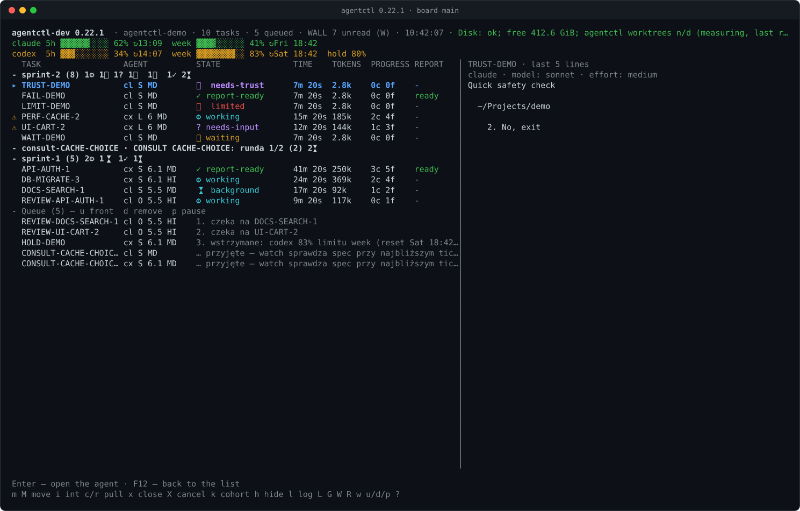
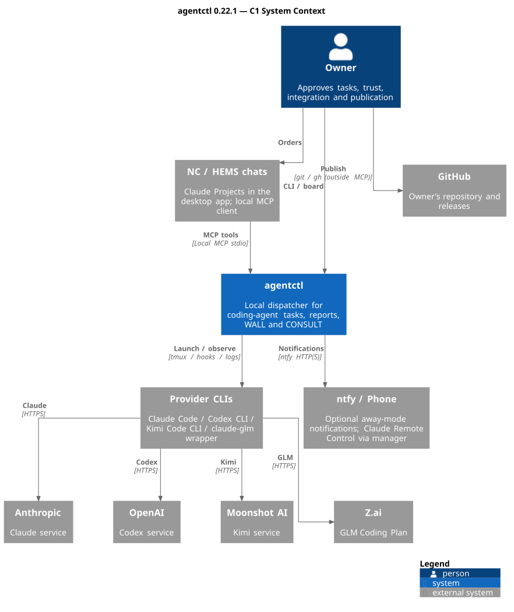

# agentctl

Lokalny dispatcher zadań dla Claude Code, OpenAI Codex CLI, Kimi Code CLI i Z.ai GLM. Specyfikacja Markdown zamienia się w worktree Git, interaktywnego agenta tmux i raport do oceny. Watch obsługuje kolejkę, dostarczanie promptów, powiadomienia i konsultacje.

[English](README.md) · **[Polska instrukcja](docs/pl/overview.md)** · [Od zera](docs/pl/tutorial.md) · [Wydanie 0.23.0](docs/release-notes/0.23.0.pl.md)

Zależności i werdykty, sloty/hold, bezpieczne follow-upy, raporty, kohorty, WALL i CONSULT: [wszystkie funkcje](docs/pl/features.md). [Galeria widoków TUI](docs/pl/screenshots.md) obejmuje pomoc, capacity, filtry i wątki WALL.

| Początek | Referencja |
|---|---|
| [Instalacja i pierwsze zadanie](docs/pl/tutorial.md) | [Konfiguracja/specyfikacje](docs/pl/configuration.md) |
| [Dostawcy/logowanie](docs/pl/providers.md) | [Wszystkie narzędzia MCP i Accepted](docs/pl/mcp-tools.md) |
| [Ekonomia tokenów](docs/pl/token-economics.md) | [Problemy/doctor](docs/pl/troubleshooting.md) |
| [Wstawka do instrukcji Projektu](docs/pl/agent-insert.md) | [Przewodnik agenta zlecającego](docs/pl/agent-guide.md) |
| [Polecenia CLI](docs/commands.md) | [Katalog regresji](tests/regression/CATALOG.md) |

## Architektura

[Kontenery i sekwencje](docs/pl/architecture.md) pokazują Accepted, trust, raporty/odzyskiwanie, WALL i CONSULT; lokalne źródła PlantUML/C4 oraz SVG/PNG.

## Instalacja

Wymagane są Node ≥22.14.0, Git, tmux i osobno zainstalowane/zalogowane CLI dostawców. Bieżące npm CLI Kimi wymaga Node ≥22.19.0. Samouczek opisuje stabilną instalację i pierwszy config.

~~~sh
git clone https://github.com/Setech-pl/agentctl.git
cd agentctl
npm ci
npm run build
./bin/agentctl-update --ref v0.23.0 --dry-run
~~~

Agentctl działa z twoimi uprawnieniami; worktree nie jest sandboxem OS. Trust folderu nigdy nie jest automatyczny. Lokalny MCP używa desktopowego stdio; web/telefon nie łączy się bezpośrednio. Właściciel ocenia dowody i decyduje o integracji/publikacji; actions to propozycje. [Granice](docs/pl/overview.md#granice).

## Hosty

`host: pc` uruchamia zadanie na skonfigurowanym hoście SSH: worktree/setup/agent zdalnie, zwykłe operacje zadania i lokalna kopia raportu. [Konfiguracja i przykład na PC](docs/pl/hosts.md). Wersja 0.23.0 obejmuje limity konta/hosta, blokady dostawców, bezpieczny zdalny GC, zadania hosta na boardzie oraz restart/adopt/resume; kolejkę przenosi `move --host pc|local`. [Informacje o wydaniu](docs/release-notes/0.23.0.pl.md).

[Współtworzenie](CONTRIBUTING.md) · [Changelog](CHANGELOG.md) · [Licencja MIT](LICENSE). Używaj gate repo i cache własnego zadania. Wydanie łączy pełne instrukcje z poprawkami operacyjnymi 0.22.2, diagnostyką i pomocą boardu.
