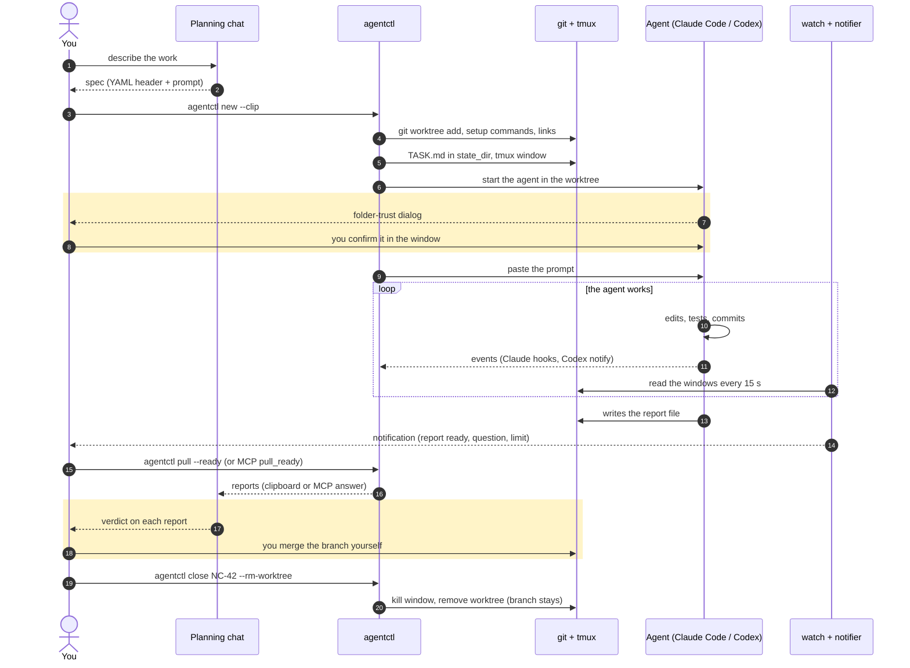
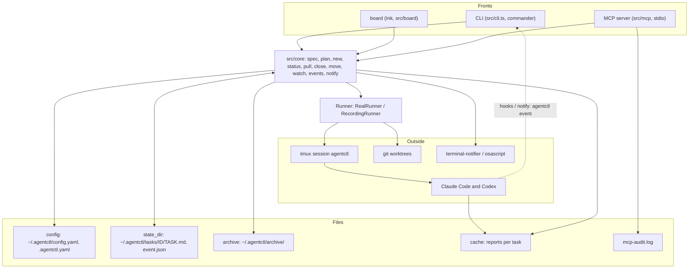
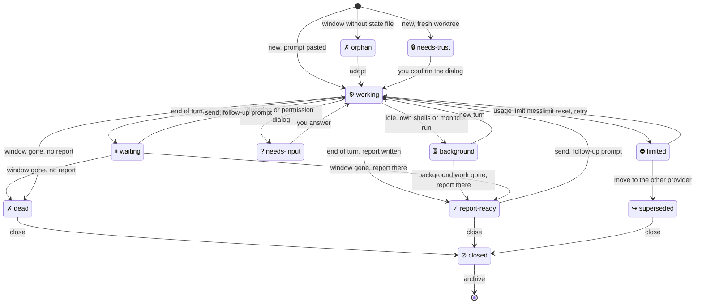

# Diagrams

Three views of agentctl. GitHub renders the Mermaid blocks; the same diagrams are in the [README](../README.md) ([Polish](../README.pl.md)). A test keeps this file and the English README identical.

## End-to-end flow

From a planning chat to a closed task. Steps in a yellow box are decisions that stay with the human: agentctl never answers the folder-trust dialog, never gives a verdict and never merges.

## Architecture

The CLI, the board and the MCP server are thin fronts. They call the same functions in `src/core`, and every side effect goes through the `Runner`, which is a recorder in `--dry-run` and in tests.

## Task states

What `status` and the board show for a task. A live window is classified from its screen (and the agent's events); a task without a window is `report-ready` if its report exists and `dead` if not. Precedence for a live window: `needs-trust`, `needs-input`, `working`, `limited`, `background`, then `report-ready` or `waiting`. `superseded` and `closed` override all of them.

