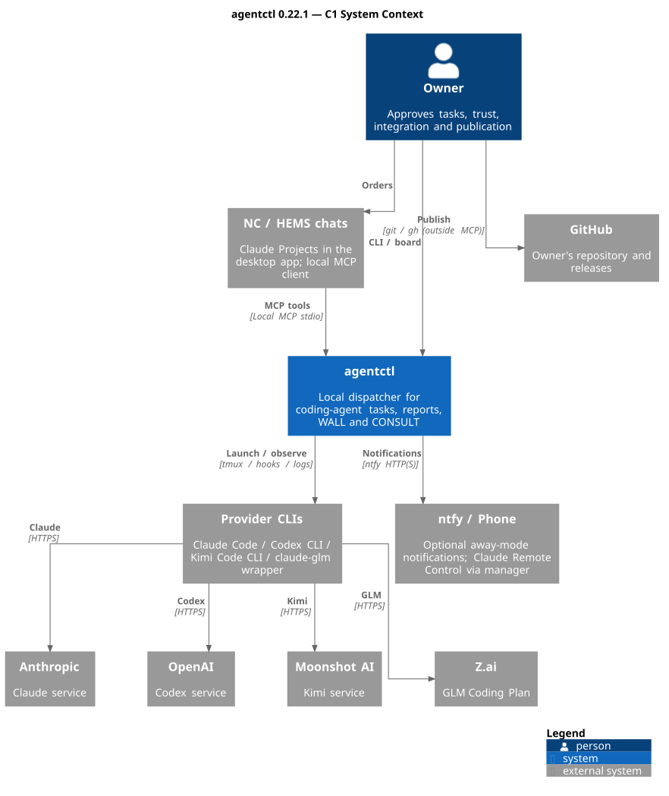
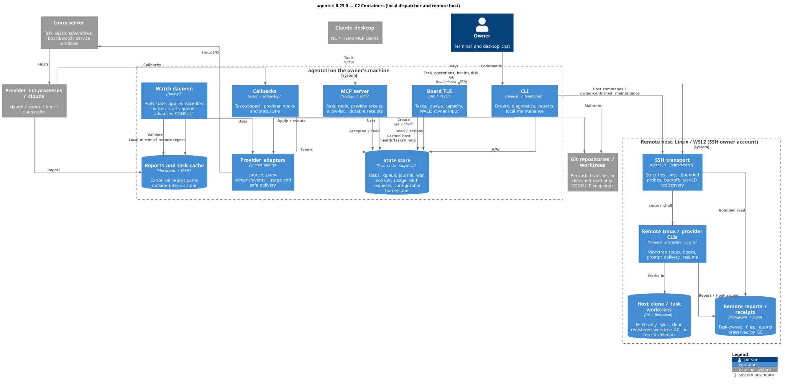
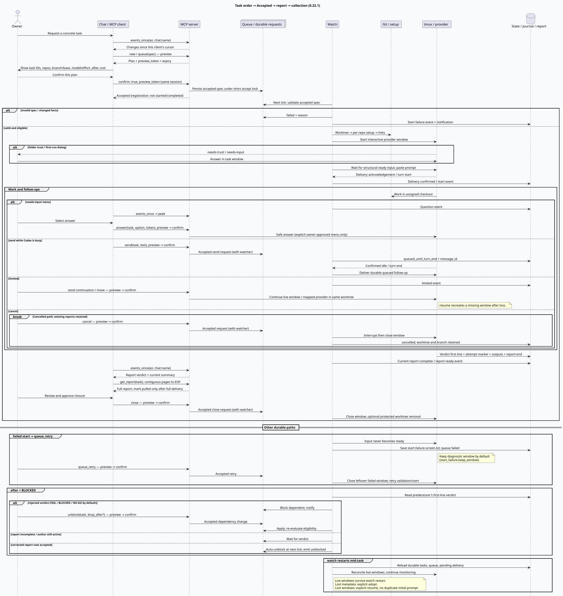
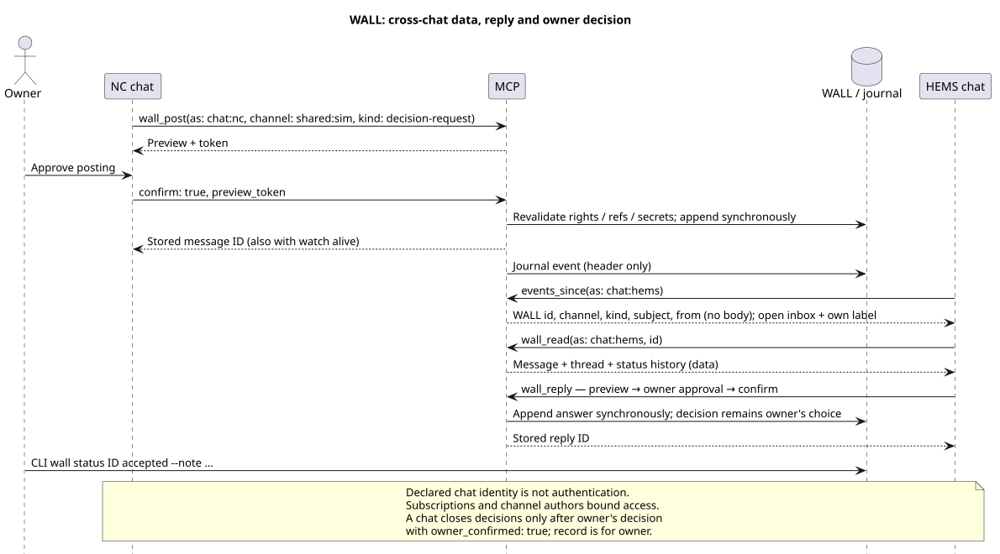
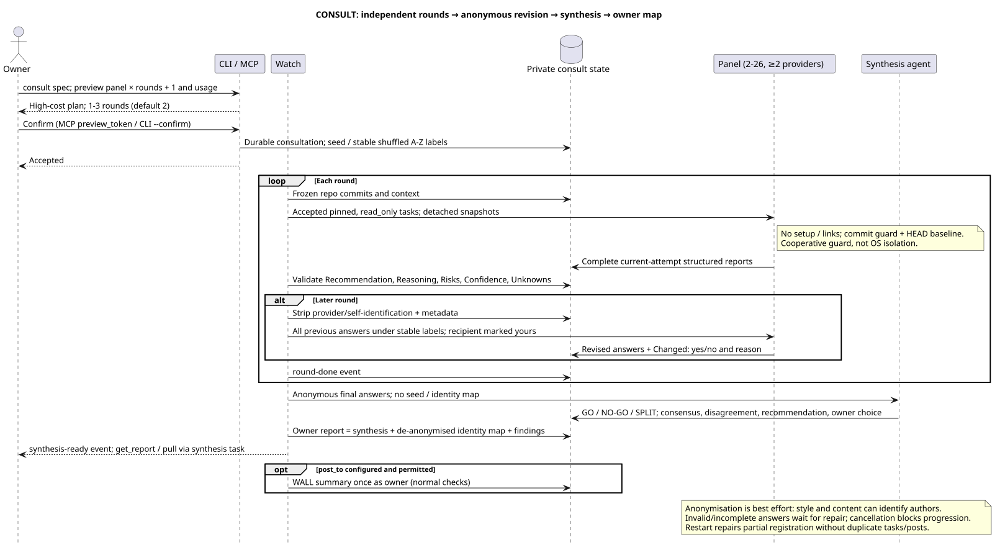

# Architecture

All diagrams describe the local 0.22.3 implementation. Text labels are shared English; the explanations below are bilingual. C4 includes ship in the local PlantUML standard library; no public rendering service is used. Orthogonal connectors use skinparam linetype ortho; both C4 views include SHOW_LEGEND().

## C1 — System Context

Owner, NC/HEMS chats in the desktop app, provider CLIs/clouds, GitHub and optional phone.

[PlantUML](../diagrams/context.puml) · [SVG](../diagrams/context.svg) · [PNG](../diagrams/context.png)

## C2 — Containers

CLI, watch, board, MCP, adapters/hooks, state, reports, tmux and worktrees. Containers here mean processes/stores, not Docker images.

[PlantUML](../diagrams/containers.puml) · [SVG](../diagrams/containers.svg) · [PNG](../diagrams/containers.png)

## Task lifecycle

Accepted → validation → setup/trust/delivery → report → events/get_report/close, with questions, busy sends, limits, retry, cancel, after and restart.

[PlantUML](../diagrams/task-lifecycle.puml) · [SVG](../diagrams/task-lifecycle.svg) · [PNG](../diagrams/task-lifecycle.png)

## WALL

Post, event in another chat, thread/reply and owner status. Content stays data.

[PlantUML](../diagrams/wall-flow.puml) · [SVG](../diagrams/wall-flow.svg) · [PNG](../diagrams/wall-flow.png)

## CONSULT

Independent rounds and anonymous revisions, synthesis, then the identity map only in the owner report.

[PlantUML](../diagrams/consult-flow.puml) · [SVG](../diagrams/consult-flow.svg) · [PNG](../diagrams/consult-flow.png)

## Render locally

Install Java/PlantUML and a native Graphviz (e.g. brew install --cask temurin; brew install plantuml graphviz). The C4 standard library is bundled. With a task-owned TMPDIR and AGENTCTL_LIVE_CACHE, from the repo:

~~~sh
plantuml -tsvg docs/diagrams/*.puml
plantuml -tpng docs/diagrams/*.puml
~~~

If a Homebrew wrapper points at the wrong CPU architecture, run the installed PlantUML JAR with the working Java and set GRAPHVIZ_DOT to the native dot executable. Only the renderer uses Java; agentctl itself uses Node. [Source verification map](../reference/source-map.md).
