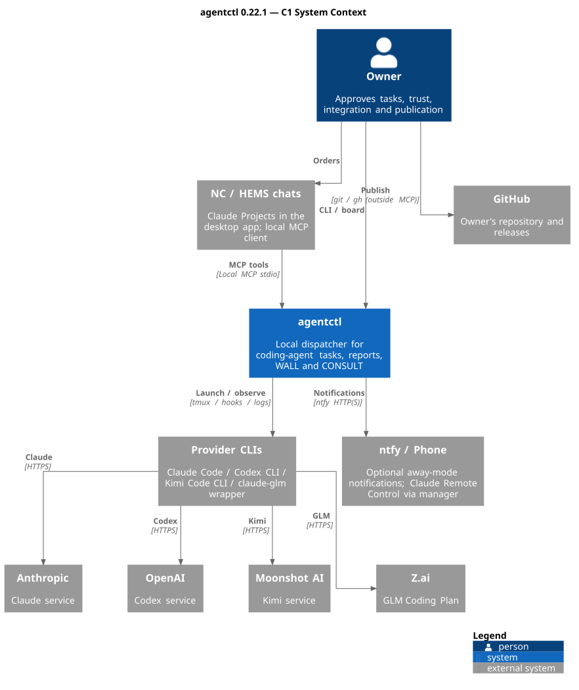
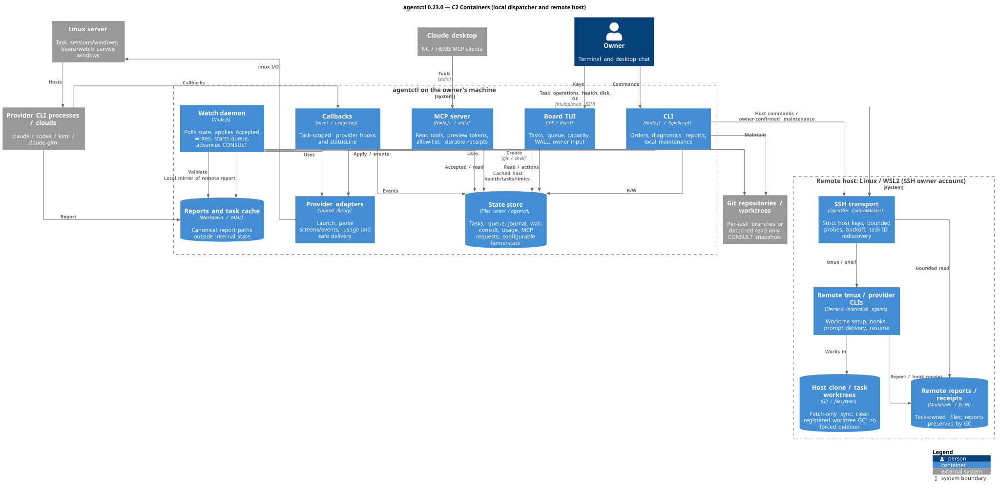
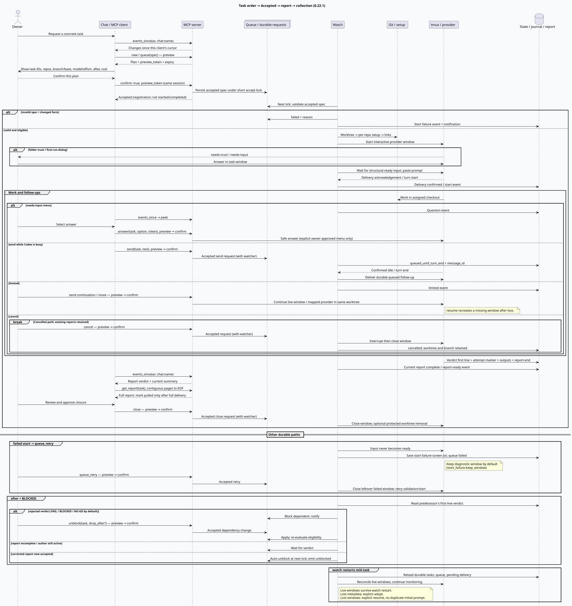
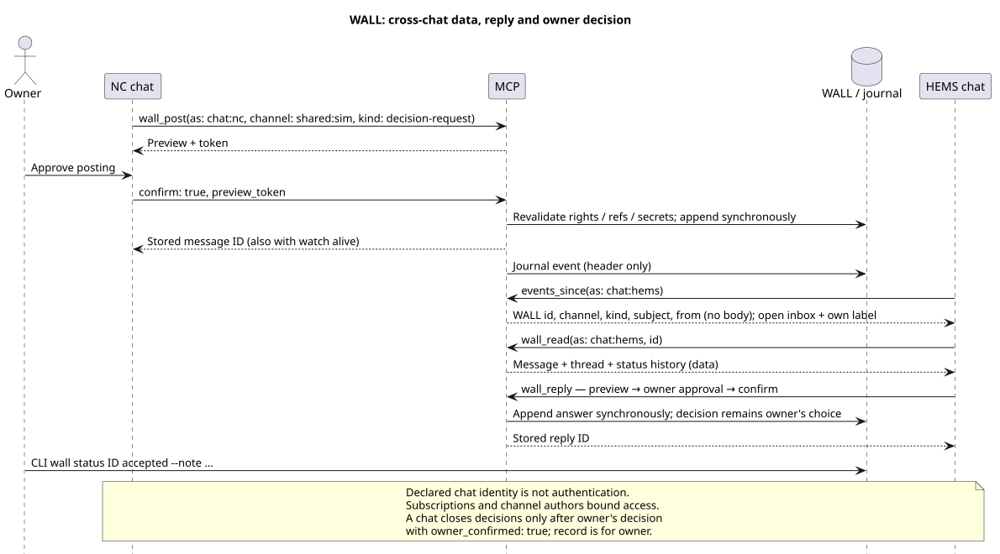
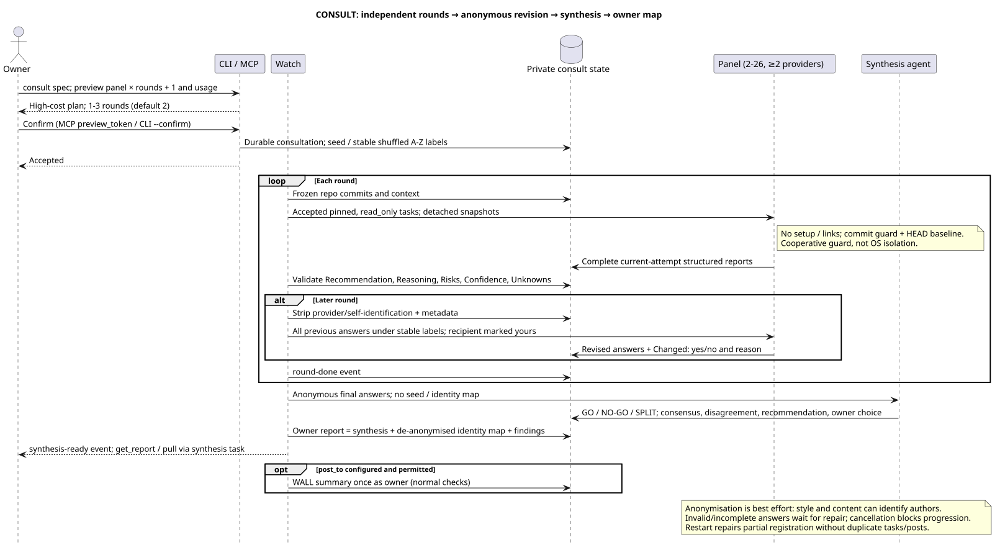

# Architektura

Diagramy opisują lokalną implementację 0.22.1. Etykiety są wspólne po angielsku, objaśnienia dwujęzyczne. C4 pochodzi z lokalnej biblioteki standardowej PlantUML; nie użyto publicznego serwera renderowania. Łączniki mają skinparam linetype ortho, oba C4 zawierają SHOW_LEGEND().

## C1 — System Context

Właściciel, czaty NC/HEMS w aplikacji desktopowej, provider CLI/cloud, GitHub i opcjonalny telefon.

[PlantUML](../diagrams/context.puml) · [SVG](../diagrams/context.svg) · [PNG](../diagrams/context.png)

## C2 — Containers

CLI, watch, board, MCP, adaptery/hooki, stan, raporty, tmux i worktree. Kontenery oznaczają tu procesy i magazyny, nie obrazy Docker.

[PlantUML](../diagrams/containers.puml) · [SVG](../diagrams/containers.svg) · [PNG](../diagrams/containers.png)

## Cykl życia zadania

Accepted → walidacja → setup/trust/delivery → raport → events/get_report/close, wraz z pytaniem, busy send, limitami, retry, cancel, after i restartem.

[PlantUML](../diagrams/task-lifecycle.puml) · [SVG](../diagrams/task-lifecycle.svg) · [PNG](../diagrams/task-lifecycle.png)

## WALL

Post, zdarzenie w innym czacie, wątek/odpowiedź i status właściciela. Treść jest danymi.

[PlantUML](../diagrams/wall-flow.puml) · [SVG](../diagrams/wall-flow.svg) · [PNG](../diagrams/wall-flow.png)

## CONSULT

Rundy niezależne i anonimowe rewizje, synteza oraz ujawnienie mapy wyłącznie w raporcie właściciela.

[PlantUML](../diagrams/consult-flow.puml) · [SVG](../diagrams/consult-flow.svg) · [PNG](../diagrams/consult-flow.png)

## Renderowanie lokalne

Zainstaluj Java/PlantUML i natywny Graphviz (np. brew install --cask temurin; brew install plantuml graphviz). Biblioteka C4 jest dołączona. Z TMPDIR i AGENTCTL_LIVE_CACHE własnego zadania, w repo:

~~~sh
plantuml -tsvg docs/diagrams/*.puml
plantuml -tpng docs/diagrams/*.puml
~~~

Jeśli wrapper Homebrew wskazuje złą architekturę CPU, uruchom JAR PlantUML działającą Javą i ustaw GRAPHVIZ_DOT na natywne dot. Java jest potrzebna rendererowi, sam agentctl używa Node. [Mapa źródeł](../reference/source-map.md).
